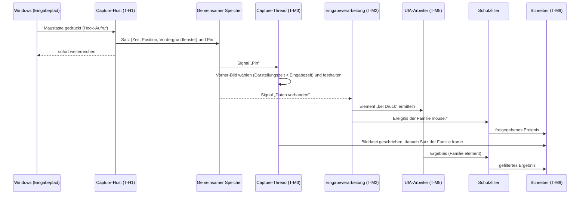

# 02 – Architektur

Status: Entwurf 0.1 · Stand: 2026-11-11

**Zweck.** Dieses Dokument legt fest, aus welchen Prozessen, Komponenten und Threads der StepRecorder besteht, wie Daten zwischen ihnen fließen, wie die eine EXE ihre Betriebsarten unterscheidet, welche Technologien und Bibliotheken verwendet werden und wie die portable EXE gebaut und konfiguriert wird. Was der Aufzeichnungskern im Einzelnen erfasst, steht in [03 – Aufzeichnungskern](03-aufzeichnungskern.md); das Dateiformat der Sitzung in [04 – Datenformat](04-datenformat.md).

## Inhalt

1. [Architekturziele und Randbedingungen](#ziele)
2. [Systemübersicht](#systemuebersicht)
3. [Prozessmodell](#prozessmodell)
4. [Gemeinsamer Speicher zwischen Capture-Host und Hauptprozess](#gemeinsamer-speicher)
5. [Komponenten](#komponenten)
6. [Thread-Modell](#thread-modell)
7. [Datenfluss](#datenfluss)
8. [Betriebsarten und Kommandozeile](#betriebsarten)
9. [Technologie- und Bibliothekswahl](#technologie)
10. [Projekt- und Solution-Struktur](#projektstruktur)
11. [Build und Auslieferung der portablen EXE](#build)
12. [Konfiguration und Datenablage](#konfiguration)
13. [Fehlerbehandlung, Protokollierung, Diagnose](#fehlerbehandlung)
14. [Architekturentscheidungen](#entscheidungen)
15. [Zuordnung der Review-Befunde](#review)
16. [Anforderungen](#anforderungen)
17. [Offene Punkte und Vorab-Experimente](#offene-punkte)

---

<a id="ziele"></a>
## 1 Architekturziele und Randbedingungen

### 1.1 Feste Randbedingungen

| Randbedingung | Festlegung |
|---|---|
| Plattform | Windows 10 22H2 (Build 19045) und Windows 11, x64 |
| Technologie | C#, .NET 10 (LTS), WPF |
| Auslieferung | eine portable EXE mit eingebauter Laufzeit; zusätzlich eine ZIP-Variante |
| Rechte | läuft ohne Adminrechte (`asInvoker`); kein Installer, kein Dienst, kein Treiber |
| Spuren | keine Registry-Schreibzugriffe; Daten neben der EXE oder im Benutzerprofil |
| Netzwerk | keines: weder Sockets noch HTTP noch benannte Pipes |
| Rolle | das Tool zeichnet auf und zeigt an; es steuert keine fremden Programme |

### 1.2 Qualitätsziele und ihre Folgen für die Architektur

| Nr. | Qualitätsziel | Folge für die Architektur |
|---|---|---|
| Q1 | Maus und Tastatur des Systems werden nie spürbar verzögert | Hooks laufen in einem eigenen Minimalprozess; der Hook-Aufruf schreibt nur in gemeinsamen Speicher (Abschnitte [3](#prozessmodell), [4](#gemeinsamer-speicher)) |
| Q2 | Kein stiller Verlust | Jede Warteschlange ist begrenzt und hat eine festgelegte Überlastreaktion, die einen Lückenmarker erzeugt (Abschnitt [7.2](#schreiben)) |
| Q3 | Rohdaten zuerst, Deutung danach | Ein einziges, nur anhängend geschriebenes Rohprotokoll; die Schritterkennung ist eine reine, wiederholbare Funktion darüber |
| Q4 | Privatsphäre ab Werk | Ein Schutzfilter sitzt vor dem einzigen Schreiber; alle Verbraucher lesen über eine Leseschicht, die Schwärzungen erzwingt; kein Netzwerk |
| Q5 | Portabel | Eine EXE, Rollenwahl per Argument; einzige Spur außerhalb von EXE-Verzeichnis, Datenverzeichnis und Aufnahmeordner ist das Entpackverzeichnis der Laufzeit (Abschnitt [11.2](#entpacken)) |
| Q6 | Prüfbar | Der fachliche Kern hat keine Windows-Abhängigkeit; Architekturregeln werden automatisch getestet; der Recorder misst sich selbst |
| Q7 | Absturzfest | Protokoll nur anhängend; Sitzung nach einem Absturz lesbar; der Capture-Host kann den Hauptprozess nicht überleben |

---

<a id="systemuebersicht"></a>
## 2 Systemübersicht

```
┌──────────────── StepRecorder.exe · Rolle Capture-Host (nur während der Aufnahme) ────────────────┐
│  T-H1  Hook-Thread:       WH_MOUSE_LL + WH_KEYBOARD_LL                                           │
│  T-H2  Raw-Input-Thread:  zweiter, unabhängiger Eingabekanal                                     │
└───────────────┬──────────────────────────────────────────────────────────────────────────────────┘
                │  gemeinsamer Speicher (unbenannt, vererbt):
                │  Eingabe-Ring · Pin-Tafel · Bildstand · Steuerblock · Statistik
┌───────────────▼──────────────────────────────────────────────────────────────────────────────────┐
│  StepRecorder.exe · Rolle Hauptprozess                                                           │
│                                                                                                  │
│  Eingabeverarbeitung ───────────────────────────┐                                                │
│  Bildschirmaufnahme (je Monitor) ─► Bereichs-   │                                                │
│        filter ─► Bildkodierung ─────────────────┤                                                │
│  UI Automation ─────────────────────────────────┼─► Schutzfilter ─► Schreiber ─► Sitzungsordner  │
│  Fenster · Sitzung · Anzeige · Zwischenablage ──┘                    (events.jsonl, frames/, …)  │
│                                                                                                  │
│  Aufzeichnungssteuerung · Aufnahmeleiste (WPF) · Startfenster (WPF) · Viewer (WPF)               │
│  Schritterkennung ─► steps.json         Leseschicht ─► Viewer · Exporte · Validator              │
└──────────────────────────────────────────────────────────────────────────────────────────────────┘

  StepRecorder.exe mcp        (eigener Prozess, ohne Fenster) ─► Leseschicht ─► stdio (JSON-RPC)
  StepRecorder.exe export     (eigener Prozess, ohne Fenster) ─► Leseschicht ─► Ausgabedateien
  StepRecorder.exe validate   (eigener Prozess, ohne Fenster) ─► Leseschicht ─► Bericht
  StepRecorder.exe compare    (eigener Prozess, ohne Fenster) ─► Leseschicht (zwei Sitzungen) ─► Bericht
  StepRecorder.exe settings   (eigener Prozess, ohne Fenster) ─► Einstellungen ─► Austauschdatei
```

Alle Kästen sind dieselbe Datei `StepRecorder.exe`; welche Rolle ein Prozess übernimmt, entscheidet das erste Argument (Abschnitt [8](#betriebsarten)). Im Hauptprozess kommen als weitere Abnehmer der Leseschicht hinzu: der Suchindex, der Schrittabgleich zweier Sitzungen und das Support-Paket (Abschnitte [7.5](#suchindex) bis [7.7](#support-paket)).

---

<a id="prozessmodell"></a>
## 3 Prozessmodell

### 3.1 Rollen

| Rolle | Start | Lebensdauer | Fenster | Aufgabe |
|---|---|---|---|---|
| **Hauptprozess** | Doppelklick, Sitzungspfad, `record` oder `support` | bis der Nutzer das Programm schließt | Startfenster, Aufnahmeleiste, Viewer | Steuerung, Bildschirmaufnahme, UI Automation, Fenster- und Systemereignisse, Zwischenablage, Schutzfilter, Schreiber, Schritterkennung, Viewer, Exporte |
| **Capture-Host** | vom Hauptprozess im Vorlauf einer Aufnahme (Hooks erst mit Beginn der Aufnahme) | bis zum Stopp der Aufnahme | keine sichtbaren (nur ein Nachrichtenfenster für Raw Input) | Low-Level-Hooks und Raw Input entgegennehmen und in den gemeinsamen Speicher schreiben – sonst nichts |
| **MCP-Server** | `StepRecorder.exe mcp …` durch einen Agenten | solange der Agent die Verbindung hält | keine | Abgeschlossene Sitzungen über die Leseschicht bereitstellen ([06](06-ki-export-und-mcp.md)) |
| **Export / Validierung / Abgleich / Einstellungen** | `StepRecorder.exe export …`, `validate …`, `compare …` bzw. `settings …` | bis die Aufgabe erledigt ist | keine | Ausgaben erzeugen, Sitzung prüfen, zwei Sitzungen abgleichen, Einstellungen aus- und einlesen |

### 3.2 Warum die Hooks einen eigenen Prozess bekommen

Ein Low-Level-Hook wird von Windows **synchron im Eingabepfad** aufgerufen: Bei jeder Mausbewegung und jedem Tastendruck wartet das System auf die Antwort des Hook-Threads. Hält dieser Thread an, ruckeln Maus und Tastatur des gesamten Systems. Antwortet er zu spät, überspringt Windows den Hook und entfernt ihn nach wiederholten Überschreitungen stillschweigend (Fakten und Quellenlage in [03, Abschnitt 3.1](03-aufzeichnungskern.md#eingabekanaele)).

Im Hauptprozess sind solche Pausen unvermeidbar: Bildpuffer von 33 MB je 4K-Bild, PNG-Kodierung, WPF, COM-Aufrufe der UI Automation und die Speicherbereinigung (GC) der Laufzeit, die alle verwalteten Threads anhält. Deshalb gilt:

- Der **Capture-Host** fordert im Betrieb keinen verwalteten Speicher an – ohne Anforderungen keine Speicherbereinigung.
- Er übersetzt nach der Aufwärmphase keinen Code mehr (vorübersetzt, gestufte Übersetzung abgeschaltet).
- Er führt im Hook-Aufruf keine Ein-/Ausgabe aus und nimmt keine Sperre.
- Er läuft mit erhöhter Priorität und ist von der Energiedrosselung für Hintergrundprozesse abgemeldet.

Verworfene Alternativen:

| Alternative | Grund der Ablehnung |
|---|---|
| Hook-Thread im Hauptprozess mit GC-Feineinstellung | Blockierende Speicherbereinigungen lassen sich nicht ausschließen; die Zusage hinge an jeder künftigen Änderung im Hauptprozess |
| Nativer Hilfsprozess in C/C++ | Zweite Werkzeugkette, zweite Datei, mehr Angriffsfläche für Fehlalarme von Virenscannern |
| Nur Raw Input statt Hooks | Kein Aufruf *vor* der Anwendung, daher keine Vorher-Bild-Garantie; keine absoluten Zeigerpositionen; kein Kennzeichen für künstlich erzeugte Eingaben |

Die Entscheidung wird in M0 durch Messung abgesichert (Vorab-Experiment VE-01 in [11 – Roadmap](11-roadmap-tests-risiken.md)); sie bleibt bestehen, solange die Messung ihr nicht widerspricht. Welche Variante eine Sitzung aufgenommen hat, steht in deren Manifest ([04](04-datenformat.md#manifest)).

### 3.3 Start des Capture-Hosts

1. Der Hauptprozess legt an: den gemeinsamen Speicher (anonyme Speicherzuordnung ohne Namen und ohne Datei auf dem Datenträger), drei unbenannte Ereignisobjekte („Daten vorhanden", „Befehl", „Pin"), ein vererbbares Handle auf sich selbst und ein Job-Objekt mit `JOB_OBJECT_LIMIT_KILL_ON_JOB_CLOSE`.
2. Er startet `Environment.ProcessPath` mit `--capture-host` und den Zahlenwerten der Handles. Über `PROC_THREAD_ATTRIBUTE_HANDLE_LIST` werden **nur** diese Handles vererbt. Der Kindprozess startet angehalten, wird dem Job zugeordnet und dann fortgesetzt.
3. Laufzeiteinstellungen, die nur für den Host gelten, gibt der Hauptprozess als Umgebungsvariablen des Kindprozesses mit (keine nebenläufige Speicherbereinigung, keine gestufte Übersetzung).
4. Der Host prüft Handles, Kennung und Layout-Version des gemeinsamen Speichers sowie die Eltern-Prozesskennung. Passt etwas nicht, beendet er sich mit Exit-Code 7, ohne einen Hook zu setzen.
5. Der Host setzt Priorität und Drosselungs-Abmeldung, durchläuft den Hook-Pfad einmal mit Probedaten (Aufwärmen) und meldet „bereit" im Steuerblock. Bleibt die Meldung länger als 3 s aus, schlägt der Aufnahmestart mit sichtbarer Fehlermeldung fehl.
6. Hooks und Raw Input setzt der Host erst auf den Befehl „laufen" und quittiert das. So kann er schon während der Vorprüfung starten, ohne dass vor Beginn der Aufnahme ein Hook besteht; das hält den Aufnahmestart unter 1,5 s ([03, Abschnitt 12.8](03-aufzeichnungskern.md#leistungsbudgets)).

Weil alle Objekte unbenannt sind und per Handle vererbt werden, kann kein fremder Prozess sie über einen Namen öffnen, vorab besetzen oder dem Host Befehle geben.

### 3.4 Lebenszyklus und Überwachung

| Ereignis | Verhalten |
|---|---|
| Vorlauf | Host wird gestartet und aufgewärmt; noch keine Hooks |
| Aufnahme beginnt | Befehl „laufen": Hooks und Raw Input aktiv |
| Pause | Hooks und Raw-Input-Registrierung werden entfernt; der Host bleibt untätig am Leben. In der Pause wird keine Eingabe beobachtet |
| Fortsetzen | Hooks und Raw Input werden neu gesetzt; der Tastenzustand wird neu abgeglichen ([03, Abschnitt 3.5](03-aufzeichnungskern.md#tastenzustand)) |
| Stopp | Befehl „beenden"; der Host entfernt die Hooks und endet innerhalb von 500 ms, sonst wird er beendet |
| Hauptprozess endet unerwartet | Das Job-Objekt beendet den Host; zusätzlich wartet der Host auf das Eltern-Handle und beendet sich selbst. Es bleibt kein Prozess mit Hooks zurück |
| Host antwortet nicht | Beide Host-Threads erhöhen alle 250 ms je einen Herzschlagzähler. Bleibt ein Zähler zweimal aus, wird der Host beendet und neu gestartet; im Protokoll steht eine Lücke (`gap`) mit Beginn und Ende |
| Host stürzt ab | wie „antwortet nicht"; nach drei Neustarts innerhalb einer Minute pausiert die Aufnahme mit sichtbarer Meldung |

Außerhalb von Vorlauf und Aufnahme existiert kein Capture-Host. Hooks gibt es nur während der Aufnahme – nicht im Vorlauf und nicht in der Pause.

### 3.5 Mehrfachstart

- Je Windows-Sitzung gibt es höchstens **ein Exemplar mit Oberfläche**. Ein weiterer Start reicht seine Argumente (zum Beispiel einen Sitzungspfad) an das laufende Exemplar weiter und endet. Dafür dienen ein Mutex, eine Dateizuordnung und ein Ereignisobjekt im sitzungslokalen Namensraum `Local\`; die Standard-Zugriffsliste beschränkt sie auf denselben Benutzer. Weitergereichte Argumente werden wie eine Kommandozeile geprüft.
- Es läuft höchstens **eine Aufnahme** je Windows-Sitzung. Ein zweiter `record`-Aufruf endet mit Exit-Code 6.
- Während einer Aufnahme werden weitergereichte „Viewer öffnen"-Wünsche zurückgestellt, bis die Aufnahme beendet ist (der Viewer ist während der Aufnahme verborgen, siehe [07](07-aufnahme-bedienung.md)).
- `mcp`, `export`, `validate`, `compare` und `settings` sind eigenständige Prozesse ohne Oberfläche und dürfen parallel laufen.
- `support` ist ein Start mit Oberfläche: Läuft schon ein Exemplar, übernimmt es den Aufruf; läuft eine Aufnahme, endet der Aufruf mit Exit-Code 6.

### 3.6 Rechte

- Die EXE fordert keine erhöhten Rechte an (`asInvoker`, `uiAccess="false"`). `uiAccess="true"` scheidet aus, weil es eine Signatur **und** einen Installationsort unter `%ProgramFiles%` oder `%SystemRoot%\system32` verlangt – unvereinbar mit einer portablen EXE.
- Fenster mit Adminrechten liefern einem normalen Prozess keine Eingaben; das wird als Lücke vermerkt ([03, Abschnitt 10](03-aufzeichnungskern.md#lueckenerkennung)). Der Nutzer kann ausdrücklich „als Administrator neu starten" wählen ([07](07-aufnahme-bedienung.md)). Dabei gibt der Hauptprozess Datenverzeichnis und Aufnahmeordner als Argumente mit, damit auch bei Anmeldung mit einem anderen Administratorkonto dieselben Orte verwendet werden.

---

<a id="gemeinsamer-speicher"></a>
## 4 Gemeinsamer Speicher zwischen Capture-Host und Hauptprozess

Der gemeinsame Speicher ist eine interne Schnittstelle zwischen zwei Rollen **derselben** EXE-Version. Er gehört nicht zum Sitzungsformat.

| Bereich | Inhalt | Schreiber | Leser |
|---|---|---|---|
| Kopf | Kennung, Layout-Version, Größen, Frequenz des Leistungszählers (QPC), Prozesskennungen | Hauptprozess (einmalig) | Host |
| Eingabe-Ring | 65 536 Sätze fester Größe (64 Byte, zusammen 4 MiB); ein Schreiber, ein Leser, ohne Sperren | Host | Eingabeverarbeitung |
| Pin-Tafel | 256 Einträge: Eingabezähler, Zeitstempel und je Monitor (bis 16) die zuletzt veröffentlichte Bildnummer zum Zeitpunkt der Eingabe | Host | Capture-Threads |
| Bildstand | je Monitor die zuletzt veröffentlichte Bildnummer | Capture-Threads | Host |
| Steuerblock | Sollzustand (laufen, pausieren, beenden), Befehlszähler, Quittung, „bereit" | Hauptprozess / Host | Host / Hauptprozess |
| Statistik | Herzschlagzähler beider Host-Threads, Histogramm der Hook-Aufrufdauer, Überlaufzähler, Zähler neu gesetzter Hooks, Zähler der Speicherbereinigungen des Hosts | Host | Überwachung |

Ein Satz im Eingabe-Ring enthält: Zeitstempel (QPC, im Hook-Aufruf gelesen), Art (Maus-Hook, Tastatur-Hook, Raw-Tastatur, Raw-Maus, Statusmeldung), die unveränderten Felder der Hook- bzw. Raw-Input-Struktur und das Vordergrundfenster zum Zeitpunkt des Aufrufs (Fenster-Stempel).

Die Reihenfolge der Hook-Sätze im Ring ist die Reihenfolge der Hook-Aufrufe. Daraus vergibt die Eingabeverarbeitung beim Entnehmen die Eingabenummer, die als Pflichtfeld `inSeq` an jedem Eingabeereignis steht – erst nach der Ausschlussprüfung, sodass Eingaben in ausgeschlossenen Anwendungen keine Nummer verbrauchen ([03, Abschnitt 2.4](03-aufzeichnungskern.md#zeitmodell)). Raw-Input-Sätze werden getrennt gezählt.

Regeln:

1. Nur Felder fester Größe ohne Zeiger; Indizes werden atomar geschrieben.
2. Der Hook-Aufruf **wartet nie**. Ist der Ring voll, erhöht der Host den Überlaufzähler und schreibt einen Überlaufsatz, sobald wieder Platz ist; die Eingabeverarbeitung erzeugt daraus eine Lücke ([03, Abschnitt 3.4](03-aufzeichnungskern.md#kanalabgleich)).
3. „Daten vorhanden" wird bei Tasten, Maustasten und Mausrad sofort signalisiert; reine Mausbewegungen holt die Eingabeverarbeitung in einem 4-ms-Takt ab. Das spart Systemaufrufe im Hook-Pfad.
4. „Pin" weckt die Capture-Threads sofort, damit sie das Vorher-Bild festhalten ([03, Abschnitt 4.4](03-aufzeichnungskern.md#vorher-bild)).
5. Bei 2 000 Sätzen je Sekunde (1 000-Hz-Maus samt Zweitkanal) überbrückt der Ring rund 30 s Stillstand des Hauptprozesses.
6. Stimmen Kennung oder Layout-Version nicht, startet der Host nicht (schützt vor gemischten Dateiständen in der ZIP-Variante).
7. Der Eingabe-Ring enthält Tasten, **bevor** der Schutzfilter über sie entschieden hat. Der Speicher ist deshalb in beiden Prozessen gegen Auslagerung gesperrt, gelesene Sätze werden mit Nullen überschrieben, beim Stopp der ganze Bereich. Soweit das Betriebssystem es anbietet, ist er von Absturzabbildern ausgenommen ([10](10-datenschutz-und-sicherheit.md)).

---

<a id="komponenten"></a>
## 5 Komponenten

### 5.1 Übersicht

| Komponente | Projekt | Verantwortung | Näher spezifiziert in |
|---|---|---|---|
| Rollenweiche | App | Erstes Argument auswerten und die Rolle starten, bevor WPF-Typen berührt werden | Abschnitt [8](#betriebsarten) |
| Capture-Host | Capture.Host | Hooks, Raw Input, Schreiben in den Eingabe-Ring | [03, Abschnitt 3](03-aufzeichnungskern.md#eingabekanaele) |
| Host-Überwachung | Capture | Host starten, überwachen, neu starten; Statistik auslesen | Abschnitt [3.4](#prozessmodell) |
| Aufzeichnungssteuerung | Capture | Zustandsautomat der Aufnahme (Vorprüfung, Start, Pause, Stopp), Aufnahmebereich | [03, Abschnitt 1](03-aufzeichnungskern.md#lebenszyklus) |
| Eingabeverarbeitung | Capture | Ring leeren, Kanäle abgleichen, Tastenzustand führen, Zeichen übersetzen, Mausbewegungen bündeln | [03, Abschnitt 3](03-aufzeichnungskern.md#eingabekanaele) |
| Bildschirmaufnahme | Capture | Ein Capture-Thread je Monitor, Bildring, Bildauswahl, Rückfallwege | [03, Abschnitt 4](03-aufzeichnungskern.md#bildschirmaufnahme) |
| Bereichsfilter | Capture | Aufnahmebereich auf Ereignisse und Bilder anwenden; fremde Bildteile vor dem Speichern entfernen | [03, Abschnitt 5](03-aufzeichnungskern.md#aufnahmebereiche) |
| Bildkodierung | Capture + Imaging | Differenzbilder bilden, PNG kodieren, Dateien schreiben | [03, Abschnitt 4.6](03-aufzeichnungskern.md#bildspeicher), [04](04-datenformat.md) |
| UI-Automation-Dienst | Capture | Elemente ermitteln, Fokus verfolgen, Text-Schnappschüsse | [03, Abschnitt 7](03-aufzeichnungskern.md#ui-automation) |
| Fensterregister | Capture | WinEvents, Fensterdaten, Zugehörigkeit zu Anwendungen | [03, Abschnitt 8](03-aufzeichnungskern.md#fensterereignisse) |
| Systembeobachter | Capture | Sitzung, Energie, Anzeige, Topologie, Zwischenablage | [03, Abschnitte 8 und 9](03-aufzeichnungskern.md#fensterereignisse) |
| Zeitbasis | Core | Umrechnung QPC ↔ Sitzungszeit, Zuordnung von Systemzeiten | [03, Abschnitt 2](03-aufzeichnungskern.md#zeitmodell) |
| Schutzfilter | Core + Capture | Rückhaltung, Maskierung, Ausschlusslisten – **jedes** Ereignis und jedes Bild passiert ihn vor dem Schreiber | [10](10-datenschutz-und-sicherheit.md) |
| Schreiber | Core | Einziger Schreibzugriff auf die Sitzung während der Aufnahme | Abschnitt [7.2](#schreiben), [04](04-datenformat.md) |
| Schritterkennung | Core | Rohereignisse → Schritte, Belegstufen, Vollständigkeitsbericht | [05](05-schritterkennung.md) |
| Leseschicht | Core | Einziger Lesezugriff aller Verbraucher; setzt Bilder zusammen, wendet das Bearbeitungs-Overlay an – Schwärzungen, Ersetzungen, Verallgemeinerungen, geänderte Ziel-Angaben –; gibt ungeprüfte auffällige Eingaben an Abnehmer ohne Oberfläche nur als Zähler heraus (Abschnitt [7.4](#datenfluss)) | [04](04-datenformat.md), [10](10-datenschutz-und-sicherheit.md) |
| Suchindex | Core | Index je Sitzung unter `cache/search/` aufbauen, prüfen und verwerfen; Suche in einer oder in allen Sitzungen eines Ordners | Abschnitt [7.5](#suchindex), [06, Abschnitt 19.7](06-ki-export-und-mcp.md#197-search), [08, Abschnitt 11.2](08-viewer.md#112-volltextsuche-über-alle-sitzungen) |
| Schrittabgleich | Core | Zwei Sitzungen Schritt für Schritt abgleichen – eine reine, wiederholbare Funktion über die Sicht der Leseschicht | Abschnitt [7.6](#schrittabgleich), [05, Abschnitt 17](05-schritterkennung.md#schrittabgleich), [06, Abschnitt 19.9](06-ki-export-und-mcp.md#199-compare_sessions), [08, Abschnitt 5.9](08-viewer.md#59-zwei-aufnahmen-vergleichen) |
| Bildwerkzeuge | Imaging | Zuschnitt, Skalierung, Annotationen, Kodierung – ohne Oberfläche lauffähig | [08](08-viewer.md), [09](09-anleitungs-export.md) |
| Exporte | Export | KI-Paket, HTML, Markdown, DOCX, PDF | [06](06-ki-export-und-mcp.md), [09](09-anleitungs-export.md) |
| Support-Paket | Export | Geführte Weitergabe: bereinigte Kopie, daraus HTML-Anleitung und KI-Paket, beides in einer ZIP-Datei | Abschnitt [7.7](#support-paket), [08, Abschnitt 12.2](08-viewer.md#122-support-paket-geführter-ablauf), [09, Abschnitt 3.5](09-anleitungs-export.md#35-support-paket), [10, Abschnitt 11.3](10-datenschutz-und-sicherheit.md#113-support-paket) |
| MCP-Server | Mcp | Werkzeuge über die Leseschicht, Transport stdio | [06](06-ki-export-und-mcp.md) |
| Oberfläche | App | Startfenster, Aufnahmeleiste, Viewer | [07](07-aufnahme-bedienung.md), [08](08-viewer.md) |
| Einstellungen | Core | Datenverzeichnis ermitteln, Einstellungen lesen und schreiben | Abschnitt [12](#konfiguration) |
| Aufnahmeprofile | Core | `profiles.json` lesen und schreiben; mitgelieferte Profile bereitstellen; die wirksamen Einstellungen einer Aufnahme bestimmen | Abschnitt [12.5](#aufnahmeprofile), [07, Abschnitt 4.7](07-aufnahme-bedienung.md#47-aufnahmeprofile), [10, Abschnitt 4.4](10-datenschutz-und-sicherheit.md#44-aufnahmeprofile-nie-unbemerkt-schwächer) |
| Einstellungs-Austausch | Core | Austauschdatei `StepRecorder-Einstellungen.json` schreiben, prüfen, als Vorschau aufbereiten und einlesen | Abschnitt [12.6](#einstellungs-austausch), [07, Abschnitt 13.2](07-aufnahme-bedienung.md#132-einstellungen-exportieren-und-importieren), [10, Abschnitt 13.4](10-datenschutz-und-sicherheit.md#134-einstellungen-und-profile-weitergeben) |

### 5.2 Abhängigkeitsregeln

```
App ──► Capture ──► Capture.Host ──► Ipc
 │         │
 │         └──────► Imaging ──► Core
 ├──► Export ─────► Imaging, Core
 ├──► Mcp ────────► Core (+ Imaging für Bildausschnitte)
 └──► Core
```

1. **Core** kennt weder Windows-Schnittstellen noch WPF noch Fremdbibliotheken außer der Basisklassenbibliothek. Datenmodell, Zeitbasis, Schreiber, Leseschicht, Schritterkennung und Validator lassen sich damit auf jedem System testen.
2. **Ipc** enthält nur die Festlegungen des gemeinsamen Speichers. **Capture.Host** verweist ausschließlich auf Ipc und die zur Build-Zeit erzeugten Windows-Aufrufe – auf keine Fremdbibliothek, nicht auf Core, nicht auf WPF.
3. **Kein Verbraucher öffnet Sitzungsdateien selbst.** Viewer, Exporte, MCP-Server, Validator, Suchindex, Schrittabgleich und Support-Paket gehen über die Leseschicht; während der Aufnahme schreibt nur der Schreiber. Auch abgeleitete Dateien unter `cache/` und die bereinigte Kopie entstehen über Schnittstellen der Leseschicht, nicht durch eigene Dateizugriffe der Verbraucher.
4. Die Oberfläche (App) ist die einzige Schicht mit WPF. Capture, Export und Mcp funktionieren ohne Fenster.
5. Die UI Automation wird ausschließlich **lesend** benutzt. Zustandsändernde Muster (`Invoke`, `SetValue`, `Select`, `Expand`, `SetFocus`, `ScrollIntoView` und ähnliche) stehen auf einer Verbotsliste, die der Build prüft.
6. Eigener Code verwendet keine Netzwerk-Schnittstellen (`System.Net.*` mit Ausnahme reiner Datentypen); auch das prüft der Build.

---

<a id="thread-modell"></a>
## 6 Thread-Modell

### 6.1 Capture-Host

| Thread | Aufgabe | Priorität | Regeln |
|---|---|---|---|
| **T-H1 Hook-Thread** | Nachrichtenschleife; `WH_MOUSE_LL` und `WH_KEYBOARD_LL`; Herzschlag per Zeitgeber | Prozess `HIGH_PRIORITY_CLASS`, Thread `THREAD_PRIORITY_TIME_CRITICAL` | Im Aufruf nur: Felder lesen, Zeit lesen, Satz schreiben, ggf. Ereignis signalisieren, weiterreichen. Keine Anforderung, keine Sperre, keine Ein-/Ausgabe |
| **T-H2 Raw-Input-Thread** | Nachrichtenfenster mit `RIDEV_INPUTSINK`; liest Raw Input gebündelt; wartet zugleich auf Eltern-Handle und „Befehl"; eigener Herzschlag | `THREAD_PRIORITY_HIGHEST` | Getrennt von T-H1, damit Raw Input die Hook-Antwortzeit nicht verlängert |

### 6.2 Hauptprozess während der Aufnahme

| Thread | Anzahl | Aufgabe | Darf blockieren? |
|---|---|---|---|
| **T-M1 UI-Thread** (STA) | 1 | WPF: Aufnahmeleiste, Rahmen, Dialoge; nimmt Hotkeys entgegen | Nein – keine Aufzeichnungsarbeit auf diesem Thread |
| WPF-Render-Thread | 1 | intern | – |
| **T-M2 Eingabeverarbeitung** | 1 | Ring leeren, Kanäle abgleichen, Tastenzustand, Zeichenübersetzung, Bündel bilden, Anfragen an UIA auslösen | Nein; Ziel: Durchlauf unter 1 ms |
| **T-M3 Capture-Thread** | 1 je Monitor im Bereich | Bilder abrufen, Bildring führen, Pins auswerten, Auslesen aus dem Grafikspeicher | Kurz (Auslesen eines Bilds) |
| **T-M4 Bildkodierer** | 2–4 | Differenzbild bilden, PNG kodieren, Datei schreiben | Ja (Rechenzeit, Datenträger) |
| **T-M5 UIA-Arbeiter** (MTA, ohne Fenster) | 1, bei Hänger Ersatz | Alle Abfragen der UI Automation, zeitbegrenzt | Ja, bis zum Zeitlimit; wird überwacht |
| **T-M6 UIA-Ereignisse** (MTA, ohne Fenster) | 1 | An- und Abmelden der UIA-Ereignisbehandlung – immer auf diesem Thread; Behandlungen reihen nur ein | Nein |
| **T-M7 Systemereignisse** | 1 | Nachrichtenschleife für WinEvent-Hooks, Sitzungs-, Energie- und Anzeigenachrichten, Zwischenablage | Nein; Rückrufe reihen nur ein |
| **T-M8 Anreicherung** | 1 | Fenstertitel, Klassen, Prozessdaten, Zugehörigkeit zum Aufnahmebereich | Ja (zeitbegrenzte Aufrufe) |
| **T-M9 Schreiber** | 1 | Einziger Schreibzugriff auf `events.jsonl`; vergibt `seq`; steuert das Leeren der Puffer | Ja (Datenträger) |
| **T-M10 Wächter** | 1 | Herzschläge des Hosts, UIA-Arbeiter, Warteschlangenfüllung, freier Speicherplatz, Abgleich mit der Systemzeit der letzten Eingabe | Nein |
| Thread-Pool | nach Bedarf | Vorschau der Schritterkennung, nach dem Stopp die endgültige Schritterkennung, Exporte; außerhalb der Aufnahme: Aufbau des Suchindex (niedrige Priorität), Schrittabgleich, Support-Paket | Ja |

### 6.3 Regeln

1. Jeder Thread, der Rückrufe von Windows erhält (T-H1, T-H2, T-M6, T-M7), tut im Rückruf nur das Nötigste und reiht die Arbeit in eine Warteschlange ein.
2. Aufrufe, die an fremden Prozessen hängen können (UI Automation, Fenstertext, Zwischenablage), laufen nur auf T-M5 und T-M8 und sind zeitbegrenzt.
3. Aufrufe der UI Automation laufen nie auf einem Thread mit Fenstern; Ereignisbehandlungen werden auf demselben Thread ab- wie angemeldet (Vorgabe der Herstellerdokumentation).
4. Je Monitor gibt es ein eigenes Direct3D-Gerät und einen eigenen Thread. Ein langsames Auslesen auf einem Monitor verzögert keinen anderen.
5. Alle Warteschlangen sind begrenzt; Größe und Überlastreaktion stehen in [03, Abschnitt 12](03-aufzeichnungskern.md#leistungsbudgets).
6. `mcp`, `export`, `validate`, `compare` und `settings` verwenden keinen dieser Threads außer Thread-Pool und Leseschicht; sie erzeugen keinen UI-Thread.
7. Der Aufbau des Suchindex läuft im Hauptprozess nie während einer Aufnahme: Er beginnt frühestens nach dem Stopp und wird abgebrochen, sobald eine neue Aufnahme startet (Abschnitt [7.5](#suchindex)). Schrittabgleich und Support-Paket gehen vom Viewer aus, der während einer Aufnahme verborgen ist.

---

<a id="datenfluss"></a>
## 7 Datenfluss

### 7.1 Aufzeichnen am Beispiel eines Mausklicks



Die Anwendung erhält den Klick erst, nachdem der Hook-Aufruf zurückgekehrt ist. Der Zeitstempel im Satz liegt also sicher vor jeder Reaktion der Anwendung – darauf beruht die Vorher-Bild-Garantie.

<a id="schreiben"></a>
### 7.2 Schreiben

1. **Ein Schreiber.** Alle Quellen übergeben ihre Sätze über eine gemeinsame Warteschlange an T-M9. Nur dieser Thread hält das Handle von `events.jsonl`, vergibt die laufende Nummer `seq` und entscheidet über das Leeren der Puffer.
2. **Nur anhängen.** Geschriebene Zeilen werden nie geändert. Nachträge (zum Beispiel ein spät ermitteltes Element) sind neue Sätze mit Verweis auf ihr Ursprungsereignis. Es gibt genau zwei ausdrückliche Ausnahmen, beide Schwärzungen nach [10](10-datenschutz-und-sicherheit.md): das endgültige Schwärzen einer abgeschlossenen Sitzung und **„Letzte Eingabe schwärzen" während der Aufnahme**. Dieser Befehl legt sofort eine Zeitraum-Schwärzung (`range`) im Bearbeitungs-Overlay an, die die Leseschicht von diesem Moment an erzwingt; beim Stopp wird sie endgültig auf Rohprotokoll und Bilder angewendet ([04](04-datenformat.md#edits-redactions)). Während der Aufnahme selbst bleibt das Rohprotokoll unverändert. Ein weiterer Aufnahmeabschnitt in einer bestehenden Sitzung – angehängt oder als Ersatz für markierte Schritte – ist keine Ausnahme: Er hängt an und ändert keine vorhandene Zeile ([03, Abschnitt 1.7](03-aufzeichnungskern.md#weitere-abschnitte)). Auch das Verwerfen eines solchen Abschnitts kürzt das Journal nicht: Der Abschnitt wird als verworfen gekennzeichnet, und die Leseschicht hält ihn aus allen Ausgaben heraus (Abschnitt [7.4](#datenfluss)).
3. **`seq` ist die Schreibreihenfolge, `t` die Zeit des Geschehens.** Beide weichen voneinander ab, weil Fenster-, Element- und Bilddaten später eintreffen. Verbraucher ordnen nach `t`. Auch Tasten können später im Protokoll stehen als Mausereignisse, die nach ihnen geschahen, weil der Schutzfilter sie zurückhält, bis ihr Eingabekontext feststeht. Je Kanal bleibt die Reihenfolge erhalten; über beide Kanäle hält sie die Eingabenummer `inSeq` aus dem Capture-Host fest, die jedes Eingabeereignis aus dem Hook als Pflichtfeld trägt ([03, Abschnitt 2.4](03-aufzeichnungskern.md#zeitmodell)).
4. **Erst die Datei, dann das Ereignis.** Der Satz zu einem Bild wird erst geschrieben, wenn die Bilddatei vollständig auf dem Datenträger liegt. Nach einem Absturz gibt es daher höchstens verwaiste Bilddateien, nie Verweise auf fehlende Bilder.
5. **Pufferung.** Sätze erreichen das Betriebssystem spätestens nach 250 ms. Dauerhaft auf den Datenträger gesichert wird bei jedem Kontrollpunkt (`session.checkpoint`, mindestens alle 30 s), vor jeder Pause und beim Stopp ([04](04-datenformat.md#absturzsicherheit)).
6. **Manifest und Sperrdatei.** `manifest.json` wird beim Start mit dem Zustand `recording` angelegt und beim Stopp abgeschlossen; eine Sperrdatei zeigt, welcher Prozess die Sitzung schreibt ([04](04-datenformat.md#absturzsicherheit)).
7. **Überlast und voller Datenträger.** Staut sich die Bildkodierung, greift die Abbaureihenfolge aus [03, Abschnitt 4.8](03-aufzeichnungskern.md#ueberlast). Unterschreitet der freie Speicherplatz die eingestellte Warnschwelle (Standard 2 GB, [07](07-aufnahme-bedienung.md)), warnt die Aufnahmeleiste. Ist kein Platz mehr, pausiert die Aufnahme nach dem Ablauf aus [04, Abschnitt 16.3](04-datenformat.md#absturzsicherheit) mit einer Lücke `diskFull`; eine Notreserve stellt sicher, dass die abschließenden Sätze noch geschrieben werden können.

### 7.3 Ableiten

Die Schritterkennung ([05](05-schritterkennung.md)) ist eine reine Funktion über den Rohereignissen. Sie läuft zweimal:

- **Vorschau** während der Aufnahme, fortlaufend und ohne Anspruch auf Endgültigkeit – nur für die Rückmeldung „zuletzt erkannter Schritt" in der Aufnahmeleiste.
- **Verbindlich** nach dem Stopp über das gesamte Protokoll; das Ergebnis ist `steps.json`.

### 7.4 Lesen

- Die Leseschicht liefert Schritte, Ereignisse und Bilder. Sie setzt Bilder aus Schlüssel- und Differenzbildern zusammen, legt das Bearbeitungs-Overlay darüber und wendet Schwärzungen an, bevor irgendein Verbraucher Daten sieht.
- **Was das Overlay außer Schwärzungen bewirkt.** Drei weitere Arten von Einträgen aus `edits.json` wendet die Leseschicht für jeden Abnehmer an ([04](04-datenformat.md#edits-json)):
  - *Ziel-Angaben:* `edits.goal` überlagert `manifest.goal`. Es sind Texte des Autors; für Durchsicht und Schwärzung zählen sie wie Kommentare.
  - *Ersetzungen:* Schritte, die `edits.replacements` als ersetzt nennt, sind als „ersetzt" gekennzeichnet, und der Ersatz steht an ihrer Stelle. Dass ersetzt wurde, liefert die Leseschicht immer mit; die ersetzten Schritte selbst erscheinen nur dort, wo ein Abnehmer beide Fassungen ausdrücklich verlangt. Dasselbe gilt für eine nicht verwendete Neuaufnahme – einen Abschnitt, der als Ersatz aufgenommen wurde, für den aber kein Eintrag besteht. Die Rohdaten bleiben vollständig.
  - *Verallgemeinerungen:* `edits.substitutions` ersetzt Werte durch Platzhalter ([10, Abschnitt 10.9](10-datenschutz-und-sicherheit.md#109-verallgemeinerung-von-werten)). Nur der Viewer kann stattdessen die Originalwerte verlangen; Abnehmer ohne Oberfläche können das nicht.
- **Feste Reihenfolge.** Erst Schwärzungen und der Zähler für Ungeprüftes, dann Verallgemeinerungen. Auf Zurückgehaltenes wird keine Verallgemeinerungsregel angewendet – so lässt sich mit einer Regel nichts über verborgene Inhalte herausfinden.
- **Verworfene Aufnahmeabschnitte** hält die Leseschicht aus jeder Ausgabe heraus ([03, Abschnitt 1.7](03-aufzeichnungskern.md#weitere-abschnitte)). Ihre Schritte, Ereignisse, Bilder und Texte erhält kein Export, kein Abnehmer ohne Oberfläche, keine Suche und kein Abgleich; auch in den Suchindex, in eine bereinigte Kopie und damit ins Support-Paket gelangen sie nicht. Mitgeteilt wird höchstens, dass es einen solchen Abschnitt gibt. Das Journal bleibt dabei ungekürzt: Die Rohdaten liegen weiter im Sitzungsordner.
- Der Viewer liest **und** schreibt das Bearbeitungs-Overlay (`edits.json`) – ebenfalls nur über die Leseschicht bzw. deren Bearbeitungsschnittstelle. Die Rohdaten bleiben unverändert. Außerdem schreibt die Aufzeichnungssteuerung über dieselbe Schnittstelle ins Overlay: während der Aufnahme, wenn der Autor „Letzte Eingabe schwärzen" auslöst (Abschnitt [7.2](#schreiben)), und nach dem Stopp eines Abschnitts, der markierte Schritte ersetzen soll ([03, Abschnitt 1.7](03-aufzeichnungskern.md#weitere-abschnitte)).
- MCP-Server, Exporte, Validator, Suche und Schrittabgleich sehen nur **abgeschlossene** Sitzungen. Eine laufende Aufnahme wird als „läuft" gemeldet, aber nicht ausgeliefert. Das gilt auch, während an eine abgeschlossene Sitzung ein weiterer Abschnitt aufgenommen wird: Für diese Zeit gilt die ganze Sitzung als laufend.
- **Ungeprüfte auffällige Eingaben.** Solange der Autor eine auffällige Eingabe im Viewer nicht durchgesehen hat, gibt die Leseschicht sie an Abnehmer ohne Oberfläche – MCP-Server und `export` auf der Kommandozeile – nur als Zähler `{unreviewed:N}` heraus. N zählt bei getippten Läufen die Tastenanschläge, bei Feldinhalten, Zwischenablage-Inhalten und Kommentaren die Zeichen ([10, Abschnitt 11.1](10-datenschutz-und-sicherheit.md)). Das gilt für jede Sicht: Schritte, Rohereignisse, Suche und Exporte. Es gibt keine Option und keine Betriebsart, die das umgeht. Der Viewer erhält den Inhalt, weil dort die Durchsicht stattfindet. Was als auffällig gilt und wie die Durchsicht abläuft, regelt [10](10-datenschutz-und-sicherheit.md); der Stand je Eingabe steht in `edits.json` ([04](04-datenformat.md#edits-json)).
- Leser öffnen Dateien so, dass ein gleichzeitiger Schreiber nicht behindert wird; der Schreiber erlaubt gleichzeitiges Lesen.

<a id="suchindex"></a>
### 7.5 Suchindex und Suche über alle Sitzungen

Die Volltextsuche der Sitzungsbibliothek ([08, Abschnitt 11.2](08-viewer.md#112-volltextsuche-über-alle-sitzungen)) und das MCP-Werkzeug `search` ([06, Abschnitt 19.7](06-ki-export-und-mcp.md#197-search)) benutzen denselben Index. Er ist abgeleitet: Er lässt sich jederzeit löschen und aus der Sitzung neu aufbauen.

| Punkt | Festlegung |
|---|---|
| Ort | Je Sitzung der Ordner `cache/search/` ([04](04-datenformat.md#cache)). Einen zentralen Index gibt es **nicht**: Wer eine Sitzung verschiebt oder löscht, nimmt ihren Index mit; außerhalb der Sitzungsordner entsteht nichts |
| Inhalt | Die Texte der Sitzung, wie die Leseschicht sie an Abnehmer **ohne Oberfläche** herausgibt: getippte Texte, Elementnamen, Fenstertitel, Kommentare, Ziel-Angaben und die weiteren Arten aus [04](04-datenformat.md#suchindex). Geschwärzte, maskierte und ungeprüfte Inhalte stehen nie darin, ebenso wenig Texte aus verworfenen Aufnahmeabschnitten; Verallgemeinerungen sind angewendet |
| Aufbau | Nach dem Stopp, sobald `steps.json` vorliegt – im Hintergrund, mit niedriger Priorität, über die Leseschicht. Nie während einer Aufnahme: Startet eine neue Aufnahme, bricht der Aufbau ab und beginnt später von vorn |
| Gültigkeit | `meta.json` nennt die Formatversion und den Stand, aus dem der Index entstand: letzte Ereignisnummer, Regelversion der Schritte, Stand von `edits.json`, Stand der Musterprüfung. Passt eines davon nicht oder ist der Index als unvollständig gekennzeichnet, wird er nicht benutzt, sondern neu gebaut |
| Verwerfen | Ändert sich etwas, das die Sicht der Leseschicht bestimmt – Schwärzungen, Verallgemeinerungen, der Stand der Durchsicht, Art und Sichtbarkeit von Kommentaren, Ziel-Angaben, Ersetzungen –, wird der Index gelöscht, **bevor** die Änderung gespeichert ist. Alle anderen Änderungen (Schritttexte, ein weiterer Aufnahmeabschnitt) machen ihn über den Stand in `meta.json` ungültig |
| Schreiben | In einen vorläufigen Ordner, dann in einem Schritt an seine Stelle. Bauen zwei Prozesse gleichzeitig – etwa Viewer und MCP-Server –, gewinnt einer; keiner liest einen halben Index |
| Format | Aufbau in [04](04-datenformat.md#suchindex) (`meta.json`, `entries.jsonl`): ein einfaches Textformat ohne zusätzliche Bibliothek. Es ist kein Austauschformat; außer der Suche verlässt sich kein Leser darauf |

**Suche über alle Sitzungen.** Durchsucht werden die Sitzungen eines Ordners: im Viewer der Aufnahmeordner, beim MCP-Server der freigegebene Ordner (`--root`).

1. Die Suche fragt je Sitzung deren Index und führt die Treffer zusammen. Ein Treffer nennt Sitzung, Schritt und einen Textausschnitt; der Ausschnitt stammt aus dem Index, also aus der gefilterten Sicht.
2. Laufende, abgestürzte und nicht lesbare Sitzungen werden übersprungen.
3. Eine Sitzung ohne gültigen Index durchsucht die Leseschicht direkt; dabei entsteht ihr Index. Reicht das Zeitbudget einer Suche dafür nicht, weist das Ergebnis die übrigen Sitzungen als „noch nicht durchsucht" aus – nie stillschweigend als trefferlos – und holt sie im Hintergrund nach.
4. Lässt sich `cache/` nicht beschreiben (gepackte Sitzung `.steprec`, schreibgeschütztes Medium), lebt der Index nur im Arbeitsspeicher des jeweiligen Prozesses.

Zielwerte auf Referenzsystem A ([03, Abschnitt 12.1](03-aufzeichnungskern.md#leistungsbudgets)): Aufbau für eine Sitzung mit 500 Schritten höchstens 2 s; Suche über 200 Sitzungen mit vorhandenem Index höchstens 2 s. Kein Start einer Aufnahme und kein Öffnen einer Sitzung wartet auf den Index.

<a id="schrittabgleich"></a>
### 7.6 Schrittabgleich zweier Sitzungen

Welche Schritte zusammengehören und was als Unterschied gilt, legt [05, Abschnitt 17](05-schritterkennung.md#schrittabgleich) fest. Für die Architektur gilt:

1. **Eine Funktion, drei Abnehmer.** Der Abgleich ist eine reine Funktion im fachlichen Kern: zwei Schrittfolgen hinein, eine Folge von Paaren heraus – gleich, geändert (mit benannten Unterschieden), nur in A, nur in B. Die Ansicht „Vergleichen mit …" im Viewer ([08, Abschnitt 5.9](08-viewer.md#59-zwei-aufnahmen-vergleichen)), das MCP-Werkzeug `compare_sessions` ([06, Abschnitt 19.9](06-ki-export-und-mcp.md#199-compare_sessions)) und der Befehl `compare` (Abschnitt [8.8](#befehle-nachgelagert)) rufen dieselbe Funktion. Bei gleichen Eingaben ist das Ergebnis gleich.
2. **Eingabe ist die Sicht der Leseschicht** – für jede der beiden Sitzungen getrennt und in der Sicht des jeweiligen Abnehmers. Schwärzungen, Durchsicht, Ersetzungen und Verallgemeinerungen beider Sitzungen gelten; verworfene Aufnahmeabschnitte kommen in dieser Sicht nicht vor.
3. **Kein Orakel.** Was die Leseschicht zurückhält – geschwärzt, maskiert, ungeprüft –, geht nicht in den Vergleich ein und wird nie als gleich oder verschieden gemeldet. Das Paar nennt stattdessen, welche Merkmale unverglichen blieben (`notCompared`); seine Kennzeichnung stützt sich nur auf das Übrige. Andernfalls ließe sich ein verborgener Inhalt erraten, indem man eine zweite Sitzung mit Vermutungen danebenlegt.
4. **Nichts wird geschrieben.** Der Abgleich ändert keine der beiden Sitzungen und legt in keiner ein Ergebnis ab; er wird bei Bedarf neu berechnet.
5. **Nur abgeschlossene Sitzungen**, als Ordner oder `.steprec`. Auch zwei Fassungen derselben Aufnahme lassen sich abgleichen, etwa Original und bereinigte Kopie.
6. **Bilder.** Für den Unterschied „Bild" liefert die Leseschicht die Bilder beider Sitzungen in derselben Sicht wie die Texte; verglichen wird nur, was beide zeigen dürfen.

Zielwert: zwei Sitzungen mit je 500 Schritten in höchstens 1 s auf Referenzsystem A, ohne Bildvergleich.

<a id="support-paket"></a>
### 7.7 Support-Paket

Das Support-Paket dient der Weitergabe an jemanden, der helfen soll ([07, Abschnitt 4.9](07-aufnahme-bedienung.md#49-support-paket-aufnehmen), [08, Abschnitt 12.2](08-viewer.md#122-support-paket-geführter-ablauf)); die Schutzregeln dafür stehen in [10, Abschnitt 11.3](10-datenschutz-und-sicherheit.md#113-support-paket). Es entsteht **nur aus dem Viewer heraus**, weil dort die Durchsicht stattfindet; einen Weg ohne Oberfläche gibt es nicht. Der Befehl `support` (Abschnitt [8.8](#befehle-nachgelagert)) öffnet lediglich die Oberfläche für diesen Ablauf.

```
 Sitzung ──(Leseschicht: Schwärzungen, Verallgemeinerungen)──► bereinigte Kopie ──► Gegenprobe
                                                                      │
                                                 ┌────────────────────┴────────────────────┐
                                                 ▼                                         ▼
                                    HTML-Anleitung (eine Datei)                        KI-Paket
                                                 └────────────────────┬────────────────────┘
                                                                      ▼
                                                     Support-<Datum>-<Titel>.zip
```

| Schritt | Was geschieht | Regel |
|---|---|---|
| 1 Vorbedingung | Die Sitzung ist abgeschlossen, die Durchsicht vollständig – jede auffällige Eingabe entschieden, die übrigen bestätigt ([10, Abschnitt 11.1](10-datenschutz-und-sicherheit.md#111-durchsicht-aller-eingaben)) –, und der Speicherplatz reicht | Die Komponente prüft das selbst, nicht nur die Oberfläche. Fehlt etwas, entsteht nichts |
| 2 Bereinigte Kopie | Eine neue Sitzung mit eigener Kennung wird aus der Sicht der Leseschicht geschrieben ([10, Abschnitt 10.8](10-datenschutz-und-sicherheit.md#108-endgültiges-schwärzen)) – ohne den Inhalt verworfener Aufnahmeabschnitte | Arbeitsordner unter `export\.tmp\` der Ausgangssitzung, nie in `%TEMP%` (Abschnitt [12.2](#konfiguration)) |
| 3 Gegenprobe | Die Kopie wird nach den geschwärzten und verallgemeinerten Zeichenfolgen durchsucht; die geschwärzten Bildflächen werden verglichen | Schlägt sie fehl, bricht der Ablauf ab. Es entsteht kein Paket |
| 4 Ausgaben | Aus der **Kopie** – nicht aus dem Original – entstehen die HTML-Anleitung als eine Datei ([09, Abschnitt 3.5](09-anleitungs-export.md#35-support-paket)) und das KI-Paket ([06, Abschnitt 3.2](06-ki-export-und-mcp.md#32-das-ki-paket-im-support-paket)) | Beide über die Leseschicht. Was nicht in der Kopie steht, kann nicht ins Paket gelangen |
| 5 Packen | Beide Ausgaben kommen in eine ZIP-Datei `Support-<Datum>-<Titel>.zip` | Datum als `JJJJ-MM-TT`; unzulässige Zeichen im Titel werden ersetzt; ist der Name vergeben, folgt eine laufende Nummer. Gewöhnliches ZIP ohne Kennwort |
| 6 Ablegen | Die fertige Datei wird in einem Schritt an ihr Ziel gesetzt – Standard ist der Ordner `export\` der Sitzung –, danach öffnet der Explorer diesen Ordner | Am Ziel liegt nie eine halbe Datei |
| 7 Aufräumen | Der Arbeitsordner samt bereinigter Kopie wird gelöscht | Nach Abbruch oder Absturz räumt das nächste Öffnen der Sitzung auf |

Weitere Festlegungen:

- **Das Programm versendet nichts.** Es ruft kein Mailprogramm, keinen Teilen-Dialog und keinen Upload auf; es öffnet nur den Ordner. Die Verbotsliste für Netzwerk-Schnittstellen gilt unverändert (Abschnitt [5.2](#komponenten)).
- **Warum die bereinigte Kopie vorausgeht.** Die Gegenprobe prüft die Daten selbst, bevor irgendetwas daraus erzeugt wird – eine zweite Sicherung neben der Leseschicht. Das Paket enthält die beiden Ausgaben; die Kopie ist ihr gemeinsamer Ursprung und bleibt nicht zurück.
- **Texte des Autors.** Bezug (etwa eine Ticketnummer) und ein Hinweis für den Empfänger können vorbelegt sein – aus dem Aufnahmeprofil oder von der Kommandozeile. Sie unterliegen der Durchsicht wie die Ziel-Angaben. Auch der Titel im Dateinamen ist Text des Autors; der letzte Schritt des Ablaufs zeigt den Namen, bevor die Datei entsteht.
- Der Ablauf läuft auf dem Thread-Pool, zeigt Fortschritt und ist jederzeit abbrechbar. Ein Abbruch hinterlässt außer dem Arbeitsordner nichts.

---

<a id="betriebsarten"></a>
## 8 Betriebsarten und Kommandozeile

### 8.1 Übersicht

| Aufruf | Betriebsart | Fenster | Standardausgabe |
|---|---|---|---|
| `StepRecorder.exe` | Startfenster | ja | unbenutzt |
| `StepRecorder.exe <Sitzungspfad>` | Viewer mit dieser Sitzung (Ordner oder `.steprec`) | ja | unbenutzt |
| `StepRecorder.exe record [Optionen]` | Aufnahme sofort starten, mit Aufnahmeleiste und Rahmen; `--profile <Name>` wählt ein Aufnahmeprofil (Abschnitt [12.5](#aufnahmeprofile)) | ja (Leiste, Rahmen) | Abschlusszeile mit dem Sitzungspfad |
| `StepRecorder.exe record --stop` | laufende Aufnahme beenden | nein | Sitzungspfad |
| `StepRecorder.exe support [--profile <Name>] [--reference <Text>]` | Support-Ablauf öffnen: Start mit dem Profil „Support-Fall" und den Ziel-Feldern, nach dem Stopp die geführte Weitergabe (Abschnitt [7.7](#support-paket)) | ja | Abschlusszeile mit dem Pfad des Pakets |
| `StepRecorder.exe compare <A> <B> [--format md\|json] [--out <Pfad>]` | Zwei Sitzungen abgleichen (Abschnitt [7.6](#schrittabgleich)) | nein | Bericht; mit `--out` der Pfad der Datei |
| `StepRecorder.exe settings export <Datei> [--parts <Liste>]` | Einstellungen, Vorlagen und Profile in eine Austauschdatei schreiben (Abschnitt [12.6](#einstellungs-austausch)) | nein | Pfad der Datei |
| `StepRecorder.exe settings import <Datei> [--parts <Liste>] [--confirm]` | Austauschdatei prüfen und zeigen, was sich ändern würde; erst mit `--confirm` einlesen | nein | Liste der Änderungen |
| `StepRecorder.exe export <Sitzung> --format <f> [--out <Pfad>] …` | Ausgabe erzeugen: Anleitung mit `html`, `md`, `docx`, `pdf` ([09](09-anleitungs-export.md)); KI-Paket mit `--format ki` ([06](06-ki-export-und-mcp.md)) | nein | Pfade der erzeugten Dateien |
| `StepRecorder.exe validate <Sitzung> [--json]` | Format und Vollständigkeit prüfen | nein | Bericht |
| `StepRecorder.exe mcp --root <Ordner> [--allow-edit]` | MCP-Server über stdio | nein | **ausschließlich** JSON-RPC |
| `StepRecorder.exe --help` / `--version` | Hilfe / Version | nein | Text |
| `StepRecorder.exe --capture-host …` | interne Rolle, nicht für Nutzer | nein | unbenutzt |

Allgemeine Optionen aller Betriebsarten: `--data-dir <Ordner>` (Datenverzeichnis erzwingen), `--settings <Datei>`, `--log-level <stufe>`.

**Ein Name, eine Bedeutung.** Eine Option bedeutet in allen Befehlen dasselbe. `--profile` bezeichnet überall das Aufnahmeprofil und kommt nur bei `record` und `support` vor; das Bildprofil des KI-Exports heißt `--image-profile` ([06, Abschnitt 8.2](06-ki-export-und-mcp.md#82-bildprofile)).

Zuständigkeiten: Dieses Dokument legt Rahmen, Standardströme und Exit-Codes fest. Die Optionen von `record` (Aufnahmebereich, Countdown, Ausgabeordner) beschreibt [07](07-aufnahme-bedienung.md), weitere Optionen von `support` [07, Abschnitt 3.2](07-aufnahme-bedienung.md#32-support-aufnahme-über-die-kommandozeile), die von `export` [06](06-ki-export-und-mcp.md) und [09](09-anleitungs-export.md), die von `mcp` [06](06-ki-export-und-mcp.md). Was der Bericht von `compare` enthält, legen [05, Abschnitt 17](05-schritterkennung.md#schrittabgleich) und [06, Abschnitt 19.9](06-ki-export-und-mcp.md#199-compare_sessions) fest. `compare`, `support` und `settings` sind in Abschnitt [8.8](#befehle-nachgelagert) beschrieben.

Auch `record` zeigt Aufnahmeleiste und Rahmen: Eine Aufnahme ohne sichtbare Anzeige gibt es in keiner Betriebsart ([10](10-datenschutz-und-sicherheit.md)).

### 8.2 Zustände der Oberfläche

```
 Startfenster ──Start──► Aufnahme ──Stopp──► Viewer
      ▲                  │  ▲                  │
      │               Pause Fortsetzen         │
      └──────────────────────── „Neue Aufnahme" ┘
```

Während der Aufnahme sind Startfenster und Viewer verborgen (nicht nur minimiert), damit sie weder in der Taskleiste noch im Alt+Tab-Umschalter erscheinen ([03, Abschnitt 6](03-aufzeichnungskern.md#unsichtbarkeit)).

### 8.3 GUI- oder Konsolenprogramm

Eine Windows-EXE gehört genau einem Subsystem an. Beide Möglichkeiten haben einen Haken:

| Subsystem | Doppelklick im Explorer | Start aus `cmd`/PowerShell | Start mit umgeleiteten Strömen (MCP) |
|---|---|---|---|
| Konsole | **Konsolenfenster blitzt auf**, bevor eigener Code läuft | wartet, Ausgabe normal | funktioniert |
| GUI | sauber | Shell wartet nicht, keine Konsole verbunden | funktioniert (Handles werden übergeben) |

**Festlegung: GUI-Subsystem (`WinExe`).** Der häufigste Weg ist der Doppelklick; ein aufblitzendes Konsolenfenster ist dort nicht hinnehmbar und würde zudem in einer laufenden Bildschirmaufnahme anderer Programme erscheinen. Die Nachteile für die Kommandozeile werden so behandelt:

1. **Umgeleitete Ströme** (Pipe oder Datei – der Normalfall bei Skripten und beim MCP-Start) funktionieren ohne Zutun. Erkennung über den Typ der Standard-Handles.
2. **Nicht umgeleitet, aus einer Konsole gestartet:** In den Betriebsarten `record`, `support`, `export`, `validate`, `compare`, `settings`, `--help`, `--version` verbindet sich das Programm mit der Konsole des Elternprozesses (`AttachConsole`) und schreibt dorthin. Gelingt das nicht, entfällt die Ausgabe; sie steht dann nur im Protokoll.
3. **Shell wartet nicht:** `cmd` und PowerShell warten nicht auf GUI-Programme. Die Dokumentation nennt die Aufrufformen, die warten (`start /wait "" StepRecorder.exe …` bzw. `Start-Process -Wait` oder Weiterleiten der Ausgabe). Skripte, die die Ausgabe einlesen, sind nicht betroffen.
4. **Kann:** In der ZIP-Variante darf ein winziges Konsolen-Startprogramm `StepRecorder.com` beiliegen, das die EXE startet, auf sie wartet und Ströme sowie Exit-Code durchreicht. Für die Einzel-EXE ist es nicht nötig.

Ob die GUI-EXE den `mcp`-Modus und die Konsolenausgabe mit den gängigen Agenten und Shells sauber bedient, prüft das Vorab-Experiment VE-07 ([11](11-roadmap-tests-risiken.md)). Der Ausweichweg ist das Startprogramm aus Punkt 4.

Eine Manifest-Einstellung, mit der ein Konsolenprogramm ohne Konsolenfenster startet, gibt es nach derzeitigem Kenntnisstand erst ab Windows 11 24H2 (nicht gegen die Dokumentation geprüft); sie hilft für Windows 10 22H2 nicht.

### 8.4 Regeln für die Standardströme

| Betriebsart | stdin | stdout | stderr |
|---|---|---|---|
| Startfenster, Viewer | – | – | – |
| `record` | – | eine Abschlusszeile (Sitzungspfad), mit `--json` als JSON-Objekt | Diagnose |
| `export` | – | je erzeugter Datei eine Zeile, mit `--json` als JSON-Objekt | Diagnose |
| `validate` | – | Bericht als Text oder mit `--json` als JSON | Diagnose |
| `support` | – | eine Abschlusszeile (Pfad des Pakets), mit `--json` als JSON-Objekt | Diagnose |
| `compare` | – | Bericht als Markdown oder JSON; mit `--out` nur der Pfad der erzeugten Datei | Diagnose, Fortschritt |
| `settings` | – | Pfad der Austauschdatei bzw. Liste der Änderungen, mit `--json` als JSON-Objekt | Diagnose, Warnungen |
| `mcp` | JSON-RPC | JSON-RPC | Diagnose |

Textausgaben sind UTF-8 ohne Byte-Reihenfolge-Marke.

<a id="stdout-reinheit"></a>
### 8.5 Reinheit der Standardausgabe im `mcp`-Modus

Ein einziges fremdes Byte auf der Standardausgabe zerstört die Verbindung zum Agenten. Deshalb:

1. Die Rollenweiche erkennt `mcp` als Erstes – vor jeder Protokollierung, vor jedem Laden weiterer Komponenten.
2. Der MCP-Transport erhält den **rohen** Standardausgabe-Strom. Unmittelbar danach wird die Konsolenausgabe der Laufzeit auf stderr umgelenkt, sodass versehentliche `Console.Write`-Aufrufe – auch aus Bibliotheken – nie stdout erreichen.
3. Zusätzlich wird das Standardausgabe-Handle des Prozesses auf stderr umgebogen, nachdem der Transport ein Duplikat des Originals erhalten hat. Das fängt Ausgaben nativer Bibliotheken ab, soweit sie das Handle erst danach lesen.
4. Kein `AttachConsole`, kein Fenster, kein Meldungsdialog. Auch unbehandelte Ausnahmen führen zu einer Zeile auf stderr und einem Exit-Code, nie zu einem Dialog.
5. Protokollierung geht nach stderr (und optional in die Protokolldatei), nie nach stdout.
6. Nachrichten sind UTF-8 ohne Marke, je Nachricht eine Zeile, ohne eingebettete Zeilenumbrüche; die Ströme werden binär behandelt.
7. Der Server ist jederzeit abbrechbar: Lesende Werkzeuge halten keinen Zustand; Schreibzugriffe mit `--allow-edit` sind atomar (temporäre Datei, dann Ersetzen). Hintergrund: Agenten beenden untätige stdio-Server von sich aus.
8. **Abnahme:** Über die gesamte MCP-Testsuite einschließlich Fehlerfällen wird die Standardausgabe byteweise mitgeschnitten und muss ausschließlich aus gültigen JSON-RPC-Nachrichten bestehen.

### 8.6 Exit-Codes

| Code | Bedeutung |
|---|---|
| 0 | Erfolg |
| 1 | allgemeiner Fehler |
| 2 | Aufruffehler: unbekannte Option, fehlendes Argument, unbekanntes Aufnahmeprofil, unzulässige Kombination von Optionen |
| 3 | Sitzung oder Eingabedatei nicht gefunden oder nicht lesbar; bei `export` und `compare` auch: Sitzung nicht abgeschlossen |
| 4 | Validierung fehlgeschlagen (Formatverletzung) – bei `validate` die Sitzung, bei `settings import` die Austauschdatei |
| 5 | Aufnahme abgebrochen; bei `support` auch: Ablauf ohne Paket beendet |
| 6 | Es läuft bereits eine Aufnahme |
| 7 | Voraussetzung nicht erfüllt – unter anderem: nicht unterstütztes System; ungültiger interner Start; `record` an eine laufende Instanz ohne Erfolg (etwa `record --stop` ohne laufende Aufnahme); Selbsttest der Unsichtbarkeit nicht bestanden bei `--fallback deny`; mit `--app` genannte Anwendung läuft nicht; `mcp` mit erhöhten Rechten gestartet; weiterer Aufnahmeabschnitt nicht möglich (Sitzung gepackt, gesperrt, nicht abgeschlossen oder ihr Aufnahmebereich nicht herstellbar) |
| 8 | Ausgabeziel nicht beschreibbar (`export`, `compare`, `support`, `settings`) |
| 9 | `export`: Abbruch wegen Warnungen oder Platzhaltern im strengen Modus (`--strict`) |

Die Codes 0 bis 7 gelten für alle Betriebsarten, 8 für jeden Befehl, der eine Ausgabe schreibt, 9 nur für `export` ([09](09-anleitungs-export.md)). `validate` meldet eine formal gültige Sitzung mit Lücken als Erfolg (0); die Lücken stehen im Bericht ([05](05-schritterkennung.md)). Auch Unterschiede zwischen zwei Sitzungen sind kein Fehler: `compare` endet mit 0, sobald der Bericht vorliegt. `settings import` endet mit 0, wenn es nur die Vorschau zeigt oder Schutz schwächende Änderungen ausgelassen hat; beides steht in der Ausgabe.

### 8.7 Interne Rolle `--capture-host`

Die Rolle ist kein Bestandteil der Nutzerschnittstelle. Ohne gültige, vom Elternprozess vererbte Handles und passende Kennung im gemeinsamen Speicher endet sie sofort mit Exit-Code 7 und setzt keinen Hook. Sie erscheint nicht in der Hilfe.

<a id="befehle-nachgelagert"></a>
### 8.8 Befehle `compare`, `support` und `settings`

**`compare <A> <B>`** gleicht zwei abgeschlossene Sitzungen ab (Ordner oder `.steprec`).

- Ohne Fenster, ohne Rückfrage; beide Sitzungen werden nur gelesen.
- `--format md` (Standard) liefert einen lesbaren Bericht, `--format json` die Paare als JSON – mit denselben Angaben wie das MCP-Werkzeug `compare_sessions` ([06, Abschnitt 19.9](06-ki-export-und-mcp.md#199-compare_sessions)).
- Ohne `--out` steht der Bericht auf der Standardausgabe. Mit `--out <Pfad>` wird er in diese Datei geschrieben, und auf der Standardausgabe steht nur ihr Pfad. Eine vorhandene Datei wird nur mit `--overwrite` ersetzt, sonst endet der Aufruf mit Exit-Code 2.
- Es gilt die Sicht für Abnehmer ohne Oberfläche: Schwärzungen, `{unreviewed:N}` und Verallgemeinerungen beider Sitzungen (Abschnitt [7.6](#schrittabgleich)).
- Exit-Codes: 0, 1, 2, 3, 8.

**`support`** öffnet die Oberfläche für den Support-Ablauf.

- Der Aufruf wirkt wie die zugehörige Kachel im Startfenster: Das Profil „Support-Fall" ist gewählt – oder das mit `--profile` genannte –, die Ziel-Felder sind sichtbar, `--reference <Text>` belegt den Bezug vor. `support` nimmt nie von selbst auf; die Aufnahme beginnt, wenn der Autor sie startet.
- Nach dem Stopp folgt die geführte Weitergabe aus Abschnitt [7.7](#support-paket).
- Der Aufruf kehrt zurück, wenn der Ablauf endet. Auf der Standardausgabe steht dann der Pfad des Pakets, mit `--json` als JSON-Objekt.
- Exit-Codes: 0 (Paket erstellt), 2 (unbekanntes Profil), 5 (Aufnahme abgebrochen oder Ablauf ohne Paket beendet), 6, 7, 8.

**`settings export <Datei>`** und **`settings import <Datei>`** geben Einstellungen, Vorlagen und Profile weiter (Abschnitt [12.6](#einstellungs-austausch)).

- Ohne Fenster, ohne Rückfrage. `--parts <Liste>` beschränkt auf einzelne Teile; ohne die Option gelten alle.
- `settings export` schreibt die Austauschdatei. Eine vorhandene Datei wird nur mit `--overwrite` ersetzt. Exit-Codes: 0, 1, 2, 8.
- `settings import` **ohne** `--confirm` prüft die Datei, listet auf, was sich ändern würde, und ändert nichts.
- `settings import` **mit** `--confirm` liest ein. Jede Änderung, die den Schutz schwächt, braucht zusätzlich `--allow-weaker <Kennung>` mit der Kennung aus der Vorschau; ohne diese Angabe unterbleibt genau diese Änderung und steht in der Ausgabe unter den ausgelassenen.
- Exit-Codes: 0, 1, 2, 3 (Datei fehlt oder ist nicht lesbar), 4 (Datei besteht die Prüfung nicht – dann ändert sich nichts), 8 (Ablageort der Einstellungen nicht beschreibbar).

---

<a id="technologie"></a>
## 9 Technologie- und Bibliothekswahl

Versionen und Lizenzen entsprechen dem Stand der Recherche vom 2026-11-11. Die genauen Versionen werden in M0 festgeschrieben.

### 9.1 Laufzeit und Plattform

| Bereich | Wahl | Lizenz | Begründung |
|---|---|---|---|
| Laufzeit | **.NET 10 (LTS)**, Support bis 2028-11-14 | MIT | .NET 8 und 9 sind seit 2026-11-10 ohne Support. .NET 11 (STS, erschienen 2026-11-10) endet am selben Tag wie .NET 10 und bringt daher keinen Vorteil gegenüber der seit einem Jahr gepflegten LTS-Version |
| Sprache | C# (aktuelle Version des .NET-10-SDK), `Nullable` aktiv | – | – |
| Oberfläche | **WPF** | MIT | Ausgereift für Windows-Oberflächen mit eigener Zeichenfläche (Viewer, Annotationen); Teil der Laufzeit |
| Oberflächenstil | eigene Stile; das eingebaute Fluent-Thema (`ThemeMode`) ist weiterhin als experimentell gekennzeichnet und wird nicht vorausgesetzt | – | Keine Abhängigkeit von einer Schnittstelle, die „in künftigen Versionen entfernt werden kann" |
| Bindungslogik | CommunityToolkit.Mvvm 8.4.x | MIT | Quellgeneratoren statt Laufzeitreflexion |
| Zielplattform der Windows-Projekte | `net10.0-windows10.0.22621.0`, Mindest-Betriebssystem `10.0.19045.0` | – | Zugriff auf neuere Schnittstellen (z. B. rahmenlose Aufnahme), die zur Laufzeit auf Vorhandensein geprüft werden |

### 9.2 Bibliotheken

| Bereich | Wahl | Version (11/2026) | Lizenz | Begründung |
|---|---|---|---|---|
| Windows-Aufrufe | **Microsoft.Windows.CsWin32** | 0.3.371 | MIT | Erzeugt typsichere Aufrufe und COM-Schnittstellen zur Build-Zeit; keine Laufzeitabhängigkeit. Noch Versionslinie 0.x, daher fest gepinnt |
| UI Automation | **COM-Schnittstelle direkt** (`IUIAutomation2` und neuer), über CsWin32 erzeugt | Systembestandteil | – | Voller Zugriff auf CacheRequest und Zeitlimits ohne Zwischenschicht |
| Direct3D / DXGI | **Vortice.Windows** (Vortice.DXGI, Vortice.Direct3D11) | 3.8.3 | MIT | Dünne, gepflegte Bindungen für .NET 8–10; keine nativen Beigaben |
| Windows.Graphics.Capture | WinRT-Projektion der Zielplattform | Teil des SDK | MIT | Nur Rückfallweg. Wirkung auf die EXE-Größe wird in M0 gemessen |
| Bildverarbeitung und PDF | **SkiaSharp** | 4.156.0 | MIT | Zuschnitt, Skalierung, Annotationen, PNG/JPEG und PDF-Erzeugung in einer Bibliothek; läuft ohne Oberfläche (wichtig für `export` und `mcp`). Bringt eine native Bibliothek mit |
| DOCX | **DocumentFormat.OpenXml** | 3.5.1 | MIT | Offizielle Bibliothek für Office-Formate |
| Markdown in Nutzertexten | **Markdig** | 1.6.0 | BSD-2-Clause | Wertet einfache Auszeichnung in Schritt- und Kommentartexten für Viewer, HTML, DOCX und PDF aus |
| JSON | System.Text.Json mit Quellgenerator | Teil der Laufzeit | MIT | Schnell, ohne Reflexion |
| ZIP (`.steprec`, Support-Paket) | System.IO.Compression | Teil der Laufzeit | MIT | Keine zusätzliche Abhängigkeit |
| Suchindex | eigenes Format | – | – | Wenige Felder, kleine Datenmengen je Sitzung; keine Suchbibliothek und keine eingebettete Datenbank nötig |
| MCP | **ModelContextProtocol** (offizielles C#-SDK) | 2.4.0 (Linie 2.x) | Apache-2.0 | Transport stdio; Bildinhalte als eigene Inhaltsblöcke; Spezifikationsstand 2026-07-28 |
| Kommandozeile | eigener kleiner Parser | – | – | Wenige Verben; keine zusätzliche Abhängigkeit |
| Verbotslisten | Microsoft.CodeAnalysis.BannedApiAnalyzers | aktuell | MIT | Prüft Netzwerk- und zustandsändernde UIA-Aufrufe zur Build-Zeit; nur Entwicklungsabhängigkeit |
| Tests | xUnit, eigene Test-Zielanwendung, Eingabeskript-Werkzeug | aktuell | Apache-2.0 / eigen | siehe [11](11-roadmap-tests-risiken.md) |

### 9.3 Bewusst ausgeschlossen

| Kandidat | Grund |
|---|---|
| FlaUI | Letzte Veröffentlichung Februar 2025; baut auf einem Interop-Paket von 2020 auf. Der direkte COM-Zugriff ist für Zeitlimits und CacheRequest ohnehin nötig |
| PDFsharp / MigraDoc | Seit 6.5.0 AGPL-3.0 oder kommerziell; die Lizenzlage älterer Versionen ist nicht eindeutig dokumentiert |
| QuestPDF | Eigene, nicht OSI-anerkannte Lizenz mit Umsatzgrenzen |
| SixLabors.ImageSharp | Geteilte Lizenz (Split License), für kommerzielle Nutzer der Anwendung nicht eindeutig frei |
| Microsoft.Web.WebView2 | Eingebettete Browser-Komponente mit eigenem Benutzerdatenordner; eigener Netzwerkverkehr ist nicht ausgeschlossen – unvereinbar mit der Zusage „kein Netzwerk" |
| SharpHook / libuiohook | Zusätzliche native Bibliothek; der Hook-Pfad muss vollständig unter eigener Kontrolle und anforderungsfrei sein |
| Windows.Media.Ocr | Laut Dokumentation nur für Anwendungen mit Paketidentität; Texterkennung ist eine spätere Ausbaustufe |
| Trimming, Native AOT | Für WPF nicht unterstützt |
| .NET Framework 4.8 | Vom Auftraggeber zugunsten von .NET entschieden |

### 9.4 Regeln für Abhängigkeiten

1. Zulässig sind nur freizügige Lizenzen (MIT, Apache-2.0, BSD). Jede Abhängigkeit – auch jede transitive – steht mit Lizenztext in `THIRD-PARTY-NOTICES.txt`.
2. Versionen werden zentral festgelegt und gesperrt; der Build prüft den Paketgraphen gegen die Ausschlussliste und gegen bekannte Sicherheitsmeldungen.
3. Der Capture-Host lädt keine Fremdbibliothek.
4. Vom MCP-SDK wird nur eingebunden, was ein stdio-Server braucht. Pakete mit HTTP-Transport gehören nicht zum Build ([06, Abschnitt 20.3](06-ki-export-und-mcp.md)). Ob das Kernpaket des SDK genügt, wird in M0 geprüft; verwendet wird das kleinste ausreichende Paket. Der Laufzeitnachweis „kein Netzwerk" (T-12 in [11](11-roadmap-tests-risiken.md)) schließt den `mcp`-Modus ein.

### 9.5 Verwendete Windows-Schnittstellen

| Bereich | Schnittstellen | Hinweis |
|---|---|---|
| Eingabe | `SetWindowsHookEx` (`WH_KEYBOARD_LL`, `WH_MOUSE_LL`), `RegisterRawInputDevices`, `GetRawInputBuffer`, `GetAsyncKeyState`, `ToUnicodeEx`, `GetKeyboardLayout`, `RegisterHotKey` | `ToUnicodeEx` mit Flag 0x4 ab Windows 10 1607 |
| Bild | DXGI Desktop Duplication (`IDXGIOutput1::DuplicateOutput`, `IDXGIOutput5::DuplicateOutput1`), Direct3D 11, Windows.Graphics.Capture, GDI `BitBlt`, `SetWindowDisplayAffinity`, DWM-Attribute | `WDA_EXCLUDEFROMCAPTURE` ab Windows 10 2004 |
| Elemente | UI Automation (COM), MSAA `AccessibleObjectFromPoint` | nur lesend |
| Fenster und System | `SetWinEventHook`, `WTSRegisterSessionNotification`, `RegisterPowerSettingNotification`, `QueryDisplayConfig`, `AddClipboardFormatListener` | – |
| Prozess | `CreateProcess` mit Handle-Liste, Job-Objekte, `SetProcessInformation` (Energiedrosselung) | – |

Keine Treiber, keine DLL-Injektion in fremde Prozesse (Low-Level-Hooks laufen im eigenen Prozess), keine undokumentierten Schnittstellen.

---

<a id="projektstruktur"></a>
## 10 Projekt- und Solution-Struktur

```
StepRecorder.sln
global.json                      festgelegtes .NET-SDK
Directory.Build.props            gemeinsame Build-Eigenschaften
Directory.Packages.props         zentrale Paketversionen
src/
  StepRecorder.Core/             net10.0     Datenmodell, Zeitbasis, Schreiber, Leseschicht,
                                             Schritterkennung, Textvorlagen, Validator, Einstellungen,
                                             Aufnahmeprofile, Einstellungs-Austausch, Suchindex,
                                             Schrittabgleich
  StepRecorder.Ipc/              net10.0     Festlegungen des gemeinsamen Speichers
  StepRecorder.Capture.Host/     windows     Hooks, Raw Input, Ring-Schreiber
  StepRecorder.Capture/          windows     Bildschirm, UI Automation, WinEvents, Zwischenablage,
                                             Bereichsfilter, Eingabeverarbeitung, Host-Überwachung
  StepRecorder.Imaging/          net10.0     Bilder zusammensetzen, zuschneiden, annotieren, kodieren
  StepRecorder.Export/           net10.0     KI-Paket, HTML, Markdown, DOCX, PDF, Support-Paket
  StepRecorder.Mcp/              net10.0     MCP-Server
  StepRecorder.App/              windows     Rollenweiche, Startfenster, Aufnahmeleiste, Viewer
                                             → erzeugt StepRecorder.exe
tests/
  StepRecorder.Core.Tests/
  StepRecorder.Capture.Tests/    Integrationstests gegen die Test-Zielanwendung
  StepRecorder.Export.Tests/
  StepRecorder.Mcp.Tests/        einschließlich Mitschnitt der Standardausgabe
  StepRecorder.Architecture.Tests/   Abhängigkeits- und Verbotsregeln
  StepRecorder.TestTarget/       Testanwendung mit bekannten Steuerelementen und Eingabezähler
  StepRecorder.InputScript/      Werkzeug für geskriptete Eingaben
build/                           Veröffentlichungs- und Signierskripte
docs/spezifikation/              diese Spezifikation
```

„windows" steht für `net10.0-windows10.0.22621.0`.

Regeln:

1. Die Abhängigkeitsregeln aus Abschnitt [5.2](#komponenten) werden von `StepRecorder.Architecture.Tests` geprüft.
2. `StepRecorder.Capture.Host` ist eine Bibliothek; die Rollenweiche in `StepRecorder.App` ruft sie auf. So bleibt es bei einer EXE.
3. Die Einstiegsklasse der Rollenweiche verweist in Feldern und statischen Initialisierern auf keinen WPF-Typ, damit die Rollen ohne Oberfläche keine WPF-Assembly laden.
4. Code-Bezeichner, Kommentare und Commit-Meldungen sind englisch; Oberflächentexte liegen als Ressourcen in Deutsch und Englisch vor.
5. Build-Ausgaben liegen außerhalb des Projektordners (Abschnitt [11.7](#entwicklungsumgebung)).

---

<a id="build"></a>
## 11 Build und Auslieferung der portablen EXE

### 11.1 Veröffentlichungs-Eigenschaften

| Eigenschaft | Einzel-EXE | ZIP-Variante | Zweck |
|---|---|---|---|
| `OutputType` | `WinExe` | `WinExe` | GUI-Subsystem (Abschnitt [8.3](#betriebsarten)) |
| `RuntimeIdentifier` | `win-x64` | `win-x64` | – |
| `SelfContained` | `true` | `true` | Laufzeit eingebaut, keine Installation |
| `PublishSingleFile` | `true` | `false` | eine Datei bzw. Ordner |
| `IncludeNativeLibrariesForSelfExtract` | `true` | – | Sonst lägen native Laufzeitdateien neben der EXE |
| `EnableCompressionInSingleFile` | `true` (Vorgabe) | – | Kleinere Datei, längerer Start; M0 misst beides und entscheidet |
| `PublishReadyToRun` | `true` (Vorgabe) | `true` | Weniger Übersetzung beim Start; kein Übersetzen im Hook-Pfad. M0 misst die Größenwirkung |
| `PublishTrimmed`, `PublishAot` | `false` | `false` | Für WPF nicht unterstützt |
| `SatelliteResourceLanguages` | `de;en` | `de;en` | Nur benötigte Sprachressourcen |
| `Deterministic`, `ContinuousIntegrationBuild` | `true` | `true` | Reproduzierbare Builds |
| `TreatWarningsAsErrors` | `true` | `true` | – |
| `ConcurrentGarbageCollection` | `true` | `true` | Kürzere Pausen im Hauptprozess; der Host erhält abweichende Werte über seine Umgebung (Abschnitt [3.3](#prozessmodell)) |

In einer Single-File-Anwendung liefert `Assembly.Location` eine leere Zeichenfolge. Pfade werden daher ausschließlich über `AppContext.BaseDirectory` und `Environment.ProcessPath` ermittelt.

<a id="entpacken"></a>
### 11.2 Entpackverhalten der Einzel-EXE

- Verwaltete Bibliotheken werden aus der EXE direkt in den Speicher geladen. **Native Bibliotheken** (Laufzeit, WPF, SkiaSharp) werden beim ersten Start nach `%TEMP%\.net\StepRecorder\<Kennung>\` entpackt und bei späteren Starts wiederverwendet. Der Capture-Host nutzt dasselbe Verzeichnis.
- Dieses Verzeichnis ist die **einzige Spur** außerhalb von EXE-Verzeichnis, Datenverzeichnis und Aufnahmeordner. Es enthält nur Programmdateien, keine Aufzeichnungsdaten. Die Dokumentation nennt es ausdrücklich; es darf jederzeit gelöscht werden, solange das Programm nicht läuft.
- Der Ort lässt sich über die Umgebungsvariable `DOTNET_BUNDLE_EXTRACT_BASE_DIR` verlegen. Sie muss vor dem Programmstart gesetzt sein.
- Auf Systemen, die das Laden von Programmbibliotheken aus `%TEMP%` unterbinden (Anwendungssteuerung in Unternehmen), startet die Einzel-EXE nicht. Dafür gibt es die **ZIP-Variante**: Sie entpackt nichts und startet schneller.

### 11.3 Auslieferungsartefakte

| Artefakt | Inhalt |
|---|---|
| `StepRecorder-<Version>-win-x64.exe` | Einzel-EXE |
| `StepRecorder-<Version>-win-x64.zip` | Ordner mit `StepRecorder.exe`, Laufzeitdateien, `LICENSE`, `THIRD-PARTY-NOTICES.txt` |
| `SHA256SUMS.txt` | Prüfsummen aller Artefakte |
| Stückliste (SBOM) | alle Bestandteile mit Version und Lizenz |

### 11.4 Anwendungsmanifest

| Eintrag | Wert | Zweck |
|---|---|---|
| `dpiAwareness` | `PerMonitorV2` (mit Rückfallwert `PerMonitor`) | Koordinaten in physischen Pixeln auf allen Monitoren – gilt für Hauptprozess **und** Capture-Host, da dieselbe EXE |
| `requestedExecutionLevel` | `asInvoker`, `uiAccess="false"` | keine erhöhten Rechte |
| `supportedOS` | Windows 10 / 11 | aktuelles Systemverhalten |
| `longPathAware` | `true` | lange Sitzungspfade |
| `activeCodePage` | `UTF-8` | einheitliche Zeichenkodierung |

### 11.5 Signierung und Reproduzierbarkeit

- Der Build ist deterministisch; das SDK ist über `global.json` festgelegt, Pakete sind gesperrt.
- Vor dem Bündeln der Einzel-EXE lassen sich die enthaltenen Dateien signieren (Einhängepunkt `PrepareForBundle` des SDK), danach die fertige EXE. Wer signiert und wie, steht in [10](10-datenschutz-und-sicherheit.md) und [11](11-roadmap-tests-risiken.md).
- Der Build braucht außer dem Wiederherstellen der Pakete keinen Netzwerkzugriff; das fertige Programm braucht keinen.

### 11.6 Größen- und Startzeitbudget

| Größe | Zielwert | Bemerkung |
|---|---|---|
| Einzel-EXE | ≤ 100 MB | Schätzung 70–100 MB; wird in M0 gemessen |
| Erster Start einschließlich Entpacken | ≤ 5 s bis zum Startfenster | Referenzsystem A aus [03, Abschnitt 12](03-aufzeichnungskern.md#leistungsbudgets) |
| Weitere Starts | ≤ 2 s kalt, ≤ 1 s warm | – |
| Start des Capture-Hosts bis „bereit" | ≤ 500 ms | – |

<a id="entwicklungsumgebung"></a>
### 11.7 Entwicklungsumgebung

- Benötigt wird das .NET-10-SDK; das auf dem Entwicklungsrechner vorhandene .NET-8-SDK reicht nicht.
- Der Projektordner liegt in einem synchronisierten Ordner (Nextcloud). Build-Ausgaben werden deshalb über `ArtifactsPath` in ein Verzeichnis **außerhalb** des Projektordners gelenkt; das Verzeichnis `.git` wird von der Synchronisierung ausgenommen ([11](11-roadmap-tests-risiken.md)).

---

<a id="konfiguration"></a>
## 12 Konfiguration und Datenablage

### 12.1 Ermittlung des Datenverzeichnisses

Reihenfolge, die erste zutreffende Regel gilt:

1. `--data-dir <Ordner>` auf der Kommandozeile.
2. Neben der EXE liegt bereits `StepRecorder.settings.json` → **portabler Modus**, Datenverzeichnis ist das EXE-Verzeichnis.
3. Das EXE-Verzeichnis ist beschreibbar → portabler Modus; die Einstellungsdatei wird dort beim ersten Ändern einer Einstellung angelegt.
4. Sonst (schreibgeschützter Ort, etwa eine Netzwerkfreigabe ohne Schreibrecht) → **Profilmodus**: Einstellungen unter `%APPDATA%\StepRecorder\`, veränderlicher Zustand und Protokolle unter `%LOCALAPPDATA%\StepRecorder\`.

Der gewählte Modus wird im Info-Dialog angezeigt.

### 12.2 Dateien

| Datei / Ordner | Inhalt | Portabler Modus | Profilmodus |
|---|---|---|---|
| `StepRecorder.settings.json` | Sprache, Hotkeys, Standard-Aufnahmebereich, Schutzstufe, Ausschlusslisten, Aufnahmeordner, Exportvorgaben, Stilvorlagen, Textbausteine | EXE-Verzeichnis | `%APPDATA%\StepRecorder\` |
| `profiles.json` | eigene und geänderte Aufnahmeprofile (Abschnitt [12.5](#aufnahmeprofile)) | EXE-Verzeichnis | `%APPDATA%\StepRecorder\` |
| `templates\` | Export-Vorlagen, je Vorlage ein Ordner mit ihren Dateien (Logo, Word-Vorlage; [09](09-anleitungs-export.md)) | EXE-Verzeichnis | `%APPDATA%\StepRecorder\` |
| `StepRecorder.state.json` | zuletzt verwendete Sitzungen, zuletzt gewähltes Aufnahmeprofil, Fensterpositionen – jederzeit löschbar | EXE-Verzeichnis | `%LOCALAPPDATA%\StepRecorder\` |
| `logs\` | Diagnoseprotokolle, rollierend, höchstens 10 MB | EXE-Verzeichnis | `%LOCALAPPDATA%\StepRecorder\` |
| `Sessions\` | Standard-Aufnahmeordner; beim Erststart bestätigt, jederzeit änderbar ([07](07-aufnahme-bedienung.md)) | EXE-Verzeichnis, sofern es nicht in einem synchronisierten Ordner liegt; sonst `%LOCALAPPDATA%\StepRecorder\Sessions` | `%LOCALAPPDATA%\StepRecorder\Sessions` |
| Zwischendateien | externes Bearbeiten, Herausziehen von Bildern, Exportvorschau, Arbeitsordner des Support-Pakets | im jeweiligen Sitzungsordner unter `export\.tmp\`; **nie** in `%TEMP%`. Wird beim Schließen der Sitzung und beim nächsten Öffnen geleert | wie links |
| `StepRecorder-Einstellungen.json` | Austauschdatei für Einstellungen, Vorlagen und Profile (Abschnitt [12.6](#einstellungs-austausch)); entsteht nur auf Befehl | dort, wo der Nutzer sie speichert | wie links |

**Standard-Aufnahmeordner.** Vorgeschlagen wird `Sessions` neben der EXE, wenn das EXE-Verzeichnis beschreibbar ist **und** nicht vermutlich in einem synchronisierten Ordner liegt (Abschnitt [12.4](#konfiguration)). In jedem anderen Fall ist es der lokale Ordner `%LOCALAPPDATA%\StepRecorder\Sessions`. Der Ordner „Dokumente" wird nie vorgeschlagen, weil er häufig synchronisiert wird. Der Erststart zeigt den Vorschlag zur Bestätigung ([07](07-aufnahme-bedienung.md)). Pfade in den Einstellungen dürfen relativ zum Datenverzeichnis angegeben werden, damit Programm und Aufnahmen gemeinsam auf einem Wechseldatenträger liegen können.

### 12.3 Regeln

1. **Keine Registry-Schreibzugriffe – ohne Ausnahme.** Lesen ist erlaubt (zum Beispiel `LowLevelHooksTimeout`). Auch eine Dateizuordnung für `.steprec` gibt es nicht, weil sie die Registry ändern würde; Sitzungen werden per Drag & Drop, über „Zuletzt verwendet" und über die Kommandozeile geöffnet ([08](08-viewer.md)).
2. Einstellungsdateien tragen eine Versionsnummer, werden atomar geschrieben (temporäre Datei, dann Ersetzen) und fehlertolerant gelesen: Unbekannte Schlüssel bleiben erhalten; eine beschädigte Datei wird als Sicherung umbenannt und durch Standardwerte ersetzt – mit Hinweis.
3. Zustand und Einstellungen sind getrennt, damit sich Einstellungen weitergeben lassen, ohne Verlaufsdaten mitzugeben.
4. **Protokolle enthalten keine aufgezeichneten Inhalte:** keine getippten Zeichen, keine Feldwerte, keine Zwischenablage-Inhalte, keine Fenstertitel – und keine Texte des Autors (Kommentare, Ziel-Angaben, Bezug), auch nicht, wenn sie von der Kommandozeile kommen. Protokolliert werden Kennungen, Zähler, Zeiten und Fehlertexte. Das Diagnoseprotokoll ist standardmäßig ausgeschaltet ([07](07-aufnahme-bedienung.md)).
5. Alle Daten liegen je Benutzer; es gibt keinen maschinenweiten Zustand.

### 12.4 Erkennen synchronisierter Ordner

Für die Warnung „Aufnahmeordner liegt in einem synchronisierten Ordner" ([10](10-datenschutz-und-sicherheit.md)) stellt die Komponente Einstellungen eine Prüfung bereit. Sie wertet aus:

- bekannte Stammordner aus Umgebungsvariablen (`OneDrive`, `OneDriveCommercial`, `OneDriveConsumer`);
- Kennzeichen von Cloud-Dateien am Ordner (Analysepunkt-Kennungen für Cloud-Platzhalter, Dateiattribute „bei Zugriff abrufen");
- Markerdateien von Synchronisierungsprogrammen im Ordner oder in einem übergeordneten Ordner (zum Beispiel die Synchronisationsdatenbank von Nextcloud/ownCloud, die Markerdatei von Dropbox).

Die Prüfung ist eine Heuristik; sie meldet „vermutlich synchronisiert" oder „kein Hinweis" und blockiert nichts.

<a id="aufnahmeprofile"></a>
### 12.5 Aufnahmeprofile (`profiles.json`)

Ein Aufnahmeprofil ist eine benannte Voreinstellung für eine Aufnahme ([07, Abschnitt 4.7](07-aufnahme-bedienung.md#47-aufnahmeprofile)). Mit dem Profilmodus der Datenablage aus Abschnitt 12.1 – dem Benutzerprofil von Windows – hat es nichts zu tun.

**Ablage**

- Mitgeliefert sind „Anleitung", „Support-Fall" und „KI-Spur". Sie sind Teil des Programms und deshalb immer vorhanden – auch wenn `profiles.json` fehlt oder beschädigt ist; in der Datei steht ein mitgeliefertes Profil nur, wenn der Nutzer es geändert hat. An der Kommandozeile tragen sie in beiden Oberflächensprachen diese Namen; ihre sprachunabhängigen Kennungen `guide`, `support` und `aiTrace` ([04](04-datenformat.md#manifest-profile)) werden ebenfalls angenommen.
- Eigene und geänderte Profile stehen in `profiles.json` im Datenverzeichnis, neben `StepRecorder.settings.json`. Die Datei entsteht beim ersten Speichern eines Profils.
- Liegt das Datenverzeichnis nicht neben der EXE (Profilmodus, `--data-dir`), wird eine `profiles.json` neben der EXE zusätzlich **nur gelesen**. So lassen sich Profile zusammen mit der EXE weitergeben, auch von einem schreibgeschützten Ort.
- Bei gleichem Namen gilt: eigenes Profil vor mitgegebenem vor mitgeliefertem. Namen werden ohne Rücksicht auf Groß- und Kleinschreibung verglichen.
- Es gelten die Regeln aus Abschnitt 12.3: keine Registry, Versionsnummer, atomares Schreiben, fehlertolerantes Lesen. Lässt sich die Datei nicht schreiben, bleiben Profile nutzbar, aber nicht änderbar; die Oberfläche sagt das.
- Welches Profil zuletzt gewählt war, steht in der Zustandsdatei, nicht in `profiles.json`.

**Inhalt.** Ein Profil nennt nur, was es festlegt; alles Übrige kommt aus den Einstellungen.

| Bestandteil | Werte | Besonderheit |
|---|---|---|
| Name | Text | eindeutig; dient als Angabe für `--profile` |
| Aufnahmebereich-Art | wie `settings.scope.mode` in [04, Abschnitt 4.3](04-datenformat.md#manifest); bei „Ganzer Bildschirm" auch die Monitorwahl | kein bestimmtes Fenster, kein Rechteck – das Ziel wird beim Start gewählt |
| Schutzstufe | `balanced`, `strict` | – |
| Zwischenablage-Inhalt | an, aus | – |
| Ergänzungen der Ausschlussliste | Einträge wie in `settings.privacy.excluded` | werden der Ausschlussliste der Einstellungen **hinzugefügt**; ein Profil kann dort nichts streichen |
| Bildeinstellungen | Zwischenbilder-Stufe und die Werte unter `settings.capture` | innerhalb der Grenzen aus 04 |
| Ausgabe nach dem Stopp | Exportformat und Vorlage, nach Namen | kein Pfad |
| Ziel-Felder zeigen | ja, nein | – |
| Vorbelegungen für das Support-Paket | Bezug, Hinweis für den Empfänger | Texte des Autors |

Ein Profil enthält keine absoluten Pfade und keine Sitzungsdaten. Die Felder heißen wie in `manifest.profile.effective` ([04, Abschnitt 4.8](04-datenformat.md#manifest-profile)); die vollständige Liste steht in [07, Abschnitt 13.1](07-aufnahme-bedienung.md#131-profile-bearbeiten).

**Wirksame Einstellungen.** Vor jedem Aufnahmestart bestimmt die Komponente, was gilt:

1. **Rangfolge:** ausdrückliche Angabe beim Start (Startfenster, Option der Kommandozeile) vor Profil vor Einstellungen.
2. **Prüfung:** Jeder Wert wird gegen seinen Wertebereich geprüft. Ein ungültiger Wert wird nicht übernommen – stattdessen gilt der Wert aus den Einstellungen – und gemeldet.
3. **Nie unbemerkt schwächer:** Die Komponente vergleicht die wirksamen Schutzeinstellungen mit den Einstellungen des Nutzers – gleich, ob die Abweichung aus einem Profil oder aus einer Option der Kommandozeile stammt. Schützt das Ergebnis schwächer, meldet sie das, **bevor** die Aufnahme beginnt: in der Oberfläche ([07](07-aufnahme-bedienung.md)) und beim Start über die Kommandozeile zusätzlich als Zeile auf stderr. Worin die Aufnahme schwächer schützt, steht danach dauerhaft in der Sitzung (`manifest.profile.weakens`). Was als schwächer gilt, legt [10, Abschnitt 4.4](10-datenschutz-und-sicherheit.md#44-aufnahmeprofile-nie-unbemerkt-schwächer) fest; dieselbe Prüfung dient dem Import (Abschnitt [12.6](#einstellungs-austausch)).
4. **Festgehalten:** Das Ergebnis gilt für die Dauer des Aufnahmeabschnitts. Der Aufzeichnungskern erhält nur dieses Ergebnis und liest selbst keine Profile ([03, Abschnitt 1.6](03-aufzeichnungskern.md#start-vorgaben)). Profilname und wirksame Einstellungen stehen im Manifest (`manifest.profile`, [04](04-datenformat.md#manifest-profile)).

**Auswahl.** `record --profile <Name>` und `support --profile <Name>` wählen ein Profil nach Namen; ein unbekannter Name beendet den Aufruf mit Exit-Code 2, ohne aufzunehmen. Die Sofortaufnahme verwendet das zuletzt gewählte Profil; gibt es das nicht mehr, gelten die Einstellungen ohne Profil, und die Startmeldung sagt das. Für einen weiteren Aufnahmeabschnitt in einer bestehenden Sitzung wird kein Profil gewählt – `--append` zusammen mit `--profile` ist ein Aufruffehler ([03, Abschnitt 1.7](03-aufzeichnungskern.md#weitere-abschnitte)).

<a id="einstellungs-austausch"></a>
### 12.6 Einstellungen, Vorlagen und Profile weitergeben (`StepRecorder-Einstellungen.json`)

**Export.** Die Austauschdatei entsteht nur auf Befehl – in den Einstellungen ([07, Abschnitt 13.2](07-aufnahme-bedienung.md#132-einstellungen-exportieren-und-importieren)) oder mit `settings export` – an dem Ort, den der Nutzer nennt. Der vorgeschlagene Name ist `StepRecorder-Einstellungen.json`. Das Programm merkt sich den Ort nicht.

| Teil | Kennung für `--parts` | Quelle |
|---|---|---|
| Aufnahmeprofile | `profiles` | `profiles.json` (eigene und geänderte) |
| Export-Vorlagen und Branding | `exportTemplates` | `templates\`; zugehörige Dateien sind eingebettet |
| Stilvorlagen für Markierungen | `annotationStyles` | Einstellungen |
| Textbausteine | `textSnippets` | Einstellungen |
| Ausschlussliste | `excluded` | Einstellungen |
| Tastenkürzel | `hotkeys` | Einstellungen |

- **Aufbau:** ein JSON-Objekt mit Formatkennung, Formatversion, Programmversion und Erstellungszeit, dazu je gewähltem Teil ein Eintrag im Aufbau seiner Quelle. Nicht gewählte Teile fehlen.
- **Was nie darin steht:** Sitzungsdaten; zuletzt verwendete Sitzungen; Fensterpositionen; der Aufnahmeordner und jeder andere absolute Pfad; Rechner-, Benutzer- und Domänenname.
- **Dateien statt Pfade:** Dateien, auf die eine Vorlage verweist (Logo, Word-Vorlage), werden eingebettet – je Datei höchstens 5 MB, zusammen höchstens 20 MB. Was darüber liegt, bleibt weg und wird gemeldet.
- Die Datei ist lesbarer Text. Sie ist weder verschlüsselt noch signiert; wer sie erhält, kann sie ansehen und ändern.

**Import.** Die Austauschdatei ist fremde Eingabe und wird so behandelt ([10, Abschnitt 13.4](10-datenschutz-und-sicherheit.md#134-einstellungen-und-profile-weitergeben)).

1. **Prüfen.** Höchstgröße 32 MB; strenges JSON; Formatkennung und Formatversion müssen passen – eine höhere Hauptversion wird abgelehnt, unbekannte Schlüssel werden übergangen und gemeldet. Jeder Wert wird gegen denselben Wertebereich geprüft wie bei der Eingabe von Hand, Tastenkürzel gegen die Regeln aus [07, Abschnitt 8](07-aufnahme-bedienung.md#8-tastenkürzel). Eingebettete Dateien durchlaufen die Prüfungen für Vorlagen aus [09, Abschnitt 9.2](09-anleitungs-export.md#92-eigene-vorlagen): kein ausführbarer Inhalt, keine Makros, keine Verweise nach außen. Pfade in der Datei werden nie befolgt. Besteht die Datei die Prüfung nicht, ändert sich nichts.
2. **Vorschau.** Bevor sich etwas ändert, steht fest und wird gezeigt, was neu ist, was ersetzt wird und was gleich bleibt – je Teil und je Eintrag. Einträge werden nach Namen zusammengeführt; was die Datei nicht nennt, bleibt unberührt. Einzige Ausnahme ist die Ausschlussliste: Sie wird durch die der Datei ersetzt.
3. **Schutz schwächende Änderungen einzeln.** Dazu zählen nach [10, Abschnitt 4.4](10-datenschutz-und-sicherheit.md#44-aufnahmeprofile-nie-unbemerkt-schwächer): ein Profil mit schwächerer Schutzstufe oder eingeschaltetem Zwischenablage-Inhalt – verglichen mit dem gleichnamigen vorhandenen Profil, sonst mit den geltenden Einstellungen – und eine Ausschlussliste, der Einträge fehlen. Jede solche Änderung wird einzeln bestätigt. Ohne Bestätigung unterbleibt genau sie: Das Profil wird nicht übernommen, die fehlenden Einträge der Ausschlussliste bleiben erhalten. Alles Übrige wird eingelesen.
4. **Übernehmen.** Erst nach der Bestätigung. Die bisherigen Dateien bleiben als eine Sicherung daneben liegen; geschrieben wird atomar. Schlägt ein Schritt fehl, gilt wieder der Stand vor dem Import.
5. **Kommandozeile.** Ohne `--confirm` zeigt `settings import` nur die Vorschau. Mit `--confirm` wird eingelesen; für jede Schutz schwächende Änderung ist zusätzlich `--allow-weaker <Kennung>` nötig – `excluded` für die Ausschlussliste, `profile:<Name>` für ein Profil (Abschnitt [8.8](#befehle-nachgelagert)).
6. Eine laufende Aufnahme bleibt von einem Import unberührt; ihre Einstellungen stehen seit ihrem Start fest.
7. Auch hier gilt: nichts in der Registry, keine Spur außerhalb des Datenverzeichnisses.

---

<a id="fehlerbehandlung"></a>
## 13 Fehlerbehandlung, Protokollierung, Diagnose

1. **Unbehandelte Ausnahme im Hauptprozess während der Aufnahme:** Der Schreiber leert seine Puffer, schreibt wenn möglich `session.stop` mit dem Grund `error` und schließt das Manifest ab. Der Capture-Host endet über das Job-Objekt.
2. **Harte Beendigung:** Wird nur der Prozess beendet, fehlen höchstens die letzten 250 ms zuzüglich dessen, was der Schutzfilter gerade zurückhielt. Bei Stromausfall oder Systemabsturz kann alles seit dem letzten Kontrollpunkt fehlen (höchstens 30 s). Beim nächsten Start erkennt das Programm Sitzungen im Zustand `recording`, die laut Sperrdatei kein laufender Prozess hält, und bietet die Wiederherstellung nach [04, Abschnitt 16.4](04-datenformat.md#absturzsicherheit) an.
3. **Fehler einer Quelle** (Aufnahmeweg fällt aus, UI Automation hängt, Zwischenablage gesperrt) beenden die Aufnahme nicht. Sie führen zum Rückfallweg, zu einer herabgesetzten Belegstufe oder zu einer Lücke – jeweils in [03](03-aufzeichnungskern.md) festgelegt.
4. **Dauerhafter Ausfall der Eingabeerfassung** führt nie zu stillem Weiterlaufen, sondern zu Pause mit sichtbarer Meldung.
5. **Selbstmessung:** Der Recorder führt Zähler (Dauer der Hook-Aufrufe als Histogramm, Ringfüllung, Wartezeiten der Bildkodierung, UIA-Antwortzeiten, verworfene Bilder, neu gesetzte Hooks) und legt sie beim Stopp im Manifest unter `performance` ab. Die Zählernamen stehen in [03, Abschnitt 12.9](03-aufzeichnungskern.md#leistungsbudgets). Budgets lassen sich so auf jedem Rechner nachprüfen.
6. **Vorprüfung ohne Aufnahme:** `StepRecorder.exe record --self-test` führt alle Startprüfungen aus (Aufnahmeweg je Monitor, Unsichtbarkeits-Selbsttest, UI Automation, Speicherplatz), gibt das Ergebnis aus und endet, ohne eine Sitzung anzulegen.
7. In den Betriebsarten ohne Oberfläche erscheint nie ein Dialog; Fehler gehen nach stderr und in den Exit-Code.

---

<a id="entscheidungen"></a>
## 14 Architekturentscheidungen

| Nr. | Entscheidung | Begründung in Kürze | Abschnitt |
|---|---|---|---|
| E-01 | .NET 10 (LTS) und WPF, self-contained | Vorgabe; LTS bis 2028; reifste Windows-Anbindung | [9.1](#technologie) |
| E-02 | GUI-Subsystem für die eine EXE | Kein Konsolenfenster beim Doppelklick; umgeleitete Ströme funktionieren | [8.3](#betriebsarten) |
| E-03 | Hooks in eigenem Minimalprozess | Speicherbereinigung und Bildkodierung dürfen den Eingabepfad nie anhalten | [3.2](#prozessmodell) |
| E-04 | Low-Level-Hooks als Hauptkanal, Raw Input als Zweitkanal | Nur der Hook wird vor der Anwendung aufgerufen (Vorher-Bild-Garantie); Raw Input deckt Hook-Verluste auf | [3.2](#prozessmodell), [03](03-aufzeichnungskern.md#eingabekanaele) |
| E-05 | Prozesskopplung nur über unbenannte, vererbte Kernel-Objekte | Kein Name, den ein fremder Prozess öffnen oder besetzen könnte; kein Netzwerk | [3.3](#prozessmodell) |
| E-06 | Ein Schreiber, Protokoll nur anhängend | Einfache, absturzfeste Reihenfolge; Rohdaten unveränderlich | [7.2](#schreiben) |
| E-07 | Fachlicher Kern ohne Windows-Abhängigkeit | Prüfbarkeit; Schritterkennung und Leseschicht überall testbar | [5.2](#komponenten) |
| E-08 | Eine Leseschicht für alle Verbraucher | Schwärzungen gelten überall, auch in Rohereignissen und Suche | [7.4](#datenfluss) |
| E-09 | UI Automation direkt über COM, nur lesend | Zeitlimits und CacheRequest; das Tool steuert nichts | [9.2](#technologie) |
| E-10 | Desktop Duplication als Hauptweg der Bildaufnahme | Liefert Darstellungszeitstempel und geänderte Bereiche | [03](03-aufzeichnungskern.md#bildschirmaufnahme) |
| E-11 | Ein Direct3D-Gerät und ein Thread je Monitor | Entkopplung; kein Monitor bremst den anderen | [6.3](#thread-modell) |
| E-12 | SkiaSharp für Bilder und PDF, keine Browser-Komponente | Eine freizügig lizenzierte Bibliothek; „kein Netzwerk" bleibt überprüfbar | [9.2](#technologie) |
| E-13 | Portable Datenablage mit Profil-Rückfall | Keine Spuren außerhalb des EXE-Verzeichnisses, solange es beschreibbar ist | [12](#konfiguration) |
| E-14 | Suchindex je Sitzung im Ordner `cache/`, kein zentraler Index | Kein Zustand außerhalb der Sitzungsordner; verschobene und gelöschte Sitzungen hinterlassen nichts; der Index entsteht nur aus der gefilterten Sicht | [7.5](#suchindex) |
| E-15 | Schrittabgleich als reine Funktion über die Sicht der Leseschicht | Ein Ergebnis für Viewer, MCP-Server und Kommandozeile; Zurückgehaltenes lässt sich nicht durch Vergleichen erraten | [7.6](#schrittabgleich) |
| E-16 | Support-Paket nur aus einer bereinigten Kopie und nur aus dem Viewer | Die Gegenprobe prüft die Daten vor jeder Ausgabe; die Durchsicht braucht eine Oberfläche | [7.7](#support-paket) |
| E-17 | Aufnahmeprofile werden vor dem Start zu wirksamen Einstellungen aufgelöst | Der Aufzeichnungskern bleibt frei von Profil-Logik; die Sitzung nennt, was tatsächlich galt | [12.5](#aufnahmeprofile) |

---

<a id="review"></a>
## 15 Zuordnung der Review-Befunde

| Befund des Architektur-Reviews | Lösung | Abschnitt |
|---|---|---|
| Nr. 9: Speicherbereinigung teilt sich einen Prozess mit dem Hook | Eigener, anforderungsfreier Capture-Host; Abnahme 99,9 % der Aufrufe unter 1 ms | [3.2](#prozessmodell), [4](#gemeinsamer-speicher), [6.1](#thread-modell), ARC-002 bis ARC-004 |
| Fehlend: eine EXE als GUI- und Konsolenprogramm; Reinheit der Standardausgabe | GUI-Subsystem mit Regeln für Standardströme; acht Regeln und bytegenaue Abnahme für `mcp` | [8.3](#betriebsarten)–[8.5](#stdout-reinheit), ARC-019 bis ARC-022 |
| Fehlend: Wiederherstellung nach Absturz (Architekturanteil) | Manifest ab Start, „erst Datei, dann Ereignis", Wiederherstellung beim nächsten Start, Job-Objekt | [7.2](#schreiben), [13](#fehlerbehandlung), ARC-006, ARC-015 |
| Nr. 11: Zeitsemantik des Protokolls (Architekturanteil) | `seq` nur Schreibreihenfolge, `t` Zeit des Geschehens; Einzelheiten in 03 | [7.2](#schreiben), [03, Abschnitt 2](03-aufzeichnungskern.md#zeitmodell) |
| Nr. 3: Schwärzungen erreichen Rohdaten nicht (Architekturanteil) | Alle Verbraucher lesen ausschließlich über die Leseschicht | [5.2](#komponenten), [7.4](#datenfluss), ARC-011 |
| Nr. 8: „Kein Netzwerk" gegen eingebettete Browser-Komponente | WebView2 ausgeschlossen; Verbotsliste im Build; kein Socket, keine benannte Pipe | [9.3](#technologie), [5.2](#komponenten), ARC-005, ARC-029 |

Die übrigen Befunde zum Aufzeichnungskern (Nr. 4, 6, 10, 12, 13, eigene Bedienung, Erfassungsumfang, HDR) sind in [03, Abschnitt 13](03-aufzeichnungskern.md#review) zugeordnet.

---

<a id="anforderungen"></a>
## 16 Anforderungen

ARC-052 bis ARC-065 gehören zu den nachträglich freigegebenen Funktionen (Ziel-Angaben, Vergleich, Neu-Aufnehmen, Verallgemeinern, Profile, Support-Paket, Suche, Austausch von Einstellungen). Die Funktionen sind Soll. Die Priorität „Soll (Schutzregel: Muss bei Umsetzung)" bedeutet: Ob die Funktion gebaut wird, ist Soll; wird sie gebaut, ist die Schutzregel der Anforderung Muss.

| ID | Anforderung | Priorität | Abnahmekriterium |
|---|---|---|---|
| ARC-001 | Alle Betriebsarten und der Capture-Host starten aus derselben `StepRecorder.exe`; die Rolle wird vor dem ersten Zugriff auf WPF bestimmt. | Muss | In den Rollen Capture-Host, `mcp`, `export`, `validate` zeigt die Modulliste des Prozesses keine WPF-Assembly. |
| ARC-002 | Low-Level-Hooks und Raw Input laufen ausschließlich im Capture-Host. | Muss | Architekturtest: Hook- und Raw-Input-Aufrufe kommen nur im Projekt Capture.Host vor. |
| ARC-003 | Der Capture-Host fordert nach der Aufwärmphase keinen verwalteten Speicher an und übersetzt keinen Code mehr. | Muss | Lasttest über 10 min: Die Zähler der Speicherbereinigungen des Hosts bleiben nach dem Start unverändert auf ihrem Anfangswert. |
| ARC-004 | Die Architektur hält die Dauer des Hook-Aufrufs unabhängig von der Last im Hauptprozess unter 1 ms (99,9-%-Wert). | Muss | Lasttest nach AUF-012 mit gleichzeitig erzwungenen Speicherbereinigungen und 4K-Bildkodierung im Hauptprozess. |
| ARC-005 | Die Kopplung der Prozesse nutzt nur unbenannte, vererbte Kernel-Objekte bzw. sitzungslokale Objekte für den Mehrfachstart; es gibt weder Sockets noch benannte Pipes. | Muss | Handle-Inventar beider Prozesse während der Aufnahme enthält keine Socket- und keine Pipe-Handles; Netzwerkmitschnitt bleibt leer. |
| ARC-006 | Der Capture-Host existiert nur in Vorlauf und Aufnahme, setzt Hooks nur während der Aufnahme und kann den Hauptprozess nicht überleben (Job-Objekt und Eltern-Überwachung). | Muss | Hauptprozess wird hart beendet → Host endet innerhalb von 1 s; außerhalb von Vorlauf und Aufnahme existiert kein Host-Prozess; im Vorlauf und in der Pause besteht kein Hook. |
| ARC-007 | Der Hauptprozess überwacht den Host per Herzschlag, startet ihn bei Ausfall neu und vermerkt die Lücke. | Muss | Host wird im Test beendet bzw. sein Hook-Thread angehalten → Erkennung innerhalb von 1 s, Neustart, `gap` mit Beginn und Ende im Protokoll. |
| ARC-008 | Nach drei Host-Neustarts innerhalb einer Minute pausiert die Aufnahme mit sichtbarer Meldung. | Muss | Fehlerinjektion: Host stürzt wiederholt ab → Aufnahme pausiert, Meldung in der Aufnahmeleiste. |
| ARC-009 | Je Windows-Sitzung gibt es ein Exemplar mit Oberfläche; weitere Starts reichen ihre Argumente weiter. | Soll | Zweiter Start mit Sitzungspfad öffnet den Viewer im ersten Exemplar und endet mit Code 0. |
| ARC-010 | Je Windows-Sitzung läuft höchstens eine Aufnahme. | Muss | Zweiter `record`-Aufruf während einer Aufnahme endet mit Exit-Code 6, ohne die laufende Aufnahme zu stören. |
| ARC-011 | Viewer, Exporte, MCP-Server und Validator greifen ausschließlich über die Leseschicht auf Sitzungen zu. | Muss | Architekturtest: Dateizugriffe auf Sitzungsdateien kommen nur in Schreiber und Leseschicht vor. |
| ARC-012 | Während der Aufnahme schreibt genau ein Thread das Rohprotokoll; geschriebene Zeilen werden nie geändert. **Ausdrückliche Ausnahmen:** das endgültige Schwärzen und „Letzte Eingabe schwärzen" – Letzteres wirkt sofort als Zeitraum-Schwärzung im Overlay und wird beim Stopp endgültig angewendet. | Muss | Codeprüfung und Test: Datei wächst während der Aufnahme nur am Ende; Prüfsumme des bereits geschriebenen Teils bleibt bis zum Stopp konstant. „Letzte Eingabe schwärzen" mit Kanarien-Text: sofort in keiner Sicht der Leseschicht, nach dem Stopp in keiner Datei. |
| ARC-013 | Der Satz zu einem Bild wird erst nach vollständigem Schreiben der Bilddatei protokolliert. | Muss | Harte Beendigung in 100 Testläufen: kein Protokollsatz verweist auf eine fehlende oder unvollständige Bilddatei. |
| ARC-014 | Jede Warteschlange ist begrenzt und hat eine festgelegte Überlastreaktion mit Lückenmarker. | Muss | Fehlerinjektion (gedrosselter Datenträger, angehaltener Verbraucher): Jeder Verlust erscheint als `gap`; kein Verlust ohne Marker. |
| ARC-015 | Nach unbehandelter Ausnahme oder Beenden des Prozesses bleibt die Sitzung lesbar; es fehlen höchstens 250 ms zuzüglich der Rückhaltung im Schutzfilter. Bei Stromausfall fehlt höchstens die Zeit seit dem letzten Kontrollpunkt. | Muss | T-13: Prozess während der Aufnahme hart beenden → Wiederherstellung beim nächsten Start; das letzte gültige Ereignis liegt höchstens 1 s vor dem Abbruch. |
| ARC-016 | Der UI-Thread führt keine Aufzeichnungsarbeit aus und wird von ihr nicht blockiert. | Muss | Während eines Lasttests bleibt die Aufnahmeleiste bedienbar (Reaktion auf Hotkey unter 100 ms). |
| ARC-017 | Aufrufe der UI Automation laufen nur auf eigenen MTA-Threads ohne Fenster; Ereignisbehandlungen werden auf demselben Thread ab- wie angemeldet. | Muss | Architekturtest und Laufzeitprüfung des Apartment-Typs im Testbuild. |
| ARC-018 | Die UI Automation wird nur lesend verwendet; zustandsändernde Muster sind verboten. | Muss | Verbotsliste im Build; ein Verstoß bricht den Build. |
| ARC-019 | Die EXE gehört zum GUI-Subsystem; beim Start aus dem Explorer erscheint kein Konsolenfenster. | Muss | Start per Doppelklick auf Windows 10 22H2 und Windows 11: Bildschirmmitschnitt zeigt kein Konsolenfenster, auch nicht kurz. |
| ARC-020 | Bei umgeleiteten Strömen schreiben `record`, `export`, `validate` in die Umleitung; aus einer Konsole gestartet schreiben sie in diese. | Soll | Tests mit Pipe, Datei und interaktiver Konsole liefern die erwartete Ausgabe. |
| ARC-021 | Im `mcp`-Modus enthält die Standardausgabe ausschließlich gültige JSON-RPC-Nachrichten. | Muss | Byteweiser Mitschnitt über die gesamte MCP-Testsuite einschließlich Fehlerfällen und unbehandelter Ausnahme besteht die Prüfung. |
| ARC-022 | `mcp`, `export` und `validate` erzeugen kein Fenster und zeigen nie einen Dialog. | Muss | Fensterinventar des Prozesses bleibt leer; Fehlerfälle enden mit stderr-Zeile und Exit-Code. |
| ARC-023 | Die Exit-Codes entsprechen der Tabelle in Abschnitt 8.6: 0 bis 6 wie dort, 7 für jede nicht erfüllte Voraussetzung, 8 für jeden Befehl, der eine Ausgabe schreibt, 9 nur für `export`. | Muss | Test je Code und Befehl; für Code 7 je genanntem Fall ein Test. |
| ARC-024 | Die Rolle `--capture-host` lässt sich nicht von außen nutzen. | Muss | Start ohne gültige vererbte Handles endet mit Exit-Code 7 und setzt keinen Hook. |
| ARC-025 | Zielplattform ist .NET 10 (LTS); Mindest-Betriebssystem ist Windows 10 22H2. | Muss | Start auf einem frischen Windows 10 22H2 und Windows 11 ohne installierte .NET-Laufzeit und ohne Adminrechte. |
| ARC-026 | Alle Abhängigkeiten tragen eine freizügige Lizenz und stehen in `THIRD-PARTY-NOTICES.txt`. | Muss | Lizenzprüfung im Build; die Datei deckt den gesamten Paketgraphen ab. |
| ARC-027 | Die ausgeschlossenen Bibliotheken aus Abschnitt 9.3 sind weder direkt noch transitiv eingebunden. | Muss | Build prüft den Paketgraphen gegen die Ausschlussliste. |
| ARC-028 | Paketversionen sind zentral festgelegt und gesperrt. | Soll | Wiederholter Build auf frischem Rechner erzeugt denselben Paketgraphen. |
| ARC-029 | Eigener Code verwendet keine Netzwerk-Schnittstellen. | Muss | Verbotsliste im Build; ergänzend der Laufzeitnachweis in [11](11-roadmap-tests-risiken.md). |
| ARC-030 | Der Capture-Host lädt keine Fremdbibliothek. | Muss | Modulliste des Host-Prozesses enthält nur Laufzeit, App, Capture.Host und Ipc. |
| ARC-031 | Das Programm wird als Einzel-EXE (self-contained, `win-x64`) ausgeliefert. | Muss | Eine Datei genügt zum Start; siehe ARC-025. |
| ARC-032 | Zusätzlich gibt es eine ZIP-Variante, die nichts entpackt. | Muss | Start der ZIP-Variante legt keine Datei unter `%TEMP%\.net` an. |
| ARC-033 | Das Entpackverzeichnis der Einzel-EXE ist die einzige Spur außerhalb von EXE-Verzeichnis, Datenverzeichnis und Aufnahmeordner; es enthält keine Aufzeichnungsdaten. | Muss | T-01: Datei- und Registry-Vergleich vor und nach einem vollständigen Lauf ([11](11-roadmap-tests-risiken.md)). |
| ARC-034 | Der Build ist deterministisch; Prüfsummen und Stückliste werden mitgeliefert. | Soll | Zwei Builds desselben Stands liefern bitgleiche Artefakte (vor dem Signieren). |
| ARC-035 | Die Dateien der Einzel-EXE lassen sich vor dem Bündeln signieren. | Soll | Signaturprüfung der gebündelten Dateien und der EXE. |
| ARC-036 | Größe und Startzeit halten die Zielwerte aus Abschnitt 11.6 ein. | Soll | Messung in M0 und vor jeder Veröffentlichung auf Referenzsystem A. |
| ARC-037 | Das Manifest setzt `PerMonitorV2`, `asInvoker`, `uiAccess="false"` und `longPathAware`. | Muss | Manifestprüfung im Build; Koordinatentest auf gemischter Skalierung (AUF-051). |
| ARC-038 | Einstellungen liegen portabel neben der EXE; ist das Verzeichnis nicht beschreibbar, im Benutzerprofil. | Muss | Tests mit beschreibbarem und schreibgeschütztem EXE-Verzeichnis sowie mit `--data-dir`. |
| ARC-039 | Das Programm schreibt nicht in die Registry. | Muss | Registry-Vergleich vor und nach einem vollständigen Lauf. |
| ARC-040 | Einstellungen sind versioniert, werden atomar geschrieben und fehlertolerant gelesen. | Soll | Beschädigte Datei → Sicherung, Standardwerte, Hinweis; unbekannte Schlüssel bleiben erhalten. |
| ARC-041 | Diagnoseprotokolle enthalten keine aufgezeichneten Inhalte. | Muss | Nach einem Testlauf mit bekanntem Testtext, Testtitel und Test-Passwort findet eine Suche in `logs\` keinen davon. |
| ARC-042 | Eine Prüfung erkennt, ob ein Ordner vermutlich synchronisiert wird. | Soll | Tests mit OneDrive-, Nextcloud- und gewöhnlichem Ordner. |
| ARC-043 | Der Capture-Host läuft mit erhöhter Priorität und ist von der Energiedrosselung abgemeldet. | Soll | Prozessinformationen im Test; Latenzmessung im Akkubetrieb mit Energiesparmodus. |
| ARC-044 | Beim Neustart mit Adminrechten werden Datenverzeichnis und Aufnahmeordner ausdrücklich übergeben. | Soll | Neustart mit abweichendem Administratorkonto verwendet dieselben Orte. |
| ARC-045 | Der Recorder legt seine Leistungszähler beim Stopp im Manifest der Sitzung ab. | Soll | `manifest.performance` enthält die Zähler aus [03, Abschnitt 12.9](03-aufzeichnungskern.md#leistungsbudgets); Werte stimmen mit einer externen Messung überein (± 10 %). |
| ARC-046 | `record --self-test` führt alle Startprüfungen aus, ohne eine Sitzung anzulegen. | Soll | Aufruf gibt je Prüfung ein Ergebnis aus und hinterlässt keine Sitzungsdateien. |
| ARC-047 | Build-Ausgaben liegen außerhalb des Projektordners. | Soll | Nach einem Build enthält der Projektordner keine `bin`-, `obj`- oder Artefaktordner. |
| ARC-048 | Der gemeinsame Speicher zwischen Capture-Host und Hauptprozess ist anonym, nicht dateigestützt, gegen Auslagerung gesperrt und wird nach Gebrauch mit Nullen überschrieben. | Muss | Prüfungen DT-16 und DT-17 aus [10](10-datenschutz-und-sicherheit.md); Handle-Inventar zeigt kein benanntes Speicherobjekt. |
| ARC-049 | Die Leseschicht gibt ungeprüfte auffällige Eingaben an Abnehmer ohne Oberfläche (MCP-Server, `export` auf der Kommandozeile) nur als Zähler `{unreviewed:N}` heraus – in Schritten, Rohereignissen, Suche und Exporten. N zählt bei getippten Läufen Tastenanschläge, bei Feldinhalten, Zwischenablage-Inhalten und Kommentaren Zeichen. Es gibt keine Option, die das umgeht. | Muss | Prüfung DT-15 aus [10](10-datenschutz-und-sicherheit.md): vor der Durchsicht im Viewer nur Zähler, danach Klartext bzw. Schwärzung; die Hilfe von `mcp` und `export` kennt keine Option zum Umgehen. |
| ARC-050 | Der Standard-Aufnahmeordner ist `Sessions` neben der EXE, wenn das Verzeichnis beschreibbar ist und nicht vermutlich synchronisiert wird; sonst `%LOCALAPPDATA%\StepRecorder\Sessions`. „Dokumente" wird nie vorgeschlagen. | Muss | Erststart mit der EXE in einem gewöhnlichen, einem schreibgeschützten und einem synchronisierten Ordner (OneDrive, Nextcloud) zeigt jeweils den erwarteten Vorschlag. |
| ARC-051 | Zwischendateien (externes Bearbeiten, Herausziehen, Exportvorschau) liegen im Sitzungsordner unter `export\.tmp\`, nie in `%TEMP%`. | Muss | T-01: Nach Bearbeiten, Herausziehen und Export findet der Datei-Vergleich außer dem Entpackverzeichnis der Laufzeit nichts unter `%TEMP%`. |
| ARC-052 | Die Leseschicht wendet für jeden Abnehmer auch Ziel-Angaben (`edits.goal`), Ersetzungen (`edits.replacements`) und Verallgemeinerungen (`edits.substitutions`) an – Verallgemeinerungen erst nach Schwärzung und Durchsicht. Nur der Viewer kann Originalwerte statt der Platzhalter verlangen. | Soll | Testsitzung mit je einem Eintrag: Viewer, Export, MCP-Server, Suche und Abgleich liefern dieselbe Sicht; eine Verallgemeinerungsregel, die auf einen ungeprüften oder geschwärzten Wert passt, verändert die Ausgabe nicht. |
| ARC-053 | Der Suchindex liegt je Sitzung unter `cache/search/`; es gibt keinen zentralen Index. Er entsteht nach dem Stopp im Hintergrund über die Leseschicht und nie während einer Aufnahme. | Soll | Nach dem Stopp entsteht der Ordner ohne Zutun; Datei-Vergleich zeigt außerhalb der Sitzungsordner keine Indexdatei; eine während des Aufbaus gestartete Aufnahme hält ihr Startbudget (AUF-002). |
| ARC-054 | Der Suchindex enthält ausschließlich die Sicht für Abnehmer ohne Oberfläche. Er wird gelöscht, bevor eine Änderung gespeichert ist, die die Sicht der Leseschicht bestimmt (Schwärzungen, Verallgemeinerungen, Durchsicht, Kommentare, Ziel-Angaben, Ersetzungen); ein Index mit unpassendem Stand, unbekannter Formatversion oder dem Kennzeichen „unvollständig" wird nie benutzt. | Soll (Schutzregel: Muss bei Umsetzung) | Kanarien-Texte in einer geschwärzten, einer maskierten und einer ungeprüften Eingabe: Bytesuche in `cache/search/` findet keinen; nach dem Schwärzen eines zuvor indizierten Textes findet die Bytesuche ihn auch bei hart beendetem Prozess nicht mehr. |
| ARC-055 | Die Suche über alle Sitzungen eines Ordners führt die Indizes der einzelnen Sitzungen zusammen. Sitzungen ohne gültigen Index durchsucht sie direkt oder weist sie, wenn das Zeitbudget nicht reicht, als noch nicht durchsucht aus; gleichzeitiger Aufbau durch zwei Prozesse führt nie zu einem halben Index. | Soll | Ordner mit 200 Sitzungen, davon 20 ohne Index: Jede der 20 ist entweder durchsucht oder als nicht durchsucht genannt, keine fehlt stillschweigend; Viewer und MCP-Server bauen gleichzeitig denselben Index – danach ist er vollständig und gültig. |
| ARC-056 | Der Schrittabgleich ist eine reine Funktion des fachlichen Kerns. Viewer, MCP-Werkzeug `compare_sessions` und Befehl `compare` verwenden dieselbe Funktion; sie ändert keine der beiden Sitzungen. | Soll | Dasselbe Sitzungspaar ergibt über alle drei Wege und bei Wiederholung dieselben Paare; Datei-Vergleich beider Sitzungsordner vor und nach dem Abgleich zeigt außer `cache/` keine Änderung. |
| ARC-057 | Der Schrittabgleich erhält beide Sitzungen nur in der Sicht der Leseschicht für den jeweiligen Abnehmer. Zurückgehaltene Inhalte gehen nicht in den Vergleich ein und werden nie als gleich oder verschieden gemeldet. | Soll (Schutzregel: Muss bei Umsetzung) | Zwei Sitzungen, die sich nur in einer ungeprüften bzw. geschwärzten Eingabe unterscheiden, und zwei, die darin übereinstimmen: Über `compare` und `compare_sessions` sind beide Ergebnisse gleich und nennen die Angabe als unverglichen. |
| ARC-058 | `compare <A> <B>` läuft ohne Fenster, schreibt den Bericht als Markdown oder JSON auf die Standardausgabe oder mit `--out` in eine Datei und verarbeitet nur abgeschlossene Sitzungen. | Soll | Tests mit Pipe und `--out`; laufende Sitzung als Argument → Exit-Code 3; die Modulliste des Prozesses zeigt keine WPF-Assembly. |
| ARC-059 | Das Support-Paket entsteht nur aus dem Viewer und nur bei vollständiger Durchsicht: bereinigte Kopie mit Gegenprobe, daraus HTML-Anleitung und KI-Paket, beides in `Support-<Datum>-<Titel>.zip`. Die Komponente prüft die Vorbedingungen selbst. | Soll (Schutzregel: Muss bei Umsetzung) | Sitzung mit einer ungeprüften Eingabe: kein Paket, auch bei direktem Aufruf der Komponente im Test; nach der Durchsicht enthält das Paket beide Ausgaben; Kanarien-Text einer geschwärzten Eingabe kommt in keiner Datei des Pakets vor (Bytesuche und Bildvergleich). |
| ARC-060 | Beim Support-Paket liegen alle Zwischenstände unter `export\.tmp\` der Sitzung; am Ziel erscheint nur die fertige ZIP-Datei. Das Programm versendet nichts. | Soll | Abbruch und hartes Beenden in jedem Schritt: am Ziel keine unvollständige Datei, nach dem nächsten Öffnen der Sitzung kein Arbeitsordner; Netzwerkmitschnitt und Prozessliste zeigen weder Verbindung noch gestartetes Mailprogramm. |
| ARC-061 | `support` öffnet die Oberfläche für den Support-Ablauf mit dem Profil „Support-Fall" bzw. dem genannten Profil, nimmt nie von selbst auf und meldet am Ende den Pfad des Pakets. | Soll | Aufruf mit `--reference`: Bezug ist vorbelegt, keine Aufnahme vor der Bestätigung des Autors; Exit-Codes 0, 2, 5 und 6 in den genannten Fällen. |
| ARC-062 | Aufnahmeprofile: Die mitgelieferten Profile sind immer vorhanden; eigene stehen in `profiles.json` im Datenverzeichnis (versioniert, atomar geschrieben, fehlertolerant gelesen); eine `profiles.json` neben der EXE wird zusätzlich nur gelesen. Nichts davon berührt die Registry. | Soll | Fehlende und beschädigte Datei: mitgelieferte Profile wählbar, Sicherung und Hinweis; EXE auf schreibgeschütztem Medium mit beigelegter `profiles.json`: Profile wählbar, keine Schreibversuche dort; Registry-Vergleich unverändert. |
| ARC-063 | Vor jedem Aufnahmestart stehen die wirksamen Einstellungen fest (Startangabe vor Profil vor Einstellungen), sind geprüft und gelten für den ganzen Aufnahmeabschnitt. Ein Profil kann die Ausschlussliste nur erweitern. Schützt das Ergebnis schwächer als die Einstellungen des Nutzers, wird das vor Beginn der Aufnahme gemeldet und in der Sitzung vermerkt. | Soll (Schutzregel: Muss bei Umsetzung) | Profil mit eingeschaltetem Zwischenablage-Inhalt: Meldung in der Oberfläche und bei `record --profile` auf stderr, bevor das erste Ereignis geschrieben ist; `manifest.profile.weakens` nennt die Abweichung; präparierte `profiles.json` mit ungültigen Werten und einem „Abzug" von der Ausschlussliste: Werte nicht übernommen, Liste unverändert; unbekannter Name → Exit-Code 2. |
| ARC-064 | Der Export der Austauschdatei `StepRecorder-Einstellungen.json` enthält nur die gewählten Teile – keine Sitzungsdaten, keinen absoluten Pfad, keinen Rechner-, Benutzer- oder Domänennamen. Das Programm merkt sich ihren Ort nicht. | Soll | Export aller Teile auf einem Testrechner mit bekanntem Benutzer- und Rechnernamen und Vorlage mit Logo: Suche in der Datei findet weder die Namen noch einen absoluten Pfad; das Logo ist eingebettet; Zustands- und Einstellungsdatei nennen den Speicherort nicht. |
| ARC-065 | Der Import behandelt die Austauschdatei als fremde Eingabe: Prüfung vor jeder Änderung, Vorschau, atomares Übernehmen mit Sicherung. Schutz schwächende Änderungen werden einzeln bestätigt und unterbleiben sonst; über die Kommandozeile wird nur mit `--confirm` eingelesen. | Soll (Schutzregel: Muss bei Umsetzung) | Fehlerhafte, übergroße und manipulierte Dateien (Pfadangaben, Makro in der Word-Vorlage, ungültige Werte): keine Änderung, Exit-Code 4; Datei mit verkleinerter Ausschlussliste und schwächerem Profil: ohne Einzelbestätigung bzw. `--allow-weaker` bleiben Liste und Profil unverändert; `settings import` ohne `--confirm` ändert keine Datei. |

---

<a id="offene-punkte"></a>
## 17 Offene Punkte und Vorab-Experimente

Alle Experimente gehören zu Meilenstein M0. Die Kennungen VE-nn verweisen auf die Vorab-Experimente in [11](11-roadmap-tests-risiken.md); wo dort noch keines besteht, ist eine Erweiterung vorgeschlagen.

| Nr. | Frage | Experiment in 11 | Warum offen | Folge je nach Ergebnis |
|---|---|---|---|---|
| O-02-1 | Hält das Zwei-Prozess-Modell 99,9 % der Hook-Aufrufe unter 1 ms – auch im Akkubetrieb und unter Last? | VE-01 | Nur durch Messung zu klären | Bei Verfehlung: Ursache beheben; ein nativer Host bleibt als letzter Ausweg |
| O-02-2 | Funktionieren `mcp` (umgeleitete Ströme) und die Konsolenanbindung aus der GUI-EXE mit den gängigen Agenten und Shells? | VE-07 | Verhalten der Standard-Handles in GUI-Prozessen ist nicht vollständig dokumentiert | Bei Problemen: Startprogramm `StepRecorder.com` auch für die Einzel-EXE-Auslieferung |
| O-02-3 | Größe und Startzeit der Einzel-EXE mit und ohne Kompression bzw. Vorübersetzung | VE-11 | Keine belastbaren Messwerte gefunden | Festlegung der Vorgabewerte in Abschnitt 11.1 |
| O-02-4 | Wie stark vergrößert die WinRT-Projektion für Windows.Graphics.Capture die EXE? | Vorschlag: Erweiterung von VE-11 | Nicht gemessen | Notfalls Rückfallweg nur über GDI oder Zugriff ohne Projektion |
| O-02-5 | Genügt das Kernpaket des MCP-SDK für einen stdio-Server ohne HTTP-Transport? | Vorschlag: Erweiterung von VE-07 | Paketaufteilung der Linie 2.x nicht geprüft | Kleinstes ausreichendes Paket wählen |
| O-02-6 | Fängt das Umbiegen des Standardausgabe-Handles Ausgaben nativer Bibliotheken zuverlässig ab? | VE-07 | Hängt vom Zeitpunkt ab, zu dem native Laufzeitbibliotheken das Handle lesen | Abnahme bleibt der bytegenaue Mitschnitt (ARC-021) |
| O-02-7 | Stufen Virenscanner den Start eines Kindprozesses mit Hooks anders ein als Hooks im Hauptprozess? | VE-12 | Erfahrungswerte fehlen | Gegebenenfalls Hinweise in [10](10-datenschutz-und-sicherheit.md); die Architektur bleibt |