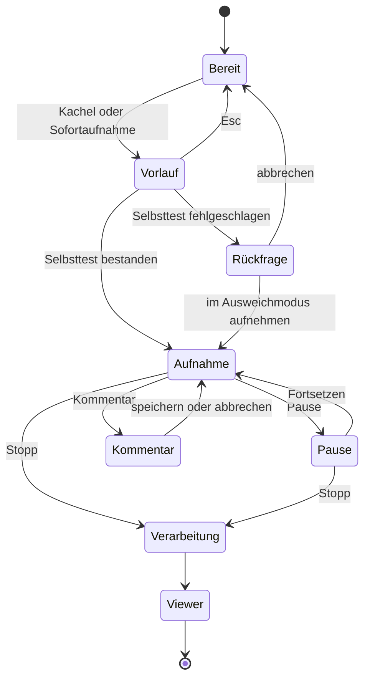

# 07 – Aufnahme und Bedienung

Status: Entwurf 0.1 · Stand: 2026-11-11

Dieses Dokument beschreibt alles, was der Autor vom Programmstart bis zum Stopp einer Aufnahme sieht und tut: Startfenster mit Aufnahmeprofilen und Ziel der Aufnahme, Aufnahmebereiche, Aufnahmeleiste, Tastenkürzel, Kommentare und Marker, Pause und Privattaste, die Unsichtbarkeitsgarantie aus Nutzersicht und die Einstellungen samt ihrem Austausch zwischen Rechnern. Die Technik dahinter steht im [Aufzeichnungskern](03-aufzeichnungskern.md); Ansehen und Bearbeiten nach der Aufnahme beschreibt der [Viewer](08-viewer.md).

## Inhalt

1. [Zweck und Abgrenzung](#1-zweck-und-abgrenzung)
2. [Leitlinien](#2-leitlinien)
3. [Programmstart](#3-programmstart)
4. [Startfenster](#4-startfenster)
5. [Aufnahmebereiche](#5-aufnahmebereiche)
6. [Ablauf und Zustände einer Aufnahme](#6-ablauf-und-zustände-einer-aufnahme)
7. [Aufnahmeleiste](#7-aufnahmeleiste)
8. [Tastenkürzel](#8-tastenkürzel)
9. [Kommentar, Marker, Schnappschuss](#9-kommentar-marker-schnappschuss)
10. [Pause, Privattaste, letzten Schritt verwerfen](#10-pause-privattaste-letzten-schritt-verwerfen)
11. [Unsichtbarkeitsgarantie aus Nutzersicht](#11-unsichtbarkeitsgarantie-aus-nutzersicht)
12. [Stopp und Übergang zum Viewer](#12-stopp-und-übergang-zum-viewer)
13. [Einstellungen](#13-einstellungen)
14. [Erststart](#14-erststart)
15. [Bedienabläufe mit Höchstzahl](#15-bedienabläufe-mit-höchstzahl)
16. [Barrierefreiheit und Sprache](#16-barrierefreiheit-und-sprache)
17. [Anforderungen](#17-anforderungen)
18. [Offene Punkte](#18-offene-punkte)

## 1 Zweck und Abgrenzung

Hier steht die Bedienung **während** der Aufnahme aus Sicht des Autors. Was dahinter geschieht, regeln andere Dokumente:

| Thema | Steht in |
|---|---|
| Wie Eingaben, Bilder und Elemente technisch erfasst werden; technische Regeln der Aufnahmebereiche und der Unsichtbarkeit | [03 Aufzeichnungskern](03-aufzeichnungskern.md) |
| Welche Ereignisse die Bedienung im Protokoll hinterlässt und wie sie aufgebaut sind | [04 Datenformat](04-datenformat.md) |
| Wie aus Ereignissen Schritte werden; was „letzter Schritt“ genau ist | [05 Schritterkennung](05-schritterkennung.md) |
| Maskierung, Schutzstufen, Ausschlussliste, Schwärzung | [10 Datenschutz und Sicherheit](10-datenschutz-und-sicherheit.md) |
| Ansehen, Bearbeiten, Kopieren nach der Aufnahme | [08 Viewer](08-viewer.md) |
| Anleitungen ausgeben | [09 Anleitungs-Export](09-anleitungs-export.md) |
| Prozesse, Kommandozeile, Ablage der Einstellungen | [02 Architektur](02-architektur.md) |

Begriffe in diesem Dokument:

| Begriff | Bedeutung |
|---|---|
| Autor | Die Person, die aufnimmt und später die Anleitung bearbeitet |
| Aufnahme | Der laufende Vorgang zwischen Start und Stopp |
| Sitzung | Das Ergebnis einer Aufnahme auf dem Datenträger |
| Aufnahmebereich | Was gespeichert wird: ganzer Bildschirm, Anwendung(en) oder Bereich |
| Darstellung | Was Viewer und Export von einem gespeicherten Bild zeigen; nachträglich änderbar |
| Aufnahmeleiste | Die kleine Bedienleiste während der Aufnahme, kurz „Leiste“ |
| Aufnahmerahmen | Der farbige Rahmen um den Aufnahmebereich, kurz „Rahmen“ |
| Klartext-Fenster | Fenster, in dem Passwortfelder technisch nicht erkennbar sind (Terminal, Remote-Desktop, virtuelle Maschine). Technisch sind es undurchsichtige Oberflächen; die Einstufung steht in [10](10-datenschutz-und-sicherheit.md#4-schutzstufen). |

## 2 Leitlinien

1. **Zwei Aktionen bis zur Aufnahme.** Der häufigste Weg braucht eine, kein Weg mehr als zwei Aktionen.
2. **Die Leiste nimmt der dokumentierten Anwendung nie den Fokus.** Für Momente, in denen ein Menü offen bleiben muss, gibt es die Tastenkürzel.
3. **Alles geht auch per Tastenkürzel.** Im Ausweichmodus und bei ausgeblendeter Leiste sind Kürzel der einzige Weg.
4. **Nie im Bild, aber immer erkennbar.** Der Recorder erscheint in keinem Screenshot; für den Autor ist die Aufnahme jederzeit sichtbar.
5. **Der Zustand ist eindeutig.** Aufnahme, Pause, Privatmodus und „außerhalb des Bereichs“ sind auf einen Blick zu unterscheiden, nicht nur an der Farbe.
6. **Einfach im Normalfall, flexibel bei Bedarf.** Optionen liegen eine Ebene tiefer und merken sich die letzte Wahl.
7. **Nichts geht still verloren.** Was nicht aufgezeichnet wird, meldet die Leiste, solange es andauert.

## 3 Programmstart

Das Programm wird nicht installiert und braucht keine Adminrechte.

| Aufruf | Ergebnis |
|---|---|
| Doppelklick auf `SebastiansStepRecorder.exe` | Startfenster |
| Sitzungsordner oder `.steprec`-Datei auf die EXE ziehen, oder EXE mit Sitzungspfad starten | Viewer mit dieser Sitzung |
| EXE mit dem Befehl `record` | Aufnahme ohne Startfenster, auf Wunsch mit einem Aufnahmeprofil (`--profile`), siehe [3.1](#31-aufnahme-über-die-kommandozeile) |
| EXE mit dem Befehl `support` | Support-Start: Aufnahme für ein Support-Paket vorbereiten, siehe [3.2](#32-support-aufnahme-über-die-kommandozeile) |
| EXE erneut starten, während eine Aufnahme läuft | Kleines Fenster „Aufnahme läuft“ mit **Stoppen**, **Pause** und **Weiter aufnehmen** – der Notausgang, falls Leiste und Kürzel nicht erreichbar sind |
| EXE erneut starten ohne laufende Aufnahme | Das vorhandene Fenster kommt nach vorn; mit Sitzungspfad öffnet sich diese Sitzung |

Beim allerersten Start erscheint einmalig der [Erststart](#14-erststart). Findet das Programm eine nicht abgeschlossene Aufnahme, bietet es die Wiederherstellung an (siehe [Abschnitt 12](#12-stopp-und-übergang-zum-viewer)).

Die übrigen Befehle stehen in anderen Dokumenten: `export` im [Anleitungs-Export](09-anleitungs-export.md#14-kommandozeilen-export), `mcp` im [KI-Export](06-ki-export-und-mcp.md#16-start-kommandozeile-konfiguration), `compare`, `validate` und der Austausch von Einstellungen in der [Architektur](02-architektur.md#betriebsarten), die auch die vollständige Übersicht aller Befehle enthält.

### 3.1 Aufnahme über die Kommandozeile

Der Befehl `record` startet eine Aufnahme ohne Startfenster, etwa aus einem Skript oder einer Verknüpfung. Rahmen der Kommandozeile, Standardströme und Exit-Codes legt [02](02-architektur.md#betriebsarten) fest; hier stehen die Optionen.

```
SebastiansStepRecorder.exe record [Optionen]
SebastiansStepRecorder.exe record --stop
SebastiansStepRecorder.exe record --self-test
```

| Option | Bedeutung | Standard |
|---|---|---|
| `--profile <Name>` | Aufnahmeprofil ([4.7](#47-aufnahmeprofile)) | keines – es gelten die Einstellungen |
| `--scope <screen\|app\|region>` | Aufnahmebereich | zuletzt verwendet |
| `--monitor <active\|all\|M1,M2…>` | Bei `screen`: Monitor mit Aktivität, alle oder bestimmte; bei `region`: Monitor des Rechtecks | `active` |
| `--app <Prozessname>` | Bei `app`: aufzunehmende Anwendung, mehrfach angebbar | – |
| `--window <Titeltext>` | Bei `app`: nur das Fenster, dessen Titel den Text enthält | – |
| `--region <x,y,b,h\|last>` | Bei `region`: Rechteck in Pixeln des Monitors, oder `last` für den zuletzt verwendeten Bereich ([5.3](#53-bereich)) | – |
| `--out <Ordner>` | Aufnahmeordner | aus den Einstellungen |
| `--title <Text>` | Titel der Sitzung | automatisch |
| `--goal <Text>` | Ziel der Aufnahme: was gezeigt wird ([4.8](#48-ziel-der-aufnahme)) | – |
| `--expected <Text>` | Erwartetes Ergebnis | – |
| `--reference <Text>` | Bezug, etwa eine Ticketnummer | – |
| `--append <Sitzung>` | An eine bestehende Sitzung anhängen | – |
| `--countdown <Sekunden>` | 0 bis 10 | aus den Einstellungen |
| `--protection <balanced\|strict>` | Schutzstufe: `balanced` ist „Schutznetz“, `strict` ist „Streng“ | aus den Einstellungen |
| `--fallback <ask\|allow\|deny>` | Verhalten, wenn der Selbsttest der Unsichtbarkeit fehlschlägt | `ask` |
| `--after-stop <viewer\|folder\|none>` | Was nach dem Stopp geschieht | aus den Einstellungen |
| `--max-duration <Minuten>` | Aufnahme endet von selbst (Kann) | – |
| `--json` | Abschlusszeile als JSON | aus |
| `--log <Datei>` | Protokolldatei mitlesen (mehrfach; `*` und `?` im Dateinamen); schwächt den Schutz, nicht in „Streng“ (Paket 13) | – |

- **Auch `record` zeigt Leiste und Rahmen.** Eine Aufnahme ohne sichtbare Anzeige gibt es in keiner Betriebsart.
- Fehlt bei `--scope app` die Angabe `--app`, öffnet sich die Fensterwahl; fehlt bei `--scope region` das Rechteck, die Bereichswahl. Es wird nie stillschweigend der ganze Bildschirm aufgenommen. `--region last` nimmt den gemerkten Bereich, wenn er auf den heutigen Monitoren unverändert passt (auch an anderer Stelle des Desktops, solange er auf seinem Monitor gleich liegt); ist er nur noch beschnitten möglich, öffnet sich die Bereichswahl im Anpassmodus mit diesem Bereich als Vorgabe, und gibt es keinen gemerkten oder passenden Bereich, die Bereichswahl ohne Vorgabe. Läuft eine mit `--app` genannte Anwendung nicht, endet der Aufruf mit Exit-Code 7 (Voraussetzung nicht erfüllt).
- Der Aufruf kehrt zurück, wenn die Aufnahme endet – durch Tastenkürzel, Leiste oder `record --stop` aus einem zweiten Aufruf. Auf der Standardausgabe steht dann der Pfad der Sitzung.
- Bricht der Autor im Countdown ab, lehnt er den Ausweichmodus ab oder verwirft er die Aufnahme, endet der Aufruf mit Exit-Code 5. Läuft bereits eine Aufnahme, mit Exit-Code 6.
- `--fallback deny` beendet den Aufruf mit Exit-Code 7, statt im Ausweichmodus aufzunehmen; `allow` nimmt ohne Rückfrage im Ausweichmodus auf.
- `record --self-test` führt nur die Startprüfungen aus und legt keine Sitzung an.
- **Profil und Einzeloptionen (Soll):** `--profile` wählt ein Aufnahmeprofil. Eine einzeln angegebene Option geht dem Profil vor, das Profil den Einstellungen. Ein unbekannter Profilname beendet den Aufruf mit Exit-Code 2, ebenso `--profile` zusammen mit `--append`: Ein weiterer Abschnitt einer bestehenden Sitzung wählt kein Profil. Schützt die Aufnahme schwächer als die Einstellungen, steht das in der Startmeldung der Leiste ([4.7](#47-aufnahmeprofile)) und auf der Fehlerausgabe ([02](02-architektur.md#aufnahmeprofile)).
- `--goal`, `--expected` und `--reference` füllen das Ziel der Aufnahme (Soll). Es sind Angaben des Autors; sie unterliegen wie Kommentare der Durchsicht ([10](10-datenschutz-und-sicherheit.md#111-durchsicht-aller-eingaben)).

Beispiele:

```
SebastiansStepRecorder.exe record --scope app --app notepad.exe --title "Datei im Editor speichern"
SebastiansStepRecorder.exe record --profile "KI-Spur" --goal "Rechnung als PDF speichern" --reference "Ticket 4711"
```

### 3.2 Support-Aufnahme über die Kommandozeile

Der Befehl `support` öffnet den Support-Start ([4.9](#49-support-paket-aufnehmen)) – gedacht für eine Verknüpfung oder Stapeldatei, die ein Helpdesk zusammen mit der EXE weitergibt (Soll).

```
SebastiansStepRecorder.exe support [Optionen]
```

| Option | Bedeutung | Standard |
|---|---|---|
| `--profile <Name>` | Aufnahmeprofil für diese Aufnahme | „Support-Fall“ |
| `--reference <Text>` | Belegt das Feld „Bezug“ vor, etwa mit der Ticketnummer | aus dem Profil, sonst leer |
| `--recipient-note <Text>` | Belegt den Hinweis für den Empfänger vor, der dem Paket mitgegeben wird | aus dem Profil, sonst leer |
| `--out <Ordner>` | Aufnahmeordner | aus den Einstellungen |
| `--json` | Abschlusszeile als JSON | aus |

- **`support` startet keine Aufnahme.** Der Befehl öffnet ein Fenster, das erklärt, was geschieht; die Aufnahme beginnt erst, wenn die Person am Rechner „Aufnahme starten“ wählt.
- Der Aufruf wirkt wie die Kachel „Support-Paket“. Leiste, Rahmen, Selbsttest und Schutzregeln sind dieselben wie bei jeder Aufnahme.
- Bezug und Hinweis sind Texte des Autors: Die Person am Rechner sieht sie, kann sie ändern, und sie unterliegen der Durchsicht ([10](10-datenschutz-und-sicherheit.md#113-support-paket)). Für den Bezug gilt die Längengrenze aus [04](04-datenformat.md#manifest-goal), für den Hinweis 2 000 Zeichen. Ein vorbelegter Text kann keinen Schritt des Ablaufs ersetzen oder überspringen.
- Der Aufruf kehrt zurück, wenn der Ablauf endet. Auf der Standardausgabe steht dann der Pfad des Pakets. Rahmen und Exit-Codes legt [02](02-architektur.md#befehle-nachgelagert) fest: 0 mit Paket, 5 ohne Paket, 2 bei unbekanntem Profil.
- Das Programm versendet nichts – auch dieser Befehl nicht.

Beispiel:

```
SebastiansStepRecorder.exe support --reference "Ticket 4711"
```

Profile lassen sich mit der EXE weitergeben: Eine Datei `profiles.json` neben der EXE wird zusätzlich gelesen ([02](02-architektur.md#aufnahmeprofile)). So kann ein Helpdesk ein angepasstes Profil „Support-Fall“ mitliefern, ohne dass der Empfänger etwas einstellt.

## 4 Startfenster

### 4.1 Aufbau

Das Startfenster ist eine kleine App im Stil von Windows 11 (Mica-Hintergrund, eigene Titelleiste) mit einer
Navigationsspalte links: **Neue Aufnahme** · **Aufnahmen** · unten **Einstellungen** · **Hilfe**. Unter 900 px
Fensterbreite zeigt die Spalte nur Symbole. Die Seite „Neue Aufnahme“ passt immer ohne Scrollen ins Fenster.

```
┌─ Sebastians Step Recorder ─────────────────────────────────────────────────────── – □ × ┐
│ ● Neue Aufnahme  │ Neue Aufnahme                                                         │
│ ◷ Aufnahmen      │ Zweck                                                   ┌ Zuletzt ─ › Alle ┐ │
│                  │ [● Anleitung][○ Support-Fall][○ KI-Spur][○ Eigene]       │ [Bild] Editor …  │ │
│                  │ Schlank – nur was Menschen …         ▬▬▭▭ Schlank        │ [Bild] Explorer …│ │
│                  │ ✓ Klicks ✓ Tastatur … ohne Mauswege        ✎ Anpassen …  └──────────────────┘ │
│                  │ Bereich                 [Monitor mit Aktivität v]  ⚑ Ziel und Titel …        │
│                  │ ▣ Ganzer Bildschirm  Alles auf dem Monitor …   [Eingabe] startet ›          │
│                  │ ▢ Eine Anwendung     Danach ein Fenster anklicken …                ›          │
│                  │ ⌗ Bereich            Danach ein Rechteck aufziehen …               ›          │
│ ⚙ Einstellungen  │ ⛨ Passwortfelder werden maskiert                                             │
│ ? Hilfe          │                                                                               │
└──────────────────┴───────────────────────────────────────────────────────────────────────────────┘
```

| Seite | Inhalt |
|---|---|
| Neue Aufnahme | Zweck (vier Auswahlkarten mit Detailgrad und „Anpassen …“), Bereich (drei Karten – ein Klick startet), Monitorwahl, „Ziel und Titel …“, rechts „Zuletzt“ mit Verweis „Alle Aufnahmen“ |
| Aufnahmen | Alle Aufnahmen des Aufnahmeordners und die zuletzt geöffneten, gruppiert nach Heute · Gestern · Diese Woche · Diesen Monat · Früher; Suche, „Öffnen …“ (`Strg+O`), „Aufnahmeordner“; Rechtsklick: Öffnen, Im Explorer zeigen |
| Einstellungen | Die Einstellungen als Seite ([13](#13-einstellungen)) |
| Hilfe | So funktioniert es (vier Schritte), alle Tastenkürzel aus einer gemeinsamen Liste, Hinweis für KI-Agenten (MCP), Version, Lizenz, Update-Suche |

### 4.2 Kacheln

Jede Kachel ist ein Startknopf: Ein Klick beginnt die Aufnahme in dieser Art. Der kleine Pfeil `[v]` öffnet die Optionen der Kachel, ohne zu starten.

| Kachel | Klick bewirkt | Unterzeile zeigt | Optionen hinter `[v]` |
|---|---|---|---|
| Ganzer Bildschirm | Aufnahme beginnt sofort | Gewählte Monitorart, z. B. „Monitor mit Aktivität“ | Monitor mit Aktivität · bestimmter Monitor (mit Vorschaubild) · alle Monitore |
| Eine Anwendung | [Fensterwahl](#45-fensterwahl) öffnet sich; Klick auf ein Fenster beginnt die Aufnahme | Zuletzt gewählte Anwendung, falls sie läuft | Liste der laufenden Anwendungen · Mehrfachauswahl · „nur dieses Fenster“ |
| Bereich | [Bereichswahl](#46-bereichswahl) öffnet sich; Loslassen der Maus beginnt die Aufnahme | Größe und Lage des letzten Bereichs | Letzten Bereich erneut verwenden · Größenvorgaben · „erst nach Bestätigung starten“ |

Die flache Kachel **Support-Paket** (Soll) ist kein Startknopf: Sie öffnet den Support-Start, in dem die Aufnahme erklärt und dann begonnen wird ([4.9](#49-support-paket-aufnehmen)).

Unter den Kacheln steht, sobald ein Bereich gemerkt ist und auf den heutigen Monitoren noch passt, der Link **Letzter Bereich · B × H** (bei beschnittenem Bereich mit dem Zusatz „angepasst“). Er öffnet die Bereichswahl im Anpassmodus ([4.6](#46-bereichswahl)); passt der Bereich nicht mehr, fehlt der Link.

### 4.3 Vorbelegung und Sofortaufnahme

- Die zuletzt gewählte Kachel ist hervorgehoben und Standardschaltfläche: Die **Eingabetaste** löst sie aus. Nach dem Erststart ist das „Ganzer Bildschirm“.
- Die **Sofortaufnahme** (Standard `Strg+Umschalt+F9`) startet ohne Dialog mit den zuletzt verwendeten Einstellungen und dem zuletzt verwendeten Aufnahmeprofil, solange das Programm läuft – auch wenn das Startfenster minimiert ist.
- Ist das Gemerkte nicht mehr verfügbar, erscheint statt einer Fehlermeldung die passende Auswahl:

| Gemerkt | Nicht verfügbar, weil | Dann |
|---|---|---|
| Bestimmter Monitor | Monitor nicht angeschlossen | Monitor mit Aktivität |
| Anwendung | Anwendung läuft nicht | Fensterwahl |
| Bereich | Bereich liegt außerhalb der aktuellen Monitore | Bereichswahl |

### 4.4 Weitere Elemente

- **Profil** (Soll): Auswahl des Aufnahmeprofils, mit dem zuletzt verwendeten vorbelegt ([4.7](#47-aufnahmeprofile)).
- **Ziel der Aufnahme** (Soll): aufklappbarer Bereich mit drei freiwilligen Textfeldern ([4.8](#48-ziel-der-aufnahme)).
- **Mehr Optionen** (eingeklappt): Countdown (0, 3 oder 5 Sekunden), Sitzungsname, „an bestehende Sitzung anhängen“, Zwischenablage-Inhalt aufzeichnen.
- **Statuszeile:** Schutzstufe und Speicherort. Ein Klick führt in die jeweilige Einstellung. Zur Schutzstufe „Schutznetz“ steht dort in einem Satz ihre Grenze: In Terminal-, Remote- und VM-Fenstern werden Eingaben lesbar aufgezeichnet ([10](10-datenschutz-und-sicherheit.md#4-schutzstufen)). Liegt der Speicherort in einem synchronisierten Ordner oder ist wenig Platz frei, steht dort ein Warnzeichen mit Erklärung.
- **Zuletzt verwendet:** bis zu fünf Sitzungen – zuletzt aufgenommene und zuletzt geöffnete, die jüngste oben; ein Klick öffnet sie im Viewer. Die Liste liegt in der Zustandsdatei des Programms ([02](02-architektur.md#konfiguration)). **Alle Aufnahmen** (oder `Strg+L`) öffnet die Seite **Aufnahmen** mit der Sitzungsbibliothek ([08](08-viewer.md#11-sitzungen-verwalten)). Die Vorschaubilder dort und in der Liste zeigen den Stand der Leseschicht, also mit allen Schwärzungen, nie das Rohbild.
- **Einstellungen** und **Hilfe** sind Seiten der Navigation, ebenso die Sitzungsbibliothek **Aufnahmen**. Die Hilfe zeigt die aktuell eingestellten Kürzel der Aufnahme; die Kürzel des Editors zeigt dort `F1`.
- Sind Tastenkürzel durch andere Programme belegt, steht das als Hinweiszeile über den Kacheln (siehe [8.3](#83-konflikte)).

### 4.5 Fensterwahl

```
 (Bildschirm abgedunkelt; das Fenster unter der Maus ist hell und umrahmt)

      ╔══════════════════════════════════════════════╗
      ║ Editor – notiz.txt                           ║
      ║                                              ║
      ║                                              ║
      ╚══════════════════════════════════════════════╝
        Editor · notepad.exe · alle Fenster dieser Anwendung

 Klick = aufnehmen · Strg+Klick = weitere Anwendung hinzufügen · L = Liste · Esc = abbrechen
```

- Das Fenster unter der Maus wird hervorgehoben; ein Etikett nennt Anwendung und Prozess.
- **Klick** wählt die ganze Anwendung und beginnt die Aufnahme. **Strg+Klick** sammelt mehrere Anwendungen; die Eingabetaste beginnt dann die Aufnahme.
- **L** oder der Pfeil der Kachel öffnet die **Liste**: alle Anwendungen mit sichtbaren Fenstern, mit Symbol, Name und Fenstertiteln, Suchfeld und Ankreuzfeldern. Die zuletzt gewählte Anwendung steht oben und ist vorbelegt.
- Anwendungen mit Adminrechten tragen ein Schildsymbol und den Hinweis, dass Eingaben dort nur erfasst werden, wenn auch der Recorder als Administrator läuft; die Schaltfläche „Als Administrator neu starten“ steht daneben.
- Anwendungen der Ausschlussliste sind grau und nicht wählbar, mit Begründung.
- Fensterwahl und Liste gehören zum Recorder: Sie erscheinen in keinem Bild, und die Klicks darin zählen nicht als Schritte.

### 4.6 Bereichswahl

```
 (Bildschirm abgedunkelt)

            ┌───────────────────────────────────┐
            │                                   │
            │           1280 × 720              │
            │                                   │
            └───────────────────────────────────┘

 Ziehen = Rechteck · Griffe = anpassen · Pfeiltasten = 1 px (Umschalt: 10 px) · Eingabe = starten · Esc = abbrechen
```

- Ziehen mit der Maus spannt das Rechteck auf; die Größe in Pixeln wird angezeigt. Mindestgröße 64 × 64 Pixel.
- Standard: Beim Loslassen beginnt die Aufnahme. Mit der Option „erst nach Bestätigung starten“ lässt sich das Rechteck vorher an Griffen und mit den Pfeiltasten anpassen; die Eingabetaste beginnt die Aufnahme.
- **Anpassmodus:** Wird die Bereichswahl mit einem Vorschlag geöffnet – über den Link „Letzter Bereich“ oder durch `--region last` bei einem beschnittenen Bereich –, ist das Rechteck schon eingezeichnet. Es lässt sich verschieben, an acht Griffen (vier Ecken, vier Kantenmitten) in der Größe ändern und mit den Pfeiltasten verschieben (1 Pixel, mit Umschalt 10). Erst die Eingabetaste beginnt die Aufnahme; das Loslassen der Maus tut es hier nicht. Ein neues Rechteck lässt sich außerhalb des alten aufziehen. Esc bricht ab.
- Das Rechteck rastet an Fensterkanten ein (Soll). Es liegt vollständig auf einem Monitor.

### 4.7 Aufnahmeprofile

Ein Aufnahmeprofil ist eine benannte Voreinstellung für eine Art von Aufnahme (Soll). Es erspart, für wiederkehrende Zwecke dieselben Einstellungen von Hand zu wählen.

- Die Auswahl **Profil** steht über den Kacheln. Die letzte Wahl ist vorbelegt; die Sofortaufnahme nutzt das zuletzt verwendete Profil.
- Ein Profil belegt vor, es zwingt nicht: Die Kacheln bleiben Startknöpfe. Wer eine andere Kachel anklickt als die vom Profil vorbelegte, nimmt in dieser Art auf; das Profil selbst ändert sich dadurch nicht.
- Ein Profil enthält nur, was es abweichend festlegt. Für alles andere gelten die Einstellungen ([Abschnitt 13](#13-einstellungen)).

| Ein Profil kann festlegen | Werte |
|---|---|
| Art des Aufnahmebereichs | Ganzer Bildschirm · Eine Anwendung · Bereich; bei „Ganzer Bildschirm“ auch die Monitorwahl |
| Schutzstufe | Schutznetz · Streng |
| Bildeinstellungen | Bildqualität, Zwischenbilder |
| Zwischenablage-Inhalt aufzeichnen | an · aus |
| Ergänzungen der Ausschlussliste | Weitere Anwendungen und Fenstertitel. Ein Profil kann die Liste nur verlängern, nie kürzen. |
| Ziel-Felder im Startfenster | aufgeklappt · eingeklappt |
| Nach dem Stopp | Viewer (Standard) · Exportdialog mit vorbelegtem Format und vorbelegter Vorlage ([09](09-anleitungs-export.md#3-exportdialog-und-ein-klick-export)) · geführter Ablauf zum Support-Paket ([08](08-viewer.md#122-support-paket-geführter-ablauf)) |
| Vorbelegungen für das Support-Paket | Bezug und Hinweis für den Empfänger |

Mitgeliefert sind drei Profile:

| Profil | Gedacht für | Legt fest |
|---|---|---|
| Anleitung | Bedienungsanleitungen und Arbeitsschritte; Auslieferungszustand | nichts Abweichendes |
| Support-Fall | Ein Problem für den Helpdesk vorführen | Ganzer Bildschirm mit Monitor mit Aktivität; Ziel-Felder aufgeklappt; nach dem Stopp der geführte Ablauf zum Support-Paket |
| KI-Spur | Einen Ablauf für einen KI-Agenten festhalten | Ganzer Bildschirm; Ziel-Felder aufgeklappt; nach dem Stopp der Exportdialog mit dem KI-Paket in der Detailstufe „Vollständig“ ([06](06-ki-export-und-mcp.md#9-detailstufen)) |

Festlegungen:

- **Nach dem Stopp wird nie von selbst exportiert.** Legt ein Profil ein Format fest, öffnet sich der Viewer und darüber der Exportdialog, bereits ausgefüllt; Vorprüfung und Durchsicht gelten wie immer. Legt das Profil nichts fest, gilt die Einstellung „Nach dem Stopp“ ([Abschnitt 13](#13-einstellungen)).
- Mitgelieferte Profile gehören zum Programm und sind immer vorhanden. Sie lassen sich ändern und auf den Auslieferungszustand zurücksetzen, aber nicht löschen. Eigene Profile entstehen im Profil-Editor ([13.1](#131-profile-bearbeiten)).
- Eigene und geänderte Profile stehen in der Datei `profiles.json` neben der Einstellungsdatei; Ablage, Rangfolge und die Ermittlung der wirksamen Einstellungen regelt [02](02-architektur.md#aufnahmeprofile). Profile sind damit so portabel wie die Einstellungen.
- **Kein unbemerkt schwächerer Schutz.** Schützt eine Aufnahme schwächer als die Einstellungen – niedrigere Schutzstufe oder eingeschalteter Zwischenablage-Inhalt –, zeigt das Startfenster das vor dem Start in seiner Statuszeile, und die Leiste nennt es in ihrer **Startmeldung**: Die Meldezeile zeigt zu Beginn der Aufnahme fünf Sekunden lang, was abweicht ([7.4](#74-hinweise-und-warnungen)). Das gilt für Profile ebenso wie für Optionen der Kommandozeile und bei jedem Start, auch bei der Sofortaufnahme; was als schwächer gilt, legt [10](10-datenschutz-und-sicherheit.md#44-aufnahmeprofile-nie-unbemerkt-schwächer) fest.
- **Was ein Profil nicht kann:** die Anzeige der laufenden Aufnahme, den Klartext-Hinweis, die Privattaste oder die Durchsicht abschalten, Einträge der Ausschlussliste streichen, einen Ordner festlegen oder eine Aufnahme starten ([10](10-datenschutz-und-sicherheit.md#44-aufnahmeprofile-nie-unbemerkt-schwächer)).
- Die Sitzung hält fest, womit aufgenommen wurde: `manifest.profile` nennt den Namen des Profils, die wirksamen Einstellungen und – unter `weakens` – worin die Aufnahme schwächer schützte ([04](04-datenformat.md#manifest-profile)). Spätere Änderungen am Profil wirken nicht auf vorhandene Sitzungen zurück.
- Fehlt, was ein Profil voraussetzt – etwa die gemerkte Anwendung –, gilt die Tabelle aus [4.3](#43-vorbelegung-und-sofortaufnahme).

### 4.8 Ziel der Aufnahme

Vor dem Start kann der Autor sagen, worum es geht (Soll). Die Angaben helfen später jedem, der die Aufnahme liest – auch einer KI. Sie beschreiben die **Absicht** des Autors, nicht das Beobachtete.

```
┌─ Ziel der Aufnahme (optional) ───────────────────────────────────────────────┐
│ Was wird gezeigt?     [Rechnung als PDF speichern                          ] │
│ Erwartetes Ergebnis   [Die PDF-Datei liegt im Ordner „Rechnungen“          ] │
│ Bezug                 [Ticket 4711                                         ] │
└──────────────────────────────────────────────────────────────────────────────┘
```

| Feld | Inhalt | In der Sitzung |
|---|---|---|
| Was wird gezeigt? | Worum es in der Aufnahme geht | `goal.description` |
| Erwartetes Ergebnis | Woran man erkennt, dass es geklappt hat – oder was hätte geschehen sollen | `goal.expected` |
| Bezug | Frei, etwa eine Ticketnummer | `goal.reference` |

- **Nie Pflicht.** Der Bereich ist eingeklappt, solange das Profil nichts anderes sagt. Leere Felder ändern nichts am Start: Kachel, Eingabetaste und Sofortaufnahme wirken wie immer, und die Höchstzahlen aus [Abschnitt 15](#15-bedienabläufe-mit-höchstzahl) gelten unverändert.
- Die Eingabetaste in einem der Felder löst die vorbelegte Kachel aus; `Umschalt+Eingabe` fügt in den beiden Textfeldern einen Zeilenumbruch ein, der Bezug ist einzeilig. Die Längengrenzen stehen in [04](04-datenformat.md#manifest-goal): 2 000 Zeichen je Text, 200 für den Bezug.
- Gespeichert wird in `manifest.goal`; leere Felder fehlen dort. Nach dem Start sind die Felder wieder leer.
- Ändern lässt sich das Ziel später im Viewer, ohne die Rohdaten zu berühren ([08](08-viewer.md#44-ziel-der-aufnahme-und-marker-typen)).
- **Texte des Autors:** Ziel, erwartetes Ergebnis und Bezug unterliegen wie Kommentare der Durchsicht der Eingaben und lassen sich schwärzen ([10](10-datenschutz-und-sicherheit.md#111-durchsicht-aller-eingaben)).
- Im KI-Paket stehen die Angaben im Kopf, gekennzeichnet als Angabe des Autors ([06](06-ki-export-und-mcp.md#76-angaben-des-autors-ziel-der-aufnahme-und-marker)); in der Anleitung stehen sie, wenn die Option gesetzt ist ([09](09-anleitungs-export.md#46-ziel-marker-neuaufnahmen-und-platzhalter)).
- Beim Anhängen an eine bestehende Sitzung ist der Bereich ausgeblendet; die Sitzung hat ihr Ziel schon.

### 4.9 Support-Paket aufnehmen

Der Fall: Ein Helpdesk gibt jemandem die EXE, damit er ein Problem vorführt. Diese Person kennt das Programm nicht. Die Kachel **Support-Paket** und der Befehl `support` ([3.2](#32-support-aufnahme-über-die-kommandozeile)) führen deshalb in einen eigenen, einfachen Start (Soll).

```
┌─ Problem aufnehmen ────────────────────────────────────────────────────────────┐
│ So geht es:   1 Aufnahme starten   2 Problem vorführen   3 Stopp drücken       │
│ Danach sehen Sie alles durch und erhalten eine ZIP-Datei zum Weitergeben.      │
│ Das Programm versendet nichts.                                                 │
│                                                                                │
│ Die Bilder zeigen, was im Aufnahmebereich zu sehen ist. Wer etwas nicht zeigen │
│ will, nimmt nur die betroffene Anwendung auf oder schwärzt es danach.          │
│ Wer das Paket bekommt, kann es weitergeben.                                    │
│                                                                                │
│ Was wird gezeigt?     [z. B. Beim Speichern erscheint eine Fehlermeldung   ]   │
│ Erwartetes Ergebnis   [z. B. Die Datei wird gespeichert                    ]   │
│ Bezug                 [Ticket 4711                                         ]   │
│                                                                                │
│ Aufgenommen wird: Ganzer Bildschirm, Monitor mit Aktivität            [Ändern] │
│ Fehler sichtbar? Strg+Umschalt+F1 markiert die Stelle.                         │
│ Stopp: Strg+Umschalt+F10 oder [■] in der Leiste.                               │
│                                                                                │
│ [Zurück]                                                    [Aufnahme starten] │
└────────────────────────────────────────────────────────────────────────────────┘
```

- Die Kachel beginnt keine Aufnahme; sie öffnet den Support-Start. Dort gilt das Profil „Support-Fall“ ([4.7](#47-aufnahmeprofile)) – oder das Profil, das der Befehl `support` mit `--profile` nennt.
- Das Fenster sagt in drei Zeilen, was geschieht – auch, dass das Programm nichts versendet.
- Es nennt in zwei Sätzen, was der Ablauf nicht verhindern kann: Die Bilder zeigen, was im Aufnahmebereich zu sehen ist, und wer das Paket bekommt, kann es weitergeben ([10](10-datenschutz-und-sicherheit.md#113-support-paket)). „Ändern“ neben dem Aufnahmebereich führt zur Wahl einer einzelnen Anwendung.
- Die drei Ziel-Felder sind aufgeklappt und mit Beispielen in grauer Schrift erläutert. Pflicht sind sie auch hier nicht. „Bezug“ ist vorbelegt, wenn Profil oder Kommandozeile ihn mitgeben.
- **Aufnahme starten** ist die Standardschaltfläche. Vorlauf, Selbsttest, Leiste und Rahmen sind dieselben wie bei jeder Aufnahme ([Abschnitt 6](#6-ablauf-und-zustände-einer-aufnahme)); auch die Warnung bei einem Sync-Ordner und die Prüfung der Kürzel gelten.
- Während der Aufnahme erinnert die Meldezeile einmal an die Marker „Fehler“ und „Erwartet“ ([9.2](#92-marker)) und an das Stopp-Kürzel.
- Nach dem Stopp öffnet sich der Viewer mit dem geführten Ablauf in drei Schritten – ansehen, Eingaben prüfen, Paket erstellen ([08](08-viewer.md#122-support-paket-geführter-ablauf)). Was das Paket enthält, steht in [09](09-anleitungs-export.md#35-support-paket).
- **Zurück** führt ins gewöhnliche Startfenster.

## 5 Aufnahmebereiche

Der Aufnahmebereich legt fest, **was gespeichert wird**. Er ist die wichtigste Entscheidung vor der Aufnahme, denn nicht Gespeichertes lässt sich später nicht zeigen – und Gespeichertes muss gegebenenfalls geschwärzt werden.

| Bereich | Gespeichert wird | Eingaben außerhalb | Typischer Zweck |
|---|---|---|---|
| Ganzer Bildschirm | Das ganze Bild des Monitors | – (alles liegt im Bereich) | Abläufe über mehrere Programme; im Zweifel die richtige Wahl |
| Eine Anwendung | Nur die Fenster der gewählten Anwendung(en) | Nur als Lücke „außerhalb des Aufnahmebereichs“ | Anleitung zu einem Programm; nichts anderes soll auf die Festplatte |
| Bereich | Nur das aufgezogene Rechteck | Nur als Lücke „außerhalb des Aufnahmebereichs“ | Ein Teil eines Fensters, fester Bildausschnitt |

Für alle Bereiche gilt: Die Ausschlussliste ([10](10-datenschutz-und-sicherheit.md#8-ausschlussliste)) wirkt zusätzlich, und der Recorder selbst ist nie im Bild.

### 5.1 Ganzer Bildschirm

| Variante | Verhalten |
|---|---|
| Monitor mit Aktivität (Standard) | Gespeichert wird jeweils der Monitor, auf dem die Eingabe stattfindet. Wechselt der Autor den Monitor, wechselt die Aufnahme mit; der Rahmen wandert mit. |
| Bestimmter Monitor | Nur dieser Monitor. Eingaben auf anderen Monitoren gelten als außerhalb. |
| Alle Monitore | Jeder Monitor wird getrennt gespeichert. Ein Schritt zeigt den Monitor mit der Aktion; die anderen Bilder bleiben abrufbar. |

Kommt während der Aufnahme ein Monitor hinzu oder fällt einer weg, läuft die Aufnahme weiter; die Leiste meldet die Änderung.

### 5.2 Eine Anwendung

- Gewählt wird per Klick auf ein Fenster oder aus der Liste, auch mehrere Anwendungen zugleich ([4.5](#45-fensterwahl)).
- Aufgenommen werden **alle Fenster der Anwendung**: Hauptfenster, Dialoge, Menüs, Aufklapplisten, Tooltips und zugehörige Hilfsfenster, auch wenn diese technisch zu einem anderen Prozess gehören (etwa ein Datei-Dialog). Welche Fenster als zugehörig gelten, regelt [03](03-aufzeichnungskern.md).
- Alles andere wird **vor dem Speichern** entfernt. In keinem Bild steht Inhalt einer anderen Anwendung, auch nicht am Rand oder im Hintergrund.
- Verdeckt ein fremdes Fenster einen Teil der Anwendung, ist diese Stelle im Bild neutral gefüllt und als „verdeckt“ gekennzeichnet.
- Arbeitet der Autor in einem anderen Programm, zeigt die Leiste „Außerhalb des Aufnahmebereichs“. Davon bleibt nur ein Lückenmarker mit Dauer und der Zahl der Eingaben – keine Tasten, keine Klickziele, keine Bilder. Eingaben außerhalb werden nie aufgezeichnet; eine Option dafür gibt es nicht, denn der Aufnahmebereich ist auch eine Datenschutzgrenze.
- Die Option **„nur dieses Fenster“** beschränkt die Aufnahme auf das angeklickte Fenster samt seiner Dialoge und Menüs.
- Wird die Anwendung beendet, läuft die Aufnahme weiter und die Leiste bietet „Bereich wechseln“ und „Stopp“ an. Startet dieselbe Anwendung erneut, wird sie wieder aufgenommen.
- Der Rahmen liegt um das jeweils aktive Fenster der Anwendung und folgt ihm beim Verschieben, auch auf einen anderen Monitor.

### 5.3 Bereich

- Gespeichert wird nur das Rechteck. Es ist fest an seine Position auf dem Monitor gebunden und folgt keinem Fenster.
- **Letzter Bereich:** Das Programm merkt sich das zuletzt aufgenommene Rechteck relativ zu seinem Monitor (Gerät, Größe, Lage, Skalierung) in der Zustandsdatei. Beim Wiederverwenden wird es auf die heutigen Monitore abgebildet: *exakt* (unverändert), *verschoben* (Monitor liegt anderswo auf dem Desktop, das Rechteck bleibt auf seinem Monitor gleich), *beschnitten* (ragt über den Monitor hinaus; mindestens 64 × 64 Pixel bleiben) oder *verloren* (Monitor fehlt oder nichts Passendes bleibt). Exakt und verschoben starten ohne Rückfrage; bei beschnitten öffnet sich die Bereichswahl im Anpassmodus ([4.6](#46-bereichswahl)); bei verloren gibt es keinen Link und keinen Vorschlag.
- Eine Mauseingabe zählt, wenn sie im Rechteck liegt; eine Tastatureingabe zählt, wenn das fokussierte Element das Rechteck berührt. Alles andere ist „außerhalb“. Die genaue Regel steht in [03](03-aufzeichnungskern.md#aufnahmebereiche).
- Der Rahmen zeigt das Rechteck während der gesamten Aufnahme.

### 5.4 Umschalten während der Aufnahme

- Die Bereichsanzeige in der Leiste (oder `Strg+Umschalt+F5`) öffnet ein kleines Menü mit den drei Bereichsarten und den zuletzt verwendeten Zielen.
- Die Aufnahme läuft beim Umschalten weiter. Der Wechsel steht als `scope.change` im Protokoll ([04](04-datenformat.md#ev-scope-change)); die Bedienung des Menüs und der Auswahl zählt nicht als Schritt.
- Der neue Bereich gilt ab der nächsten Eingabe. Der Rahmen zeigt ihn sofort.

### 5.5 Aufnehmen und Zeigen sind getrennt

| | Aufnahmebereich | Darstellung |
|---|---|---|
| Legt fest | Was auf die Festplatte kommt | Was Viewer und Export davon zeigen |
| Wann gewählt | Vor oder während der Aufnahme | Jederzeit danach – für alles, je Export oder je Schritt |
| Auswahl | Ganzer Bildschirm · Anwendung(en) · Bereich | Ganzer Bildschirm · Anwendungsfenster · Ausschnitt um die Aktion · freier Zuschnitt |
| Umkehrbar | Nein | Ja, ohne Qualitätsverlust |
| Bedeutung für die Privatsphäre | Hoch: Nicht Gespeichertes kann nicht nach außen gelangen | Gering: Nicht Gezeigtes ist weiterhin gespeichert |

Daraus folgt die Faustregel:

| Der Autor will … | Dann … |
|---|---|
| später frei zwischen Vollbild, Fenster und Ausschnitt wählen | **Ganzer Bildschirm** aufnehmen und die Darstellung im Viewer wählen |
| sicher sein, dass andere Programme nie gespeichert werden | **Eine Anwendung** aufnehmen |
| beides: Fensterbilder für die Anleitung und Vollbilder zur Übersicht | **Ganzer Bildschirm** aufnehmen; je Schritt zwischen den Darstellungen wechseln |

Das Startfenster weist darauf mit einem Satz unter den Kacheln hin, sobald „Eine Anwendung“ oder „Bereich“ gewählt ist: „Es wird nur dieser Teil gespeichert; ein Vollbild lässt sich später nicht mehr erzeugen.“

## 6 Ablauf und Zustände einer Aufnahme



| Zustand | Leiste | Rahmen | Aufgezeichnet wird |
|---|---|---|---|
| Bereit | – (Startfenster sichtbar) | – | nichts |
| Vorlauf | Countdown, falls eingestellt | erscheint | nichts; die Vorprüfung mit dem Selbsttest der Unsichtbarkeit läuft |
| Aufnahme | roter Punkt, laufende Zeit | rot, durchgezogen | alles im Aufnahmebereich |
| Aufnahme, Privatmodus an | Schloss und „Privat“ | rot, gestrichelt, mit Schloss an der Ecke | wie Aufnahme, Eingaben nur maskiert ([10](10-datenschutz-und-sicherheit.md#7-privattaste)) |
| Pause | Pausenzeichen, Zeit steht | grau, gestrichelt | nichts; im Protokoll steht eine Lücke „Pause“ |
| Kommentar | Kommentarfeld offen | unverändert | das eingefrorene Bild und der Kommentar; keine Nutzerschritte |
| Verarbeitung | „Wird verarbeitet …“ mit Fortschritt | verschwindet | nichts |

Der Privatmodus ist kein eigener Zustand, sondern eine Eigenschaft der Aufnahme: Er lässt sich jederzeit zu- und abschalten.

Beim Start verschwindet das Startfenster vollständig (kein Taskleisten-Eintrag). Ohne Countdown liegen zwischen der auslösenden Aktion und dem ersten aufgezeichneten Ereignis höchstens 1,5 Sekunden auf dem Referenzsystem A ([03](03-aufzeichnungskern.md#leistungsbudgets)).

## 7 Aufnahmeleiste

### 7.1 Aufbau

Ausführliche Form:

```
┌───────────────────────────────────────────────────────────────────────────────────────────────────────┐
│ :: ● 02:14 │ 17 │ [II] [■] │ [Kommentar] [Marker] [Foto] │ [Privat] [Verwerfen] │ Bildschirm 1 v │ ...│
├───────────────────────────────────────────────────────────────────────────────────────────────────────┤
│ Klick · Schaltfläche „Speichern“                                                                      │
└───────────────────────────────────────────────────────────────────────────────────────────────────────┘
```

Kompakte Form:

```
┌──────────────────────────────┐
│ :: ● 02:14 · 17  [II] [■] ...│
└──────────────────────────────┘
```

Mit Hinweis (Klartext-Fenster hat den Fokus):

```
┌───────────────────────────────────────────────────────────────────────────────────────────────────────┐
│ :: ● 02:14 │ 17 │ [II] [■] │ [Kommentar] [Marker] [Foto] │ [Privat] [Verwerfen] │ Bildschirm 1 v │ ...│
├───────────────────────────────────────────────────────────────────────────────────────────────────────┤
│ (!) Klartext – Passwörter hier nicht erkennbar.                  [Privat  Strg+Umschalt+F8]           │
└───────────────────────────────────────────────────────────────────────────────────────────────────────┘
```

| Nr. | Element | Funktion | Kürzel (Standard) | In Kompaktform |
|---|---|---|---|---|
| 1 | Anfasser `::` | Leiste verschieben | – | ja |
| 2 | Zustand und Zeit | Punkt (Aufnahme), Pausenzeichen, Schloss (Privat); laufende Aufnahmezeit | – | ja |
| 3 | Schrittzähler | Zahl der bisher erkannten Hauptschritte (vorläufig) | – | ja |
| 4 | Pause / Fortsetzen `[II]` | Aufnahme anhalten und fortsetzen | `Strg+Umschalt+F9` | ja |
| 5 | Stopp `[■]` | Aufnahme beenden, Viewer öffnen | `Strg+Umschalt+F10` | ja |
| 6 | Kommentar | Bild einfrieren und Kommentar schreiben | `Strg+Umschalt+F12` | im Menü |
| 7 | Marker | Stelle markieren, ohne Oberfläche. Ein Linksklick setzt einen Marker vom Typ „Notiz“; ein Rechtsklick bietet die vier Typen an ([9.2](#92-marker)) | `Strg+Umschalt+F7` | im Menü |
| 8 | Schnappschuss `[Foto]` | Aktuelles Bild als eigenen Schritt festhalten | `Strg+Umschalt+F11` | im Menü |
| 9 | Privattaste | Eingaben maskieren ein/aus. In der Schutzstufe „Streng“ steht daneben die Freigabetaste (`Strg+Umschalt+F3`). | `Strg+Umschalt+F8` | im Menü; Schloss bleibt sichtbar |
| 10 | Verwerfen | Letzten Schritt als Fehlbedienung kennzeichnen | `Strg+Umschalt+F6` | im Menü |
| 11 | Bereichsanzeige | Zeigt den Aufnahmebereich; Klick wechselt ihn | `Strg+Umschalt+F5` | im Menü |
| 12 | Menü `...` | Kompakt/ausführlich, Leiste ausblenden, Marker mit Typ, letzte Eingabe schwärzen, Aufnahme verwerfen, Kürzelübersicht | `Strg+Umschalt+F4` blendet die Leiste aus und ein | ja |
| 13 | Meldezeile | Rückmeldung zum letzten Schritt; Hinweise und Warnungen | – | nur bei Hinweis oder Warnung |

### 7.2 Verhalten

- **Kein Fokus:** Ein Klick auf die Leiste ändert weder das Vordergrundfenster noch den Tastaturfokus. Schreibmarke, Auswahl und aktives Fenster bleiben, wie sie sind.
- **Aber:** Ein offenes Menü, eine Aufklappliste oder ein Kontextmenü schließt sich bei jedem Mausklick außerhalb – auch bei einem Klick auf die Leiste. Wirklich störungsfrei sind nur die Tastenkürzel ([Abschnitt 8](#8-tastenkürzel)).
- **Immer im Vordergrund**, aber nie im Bild (siehe [Abschnitt 11](#11-unsichtbarkeitsgarantie-aus-nutzersicht)). Das gilt auch für Tooltips und das Menü der Leiste.
- **Verschiebbar** am Anfasser; rastet an Bildschirmkanten ein. Die Position wird je Monitoranordnung gemerkt. Standard: oben in der Mitte des aufgenommenen Monitors.
- **Folgt dem aktiven Monitor** (abschaltbar), wenn „Monitor mit Aktivität“ aufgenommen wird.
- **Kompakt und ausführlich:** Standard ist „automatisch“ – nach fünf Sekunden ohne Mauskontakt schrumpft die Leiste auf die Kompaktform und klappt beim Überfahren wieder auf. Hinweise und Warnungen klappen die Meldezeile von selbst auf.
- **Ausblendbar:** `Strg+Umschalt+F4` blendet die Leiste ganz aus und wieder ein. Der Rahmen bleibt als Anzeige bestehen.
- **Tooltips** nennen Funktion und Kürzel.
- **Eigene Bedienung zählt nicht:** Klicks auf die Leiste sind keine Schritte der Aufnahme.
- Bedienflächen sind bei 100 % Skalierung mindestens 28 × 28 Pixel groß und skalieren mit der Anzeige.

### 7.3 Rückmeldung zum letzten Schritt

Die Meldezeile zeigt, was zuletzt erkannt wurde: die Zeile „Aktion“ im Protokollstil der Textvorlagen ([05](05-schritterkennung.md#textvorlagen)). Der Autor sieht so, dass die Aufnahme arbeitet und was sie versteht.

| Erkannt | Meldezeile |
|---|---|
| Klick auf benanntes Element | Linksklick auf Schaltfläche „Speichern“ |
| Klick, Ziel steht noch nicht fest | Klick … |
| Klick ohne erkennbares Element | Linksklick an Position (1180, 640) im Fenster „Zeichnung1“ |
| Texteingabe | Text in Feld „Dateiname“ eingegeben |
| Eingabe, deren Einstufung noch läuft | Texteingabe … |
| Maskierte Eingabe | Eingabe in Feld „Kennwort“: 8 Tastenanschläge, nicht aufgezeichnet (maskiert) |
| Tastenkombination | Tastenkombination Strg+S |
| Ziehen | Ziehen von Eintrag „bericht.docx“ nach Eintrag „Archiv“ |
| Marker, Schnappschuss, Kommentar | Marker 3 gesetzt · Marker 4 (Fehler) gesetzt · Schnappschuss · Kommentar hinzugefügt |
| Verwerfen | Schritt 17 verworfen |

- Getippter Text erscheint in der Meldezeile **nie im Wortlaut**: Die Zeile „Aktion“ nennt bei Texteingaben nur das Ziel. Zurückgehaltene und maskierte Eingaben erscheinen ohne Inhalt ([10](10-datenschutz-und-sicherheit.md#5-passwort-rückhaltung)).
- Die Rückmeldung erscheint höchstens eine Sekunde nach der Eingabe.
- Rückmeldung und Schrittzähler sind **vorläufig** ([05](05-schritterkennung.md#mitlaufend)): Ein Schritt wird gemeldet, sobald seine Eingabe abgeschlossen ist, und kann sich bis zu seinem Abschluss noch ändern – etwa weil zwei Klicks zu einem Doppelklick werden.
- Die Rückmeldung lässt sich in den Einstellungen abschalten.

### 7.4 Hinweise und Warnungen

*Mitgelesene Inhalte (Pakete 12, 13 aus [12](12-entwickler-fahrplan.md)):* Schützt eine Aufnahme schwächer als die Einstellungen, nennt die Startmeldung jede Abweichung („Schwächer als die Einstellungen: …“, bei Protokolldateien mit den gefundenen Dateinamen). Solange eine inhaltstragende Quelle mitliest, steht neben der Schrittzahl dauerhaft ein Auge; der Tooltip nennt die Quellen und dass sie vor der Weitergabe durchgesehen werden müssen.

Hinweise und Warnungen stehen in der Meldezeile, solange der Anlass besteht. Sie unterbrechen die Aufnahme nie durch einen Dialog.

| Anlass | Text in der Leiste | Angebotene Aktion | Folge im Protokoll |
|---|---|---|---|
| Klartext-Fenster hat den Fokus, Schutzstufe „Schutznetz“ | „Klartext – Passwörter hier nicht erkennbar.“ | Privattaste, hervorgehoben | keine; mit Privatmodus maskierte Eingaben |
| Klartext-Fenster hat den Fokus, Schutzstufe „Streng“ | „Streng – Eingaben hier werden maskiert.“ | Freigabetaste | maskierte Eingaben; nach Freigabe Klartext bis zum Fensterwechsel |
| Privatmodus aktiv | „Privat – Eingaben werden nicht gespeichert.“ | Privatmodus beenden | maskierte Eingaben |
| Privatmodus seit 60 s ohne Tastendruck (einstellbar) | „Privatmodus ist noch aktiv – Eingaben werden nicht gespeichert. Ausschalten: <Kürzel>“ | Privatmodus beenden | – |
| Keine Eingabe seit 10 Minuten (einstellbar) | „Aufnahme läuft noch – seit N Minuten keine Eingabe. Beenden: <Kürzel>“ | Stopp | – |
| Passwortabfrage im Terminal erkannt | „Passwortabfrage erkannt – Eingabe wird maskiert.“ | – | maskierte Eingabe bis zur Eingabetaste |
| Eingabeziel außerhalb des Aufnahmebereichs | „Außerhalb des Aufnahmebereichs.“ | Bereich wechseln | Lücke „außerhalb“ |
| Ausgeschlossene Anwendung im Vordergrund | „Ausgeschlossene Anwendung – wird nicht aufgezeichnet.“ | – | Lücke |
| Fenster mit Adminrechten im Vordergrund | „Adminfenster – Eingaben nicht erfassbar.“ | Hinweis auf „Als Administrator neu starten“ | Lücke |
| Rückkehr von einem Sicherheitsdialog | „Sicherheitsdialog war nicht aufzeichenbar (8 s).“ | – | Lücke |
| Rückkehr nach Sperren, Benutzerwechsel oder Trennen der Sitzung | „Aufnahme pausiert – die Sitzung war gesperrt oder getrennt. Fortsetzen?“ | Fortsetzen · Stopp | Lücke „gesperrt“ bzw. „getrennt“ (`sessionLocked`, `sessionDisconnected`), danach Pause (`paused`) bis zur Bestätigung |
| Eingabeerfassung gestört und wiederhergestellt | „Eingabeerfassung war kurz unterbrochen.“ | – | Lücke oder Ergänzung |
| Bilder ausgelassen | „Rechner überlastet – einzelne Bilder fehlen.“ | – | Lücke „Bild ausgelassen“ |
| Weniger als 2 GB frei | „Wenig Speicherplatz.“ | Ordner öffnen | – |
| Datenträger voll | „Aufnahme pausiert – Datenträger voll.“ | Stopp · Fortsetzen | Pause und Lücke |
| Aufgenommene Anwendung beendet | „Anwendung beendet.“ | Bereich wechseln · Stopp | Lücke „außerhalb“ |
| Monitor hinzugefügt oder entfernt | „Monitoranordnung geändert – Aufnahme läuft weiter.“ | – | `display.topology` |

**Erinnerungen.** Die beiden Erinnerungen der Tabelle (Leerlauf, Privattaste) **erinnern nur**: Sie pausieren und beenden nichts. Sie laufen über drei Kanäle:

| Kanal | Verhalten |
|---|---|
| Leiste | Die Meldezeile zeigt den Text und bleibt stehen, bis der Autor etwas tut (kein Zeitablauf). |
| Infobereich | Das Symbol des Recorders im Infobereich blinkt zehn Sekunden lang. |
| Ton | Ein Erinnerungston, wenn die Leiste ausgeblendet ist oder die Töne auf „immer“ stehen; bei „nie“ bleibt er aus. |

- Bei ausgeblendeter Leiste (ohne Ausweichmodus) erscheint der Text zusätzlich zehn Sekunden lang als Schildchen am Rahmen. Eine Windows-Benachrichtigung gibt es nicht, weil sie im Bild erscheinen würde.
- **Leerlauf:** Gezählt wird die Zeit ohne jede Eingabe, auch ohne Mausbewegung und auch außerhalb des Aufnahmebereichs. Wählbar sind aus, 5, 10 oder 30 Minuten (Standard 10). Die Erinnerung wiederholt sich im selben Abstand, höchstens dreimal je Leerlaufphase; jede Eingabe beginnt eine neue Phase.
- **Privattaste:** Einmal je Einschalten, nach 30, 60 oder 120 Sekunden ohne Tastendruck (Standard 60).
- **Nie in Pause oder Lücke:** In der Pause, bei gesperrtem Rechner, auf dem sicheren Desktop und in Lücken stehen die Uhren; danach beginnen sie von vorn.

Mit Aufnahmeprofilen und Support-Start kommen zwei Meldungen zu Beginn der Aufnahme hinzu (Soll):

| Anlass | Text in der Leiste | Dauer | Folge im Protokoll |
|---|---|---|---|
| **Startmeldung:** Die Aufnahme schützt schwächer als die Einstellungen – durch ein Profil oder eine Option der Kommandozeile | Was abweicht, etwa „Profil ‚KI-Spur‘: Zwischenablage-Inhalt wird aufgezeichnet.“ oder „Schutzstufe ‚Schutznetz‘ statt ‚Streng‘.“ | Fünf Sekunden ab Aufnahmebeginn; die Meldezeile pulsiert einmal | `manifest.profile` nennt die wirksamen Einstellungen |
| Support-Aufnahme | „Fehler sichtbar? Strg+Umschalt+F1 markiert die Stelle. Stopp: Strg+Umschalt+F10.“ | Einmal, fünf Sekunden nach Aufnahmebeginn | – |

Ist die Leiste ausgeblendet oder läuft der Ausweichmodus, erscheint die Startmeldung wie der Klartext-Hinweis als Schildchen an der oberen Kante des Rahmens. Abschalten lässt sie sich nicht.

Der **Klartext-Hinweis** ist Teil des Schutznetzes und in der Schutzstufe „Schutznetz“ nicht abschaltbar ([10](10-datenschutz-und-sicherheit.md#43-das-schutznetz)):

- Er erscheint spätestens eine halbe Sekunde, nachdem ein Klartext-Fenster den Fokus erhält, und bleibt, solange es den Fokus hat.
- Beim ersten Auftreten je Aufnahme pulsiert die Meldezeile einmal.
- Ist die Leiste ausgeblendet, erscheint der Hinweis drei Sekunden lang als Schildchen an der oberen Kante des Rahmens; der Rahmen wechselt auf Orange gestrichelt, solange das Klartext-Fenster den Fokus hat.
- Ein Klick auf den Hinweis oder die Privattaste schaltet den Privatmodus ein.

### 7.5 Aufnahmerahmen

- Der Rahmen umschließt den Aufnahmebereich: den Monitor, das aktive Fenster der aufgenommenen Anwendung oder das Rechteck.
- Er ist drei Pixel stark (einstellbar von zwei bis sechs), klickdurchlässig und nie im Bild.
- Linienart und Zusatzzeichen zeigen den Zustand (siehe Tabelle in [Abschnitt 6](#6-ablauf-und-zustände-einer-aufnahme)); die Farbe ist nie das einzige Merkmal.
- Der Rahmen ist die Anzeige, die immer bleibt: Auch bei ausgeblendeter Leiste ist die Aufnahme an ihm erkennbar.

## 8 Tastenkürzel

### 8.1 Standardbelegung

Alle Kürzel wirken systemweit, egal welches Programm den Fokus hat.

| Funktion | Standard | Wirkt im Zustand | Anmerkung |
|---|---|---|---|
| Sofortaufnahme | `Strg+Umschalt+F9` | Bereit | Start mit den letzten Einstellungen |
| Pause / Fortsetzen | `Strg+Umschalt+F9` | Aufnahme, Pause | dieselbe Taste wie die Sofortaufnahme |
| Stopp | `Strg+Umschalt+F10` | Aufnahme, Pause | öffnet den Viewer |
| Schnappschuss | `Strg+Umschalt+F11` | Aufnahme | ohne Oberfläche |
| Kommentar | `Strg+Umschalt+F12` | Aufnahme | friert zuerst das Bild ein |
| Privattaste | `Strg+Umschalt+F8` | Aufnahme | Umschalter |
| Freigabetaste | `Strg+Umschalt+F3` | Aufnahme, nur Schutzstufe „Streng“ | erlaubt Klartext im aktuellen Fenster bis zum Fensterwechsel |
| Marker | `Strg+Umschalt+F7` | Aufnahme | ohne Oberfläche |
| Letzten Schritt verwerfen | `Strg+Umschalt+F6` | Aufnahme, Pause | mehrfach drücken geht schrittweise zurück |
| Aufnahmebereich wechseln | `Strg+Umschalt+F5` | Aufnahme, Pause | öffnet das Bereichsmenü |
| Leiste ein-/ausblenden | `Strg+Umschalt+F4` | Aufnahme, Pause | der Rahmen bleibt |

Für Marker mit Typ kommen drei Funktionen hinzu (Soll, [9.2](#92-marker)); der Marker aus der Tabelle oben setzt den Typ „Notiz“:

| Funktion | Standard | Wirkt im Zustand | Anmerkung |
|---|---|---|---|
| Marker „Fehler“ | `Strg+Umschalt+F1` | Aufnahme | Typ `error`, ohne Oberfläche |
| Marker „Erwartet“ | `Strg+Umschalt+F2` | Aufnahme | Typ `expected`, ohne Oberfläche |
| Marker „Wichtig“ | nicht vorbelegt | Aufnahme | Typ `important`; frei belegbar ([8.4](#84-eigene-belegung)), sonst über die Leiste |

Im Zustand „Bereit“ ist nur die Sofortaufnahme belegt. Alle übrigen Kürzel gelten nur während einer Aufnahme und geben ihre Tastenkombination danach wieder frei.

Im Kommentarfeld, in der Fensterwahl und in der Bereichswahl gelten zusätzlich die dort angegebenen einfachen Tasten (Eingabe, Esc, Pfeiltasten, L).

### 8.2 Warum diese Belegung

- **Kein Alt, keine Windows-Taste:** Beide können ein offenes Menü der dokumentierten Anwendung schließen oder das Startmenü auslösen. Strg und Umschalt tun das nicht. Marker und Schnappschuss müssen gerade bei offenem Menü funktionieren – und ein Mausklick auf die Leiste scheidet dafür aus, weil jeder Klick außerhalb ein Menü schließt.
- **Kein Strg+Alt:** Diese Kombination entspricht AltGr und würde auf vielen Tastaturlayouts das Tippen von Zeichen stören (etwa `@` und `€`).
- **Funktionstasten statt Buchstaben:** `Strg+Umschalt+Buchstabe` ist in gängigen Programmen dicht belegt (Speichern unter, Befehlspalette, privates Fenster).
- **F9 und F10** für Aufnahme und Stopp folgen der Gewohnheit verbreiteter Aufnahmeprogramme.
- **F1 und F2** für die Marker „Fehler“ und „Erwartet“ sind die beiden letzten freien Tasten der Reihe. Für „Wichtig“ bleibt keine; dieser Typ ist deshalb nicht vorbelegt, statt eine Kombination zu nehmen, die gängige Programme selbst nutzen.

Bekannte Überschneidungen: SAP GUI nutzt `Strg+Umschalt+F1` bis `F12` als Funktionstasten 37 bis 48; Word, Excel und Entwicklungsumgebungen belegen einzelne dieser Kombinationen. Solange eine Aufnahme läuft, erhält die dokumentierte Anwendung diese Kombinationen nicht: Registrierte Kürzel des Recorders sind die einzige Stelle, an der er in die Eingabe eingreift ([03](03-aufzeichnungskern.md#eigene-bedienung)). Wer genau eine solche Kombination dokumentieren will, ändert die Belegung oder setzt die Kürzel für diese Aufnahme aus (Menü der Leiste, Kann).

### 8.3 Konflikte

| Fall | Verhalten |
|---|---|
| Ein anderes Programm hat die Kombination bereits systemweit belegt | Das Startfenster nennt die betroffene Funktion und bietet „Andere Taste wählen“ an. Die Funktion bleibt über die Leiste erreichbar. |
| **Stopp** oder **Pause** lässt sich nicht belegen | Vor dem Start erscheint ein Hinweis. Im Ausweichmodus (siehe [Abschnitt 11](#11-unsichtbarkeitsgarantie-aus-nutzersicht)) beginnt die Aufnahme erst, wenn Stopp belegt ist. |
| Die Kombination erzeugt auf einem installierten Tastaturlayout ein Zeichen | Warnung beim Festlegen; beim Erststart wird die Standardbelegung geprüft und bei Bedarf auf ein Ersatzschema umgestellt (Soll). |
| Zwei Funktionen sollen dieselbe Kombination erhalten | Nicht zulässig, außer Sofortaufnahme und Pause/Fortsetzen. |
| Vom System reservierte Kombination (z. B. `Strg+Alt+Entf`, `Win+L`, `Alt+Tab`) | Wird abgelehnt. |
| Fenster mit Adminrechten im Vordergrund | Stopp muss auch dann möglich sein – über Kürzel, Leiste oder erneuten Programmstart. Ob die Kürzel dort wirken, wird in M0 gemessen ([11](11-roadmap-tests-risiken.md)). |

### 8.4 Eigene Belegung

- Jede Funktion lässt sich in den Einstellungen neu belegen, im Reiter **Tastenkürzel**: Feld anklicken (oder Eingabetaste), dann die Kombination drücken. Esc bricht ab, die Rücktaste löscht das Kürzel. „Standard wiederherstellen“ setzt alle zurück. Gespeichert wird mit „Speichern“; bei Fehlern in der Belegung bleibt das Fenster offen und nennt sie.
- **Umsetzung:** Der Reiter bietet zehn Funktionen: Sofort aufnehmen und Pause/Fortsetzen (eine Taste), Stopp, Marker „Fehler“, Marker „Erwartet“, Marker (Notiz), Kommentar, Schnappschuss, Privattaste, Letzten Schritt verwerfen, Leiste ein-/ausblenden. Freigabetaste, Aufnahmebereich wechseln und Marker „Wichtig“ haben noch keine einstellbare Belegung; „Letzte Eingabe schwärzen“ ebenfalls nicht.
- **Prüfung je Zeile:** Neben jedem Feld steht, ob die Kombination frei ist, doppelt vergeben ist (Name der anderen Funktion) oder bei Windows bereits von einem anderen Programm belegt ist. Letzteres erkennt der Reiter nur, wenn das andere Programm die Kombination bei Windows angemeldet hat; fängt es sie anders ab, erscheint nichts. Ungültige Kombinationen, solche ohne Umschalttaste und die in [8.3](#83-konflikte) genannten reservierten Kombinationen (auch gängige Befehle wie `Strg+C`, `Strg+V`, `Strg+S`) lehnt die Prüfung ab. Stopp lässt sich nicht leeren.
- Alle Aufnahme-Kürzel kommen zur Laufzeit aus den Einstellungen: Leiste, Hilfe, Startfenster und Meldungen nennen die eingestellte Belegung, nicht die Standardbelegung. Das Startfenster zeigt belegte Kürzel mit dem Hinweis „belegt“.
- Regeln: mindestens eine Umschalttaste (Strg, Umschalt, Alt, Windows) plus eine weitere Taste; ohne Umschalttaste nur `Pause`, `Rollen` und `F13` bis `F24`. Bei Kombinationen mit Alt oder der Windows-Taste erscheint der Hinweis aus [8.2](#82-warum-diese-belegung).
- Jede Funktion lässt sich auch ganz ohne Kürzel betreiben, mit Ausnahme von Stopp.
- **Schemata** (Kann): „Funktionstasten“ (Standard) und „Buchstaben“ (`Strg+Umschalt+Alt` + R, S, N, K, P, M, Z, B, L) lassen sich mit einem Klick wählen.
- Die Kürzelübersicht (Hilfe, Menü der Leiste) zeigt immer die aktuelle Belegung.

Die Tastenkombinationen des Recorders gelten nicht als Nutzerschritte ([05](05-schritterkennung.md)).

## 9 Kommentar, Marker, Schnappschuss

Drei Wege, während der Aufnahme etwas festzuhalten – vom unauffälligsten zum ausführlichsten:

| | Marker | Schnappschuss | Kommentar |
|---|---|---|---|
| Zweck | Stelle wiederfinden | Aktuelles Bild als Schritt | Erklärung schreiben, Bereich zeigen |
| Oberfläche | keine | keine | Kommentarfeld |
| Stört die dokumentierte Anwendung | nein, wenn per Kürzel ausgelöst | nein, wenn per Kürzel ausgelöst | ja: das Kommentarfeld nimmt den Tastaturfokus |
| Ergebnis im Viewer | Fähnchen in Zeitleiste und Schrittliste | Schritt „Schnappschuss“ mit Bild | Schritt „Kommentar“ mit Bild, Text und markiertem Bereich |

**Empfehlung für offene Menüs:** Marker oder Schnappschuss **per Tastenkürzel** setzen und den Text später im Viewer ergänzen. Ein Klick auf die Leiste würde das Menü schließen.

### 9.1 Ablauf eines Kommentars

1. Der Autor drückt `Strg+Umschalt+F12` oder klickt „Kommentar“.
2. **Zuerst wird das Bild eingefroren** – der Zustand unmittelbar vor dem Auslösen, mit allem, was offen war.
3. Das Kommentarfeld erscheint über dem eingefrorenen Bild. Die Aufnahme von Nutzerschritten ruht.
4. Der Autor tippt den Text. Optional zieht er vorher mit der Maus einen Bereich im eingefrorenen Bild auf.
5. **Eingabe** speichert, **Esc** verwirft, **Umschalt+Eingabe** fügt einen Zeilenumbruch ein.
6. Das Kommentarfeld schließt; der Fokus geht an das vorher aktive Fenster zurück. Die Aufnahme läuft weiter.

```
 (eingefrorenes Bild, leicht abgedunkelt; der aufgezogene Bereich bleibt hell)

            ┌───────────────────────────┐
            │   markierter Bereich      │
            └───────────────────────────┘

 ┌────────────────────────────────────────────────────────────────────────────┐
 │ Kommentar: [Der Eintrag erscheint nur, wenn eine Datei markiert ist.     ] │
 │                                                [Speichern Eingabe] [Esc]   │
 └────────────────────────────────────────────────────────────────────────────┘
```

Festlegungen:

- Das eingefrorene Bild wird zum Bild des Kommentarschritts. Ein Menü, das beim Auslösen offen war, ist darin zu sehen – auch wenn es sich in der Anwendung durch den Fokuswechsel schließt.
- Was der Autor ins Kommentarfeld tippt, ist Inhalt des Kommentars und erscheint nicht als Tasteneingabe im Protokoll. Gespeichert wird ein `comment` mit Text, eingefrorenem Bild und markiertem Bereich ([04](04-datenformat.md#ev-comment)).
- Das Kommentarfeld der Aufnahme bleibt so einfach wie möglich: Text und optional ein Bereich. Alles Weitere geschieht im Viewer – auch die Kennzeichnung als Tipp oder Warnung ([08](08-viewer.md#8-kommentieren)).
- Schließt sich durch den Fokuswechsel ein Menü, öffnet der Autor es danach erneut. Die Zeit im Kommentarfeld ist im Protokoll als Bedienung des Recorders gekennzeichnet und wird nicht als Schritt oder Wartezeit des Ablaufs gewertet.
- Eine Kommentareingabe ohne Fokuswechsel gibt es nicht: Sie würde verlangen, Eingaben systemweit zum Recorder umzuleiten, und der Recorder leitet keine Eingaben um.

### 9.2 Marker

- Ein Tastendruck, keine Oberfläche. Die Meldezeile bestätigt „Marker 3 gesetzt“.
- Marker sind nummeriert und erscheinen im Viewer als Fähnchen; dort lässt sich Text ergänzen.

**Marker mit Typ (Soll).** Jeder Marker hat einen Typ. Er sagt, warum die Stelle zählt – das hilft vor allem, wenn ein Fehler vorgeführt wird.

| Typ | Im Protokoll | Bedeutung | Kürzel (Standard) | Meldezeile |
|---|---|---|---|---|
| Notiz | `note` | Stelle wiederfinden; der bisherige Marker und der Standard | `Strg+Umschalt+F7` | „Marker 3 gesetzt“ |
| Fehler | `error` | „Hier tritt der Fehler auf“ | `Strg+Umschalt+F1` | „Marker 4 (Fehler) gesetzt“ |
| Erwartet | `expected` | „So sollte es aussehen“ | `Strg+Umschalt+F2` | „Marker 5 (Erwartet) gesetzt“ |
| Wichtig | `important` | Besonders beachten | nicht vorbelegt | „Marker 6 (Wichtig) gesetzt“ |

- Jeder Typ hat eine eigene Kürzel-Funktion und braucht keine Oberfläche. Per Kürzel gesetzt, lassen alle vier ein offenes Menü der dokumentierten Anwendung offen.
- An der Leiste setzt ein Linksklick auf „Marker“ den Typ „Notiz“. Ein Rechtsklick auf „Marker“ und der Eintrag „Marker mit Typ“ im Menü der Leiste bieten alle vier an.
- **Bezeichnung:** In diesem Menü lässt sich dem Marker eine kurze Bezeichnung mitgeben – ein Textfeld, höchstens 200 Zeichen, die Eingabetaste setzt den Marker. Das Feld nimmt wie das Kommentarfeld den Tastaturfokus; Zeitpunkt des Markers bleibt der erste Klick. Per Kürzel gesetzte Marker haben keine Bezeichnung – dafür stören sie nichts. Die Bezeichnung ist Text des Autors: Sie steht im `marker`-Ereignis (`label`), unterliegt der Durchsicht und lässt sich schwärzen ([10](10-datenschutz-und-sicherheit.md#111-durchsicht-aller-eingaben)).
- Die Nummerierung läuft über alle Typen durch.
- **Bild und Wortlaut:** Zu „Fehler“, „Erwartet“ und „Wichtig“ gehört das Bild genau dieses Moments. Bei „Fehler“ und „Erwartet“ hält der Recorder zusätzlich den Text des Vordergrundfensters fest – eine Fehlermeldung steht damit als Text im Protokoll, nicht nur im Bild ([03](03-aufzeichnungskern.md#eigene-bedienung)).
- **In der Anleitung:** Marker der Typen „Fehler“, „Erwartet“ und „Wichtig“ sind Hauptschritte und erscheinen als Hinweis mit Bild; ein Marker „Notiz“ ist ein Nebenschritt für den Autor ([05](05-schritterkennung.md#schrittarten), [09](09-anleitungs-export.md#46-ziel-marker-neuaufnahmen-und-platzhalter)).
- Der Typ steht im `marker`-Ereignis ([04](04-datenformat.md#ev-marker)). Der Viewer zeigt ihn am Fähnchen, filtert danach und kann ihn nachträglich ändern ([08](08-viewer.md#44-ziel-der-aufnahme-und-marker-typen)); im KI-Paket steht er im Ablauf ([06](06-ki-export-und-mcp.md#76-angaben-des-autors-ziel-der-aufnahme-und-marker)).
- Ein Marker ist eine Angabe des Autors, keine Beobachtung des Recorders: „Fehler“ heißt, dass der Autor hier einen Fehler sieht.

### 9.3 Schnappschuss

- Ein Tastendruck, keine Oberfläche. Festgehalten wird das Bild unmittelbar vor dem Tastendruck.
- Im Viewer entsteht ein eigener Schritt „Schnappschuss“, gedacht für Zustände, zu denen es keine Eingabe gibt: eine Ergebnisanzeige, eine Meldung, ein aufgeklapptes Menü.

## 10 Pause, Privattaste, letzten Schritt verwerfen

### 10.1 Pause

- Während der Pause wird nichts aufgezeichnet: keine Eingaben, keine Bilder, keine Fensterereignisse.
- Leiste und Rahmen zeigen die Pause; die Zeit steht.
- Im Protokoll steht eine Lücke mit dem Grund „Pause“ und ihrer Dauer.
- Stopp, Fortsetzen und „Leiste ein-/ausblenden“ bleiben verfügbar.
- **Sperren, Benutzerwechsel und Trennen der Sitzung pausieren die Aufnahme.** Nach der Rückkehr läuft sie nicht von selbst weiter: Die Leiste fragt „Fortsetzen?“ und wartet auf die Bestätigung per Klick oder Kürzel. Nach dem Entsperren kann jemand anderes am Rechner sitzen; deshalb gibt es dafür keine Einstellung. Im Protokoll folgt auf die Lücke der Sperrzeit eine Pause, bis die Bestätigung kommt ([03](03-aufzeichnungskern.md#fensterereignisse)).

### 10.2 Privattaste

Die Privattaste ist das wichtigste Werkzeug des Schutznetzes für Klartext-Fenster. Maßgeblich ist [10](10-datenschutz-und-sicherheit.md#7-privattaste); hier steht, wie sie sich bedient:

- Die Privattaste ist ein **Umschalter**: einmal drücken schaltet den Privatmodus ein, erneut drücken schaltet ihn aus. Er endet sonst nur beim Stopp – **nicht** von selbst mit der Eingabetaste, weil viele Programme ein Passwort zweimal abfragen.
- Unabhängig davon maskiert die Erkennung von Passwortabfragen im Terminal jede erkannte Abfragezeile von selbst bis zur Eingabetaste ([10](10-datenschutz-und-sicherheit.md#6-passwortabfragen-im-terminal)). Die Meldezeile zeigt das an; der Privatmodus bleibt davon unberührt.
- Im Privatmodus werden Zeichen- und Bearbeitungstasten nur als Anzahl gespeichert; Feldinhalte und Zwischenablage-Inhalte gar nicht. Tastenkombinationen, Klicks, Mausweg und Bilder laufen weiter. Wer auch keine Bilder will, nimmt die Pause. *Kann:* Einstellung „Im Privatmodus auch Bilder aussetzen“.
- Der Privatmodus wirkt **garantiert ab dem nächsten Tastendruck** nach dem Einschalten. Zusätzlich werden die Tasten des gerade laufenden Tastenlaufs mitmaskiert, soweit sie noch zurückgehalten sind – typischerweise die letzten Zehntelsekunden. Bereits abgeschlossene Eingaben bleiben unberührt.
- Anzeige: Schloss und „Privat“ in der Leiste, gestrichelter Rahmen mit Schloss. Bei ausgeblendeter Leiste zeigt allein der Rahmen den Zustand.
- Nach 60 Sekunden ohne Tastendruck (einstellbar: 30, 60 oder 120) erinnert der Recorder einmal daran, dass der Privatmodus noch aktiv ist – in der Meldezeile, am Symbol im Infobereich und, bei ausgeblendeter Leiste, mit einem Ton ([7.4](#74-hinweise-und-warnungen)). Er schaltet den Privatmodus nie von selbst aus. So fehlt später nicht versehentlich ein ganzer Abschnitt.
- Im Viewer erscheinen maskierte Eingaben als „Eingabe maskiert (8 Tastenanschläge)“.

**Schutzstufe „Streng“:** Dort werden Eingaben in Klartext-Fenstern von vornherein maskiert. Die **Freigabetaste** (`Strg+Umschalt+F3`) erlaubt Klartext im aktuellen Fenster, bis das Fenster gewechselt wird. Die Leiste zeigt die Freigabe so deutlich wie den Privatmodus.

### 10.3 Letzten Schritt verwerfen

- Kennzeichnet den zuletzt erkannten Hauptschritt als **Fehlbedienung**; im Protokoll steht dafür ein `marker` der Art `discardPrevious` ([04](04-datenformat.md#ev-marker)). Erneutes Drücken geht jeweils einen Schritt weiter zurück; die Meldezeile nennt den betroffenen Schritt.
- Es wird **nichts gelöscht**. Der Schritt fehlt in der Anleitung, steht aber weiterhin im Protokoll und im KI-Paket, dort als „vom Autor verworfen“. Die Fehlbedienung hat den Zustand der Anwendung ja tatsächlich verändert, und genau das muss nachvollziehbar bleiben.
- Im Viewer lässt sich das Verwerfen zurücknehmen ([08](08-viewer.md)).
- Wer etwas wirklich entfernen will, weil es vertraulich ist, nutzt den folgenden Befehl oder im Viewer das Schwärzen.

### 10.4 Letzte Eingabe schwärzen

Für den Fall, dass die Privattaste zu spät kam (Soll; Regel in [10](10-datenschutz-und-sicherheit.md#7-privattaste)):

- Der Befehl „Letzte Eingabe schwärzen“ steht im Menü der Leiste. Er legt **sofort** eine Zeitraum-Schwärzung über den zuletzt gespeicherten Tastenlauf an – in `edits.json` eine Schwärzung der Art `range` über dessen Ereignisnummern ([04](04-datenformat.md#edits-redactions)). Von diesem Moment an gibt keine Ausgabe den Inhalt mehr her, auch nicht die Meldezeile der Leiste.
- **Beim Stopp** wird diese Schwärzung endgültig angewendet: Der Inhalt wird aus dem Rohprotokoll entfernt, bevor die Sitzung abgeschlossen wird. Das ist die ausdrückliche Ausnahme vom Grundsatz, dass das Rohprotokoll nur angehängt wird ([10](10-datenschutz-und-sicherheit.md#108-endgültiges-schwärzen)).
- Endet die Aufnahme durch einen Absturz, bleibt die Schwärzung wirksam; das endgültige Anwenden holt die Wiederherstellung der Sitzung nach.
- Die Leiste fragt einmal in ihrer Meldezeile nach („Letzte Eingabe unwiderruflich schwärzen?“); es öffnet sich kein Dialog.
- Ein Tastenkürzel ist nicht vorbelegt, lässt sich aber vergeben.
- Abgrenzung: „Letzten Schritt verwerfen“ kennzeichnet eine Fehlbedienung und löscht nichts. Dieser Befehl löscht Inhalt und kennzeichnet nichts als Fehlbedienung.

## 11 Unsichtbarkeitsgarantie aus Nutzersicht

### 11.1 Worauf sich der Autor verlassen kann

- **In keinem Bild erscheint ein Teil des Recorders.** Das gilt für Leiste, Rahmen, Kommentarfeld, Fenster- und Bereichswahl, Bereichsmenü, Tooltips, Menüs, Dialoge und Meldungen.
- **Der Inhalt hinter den Recorder-Fenstern ist vollständig zu sehen.** Wo die Leiste lag, zeigt das Bild, was darunter war – kein schwarzes Feld, keine Lücke.
- **Keine Spuren in der Windows-Oberfläche:** Während der Aufnahme hat der Recorder keinen Eintrag in der Taskleiste und keinen in `Alt+Tab`. Startfenster und Viewer sind verborgen und kommen nach dem Stopp zurück. Der Recorder legt für die Dauer der Aufnahme allerdings ein Symbol im Infobereich an: Es zeigt Aufnahme, Pause oder Privatmodus, blinkt bei einer Erinnerung ([7.4](#74-hinweise-und-warnungen)), blendet per Klick die Leiste ein und aus und bietet per Rechtsklick ein Menü. Es ist Teil der Anzeige für den Autor, auch wenn die Leiste ausgeblendet ist (siehe offener Punkt 8).
- **Keine Windows-Benachrichtigungen** des Recorders während der Aufnahme; Töne sind standardmäßig nur bei ausgeblendeter Anzeige an (Einstellung „Signaltöne“).

### 11.2 Woran der Autor die Aufnahme trotzdem erkennt

Rahmen und Leiste sind für den Autor am Bildschirm sichtbar; ausgenommen sind sie nur aus den Bildern. In jedem Zustand außer „Bereit“ ist mindestens eines von beiden zu sehen. Einen Betrieb ganz ohne Anzeige gibt es nicht ([10](10-datenschutz-und-sicherheit.md#2-grundsätze)).

Nebenwirkung, die der Autor kennen sollte: Auch andere Bildschirmaufnahme-Programme und Bildschirmfreigaben (etwa in Videokonferenzen) zeigen die Fenster des Recorders nicht.

### 11.3 Selbsttest bei jedem Start

Vor jeder Aufnahme prüft der Recorder an einem Probebild, dass seine Fenster tatsächlich fehlen ([03](03-aufzeichnungskern.md#unsichtbarkeit)). Die Prüfung ist Teil der Vorprüfung beim Start und fällt nicht auf.

| Ergebnis | Was der Autor sieht |
|---|---|
| Bestanden | Nichts Besonderes; die Aufnahme beginnt. Die Meldezeile zeigt kurz „Unsichtbarkeit geprüft“. |
| Fehlgeschlagen | Vor Beginn der Aufnahme erscheint die Rückfrage unten. Es wird nie stillschweigend im Normalmodus weiter aufgenommen. |

```
┌─ Aufnahme im Ausweichmodus? ───────────────────────────────────────────────┐
│ Auf diesem System lassen sich die Fenster des Recorders nicht aus den      │
│ Bildern ausnehmen.                                                         │
│                                                                            │
│ Im Ausweichmodus blendet sich die Anzeige für den Augenblick jedes Bildes  │
│ aus (kurzes Flackern möglich). Die Bilder können dabei den Zustand kurz    │
│ nach der Eingabe zeigen. Bedient wird über Tastenkürzel:                   │
│                                                                            │
│   Pause / Fortsetzen  Strg+Umschalt+F9      Stopp  Strg+Umschalt+F10       │
│   Privattaste         Strg+Umschalt+F8                                     │
│                                                                            │
│ [Im Ausweichmodus aufnehmen]   [Abbrechen]   [Details]                     │
└────────────────────────────────────────────────────────────────────────────┘
```

### 11.4 Ausweichmodus

- Die Leiste schrumpft zur reinen Anzeige (Zustand und Zeit) ohne Schaltflächen; der Rahmen bleibt.
- Beide werden **für den Augenblick jedes Bildes verborgen**. Der Autor sieht sie also fast durchgehend; in den Bildern fehlen sie.
- Bedient wird über die Tastenkürzel. Die Rückfrage zeigt die wichtigsten; die Aufnahme beginnt nur, wenn Stopp belegt ist.
- Hinweise, die sonst in der Meldezeile stehen (Klartext-Fenster, außerhalb des Bereichs), erscheinen als Schildchen am Rahmen.
- Ist ein Monitor vorhanden, der nicht aufgenommen wird, liegt die vollständige Leiste dort; dann entfällt das Flackern.
- Im Ausweichmodus entfällt die Garantie, dass das Vorher-Bild vor der Eingabe entstand ([03](03-aufzeichnungskern.md)); die Rückfrage sagt das dazu. Liegt die Anzeige auf einem nicht aufgenommenen Monitor, bleibt die Garantie erhalten.
- Die Sitzung vermerkt, dass im Ausweichmodus aufgenommen wurde.
- „Details“ erklärt die Ursache und nennt, was der Autor tun kann (etwa Windows aktualisieren).

Die Abnahme der Garantie – ein bekanntes Testmuster muss mit darüberliegenden Recorder-Fenstern pixelgleich aufgenommen werden, auf jedem Aufnahmeweg – steht in [03](03-aufzeichnungskern.md) und [11](11-roadmap-tests-risiken.md).

## 12 Stopp und Übergang zum Viewer

- **Stopp** beendet die Aufnahme sofort. Leiste und Rahmen zeigen „Wird verarbeitet …“ mit Fortschritt und verschwinden dann.
- Danach öffnet sich der **Viewer** mit der neuen Sitzung, der erste Schritt ist ausgewählt. Zeitziele stehen in [08](08-viewer.md#14-geschwindigkeitsziele).
- Die Sitzung erhält automatisch einen Namen ([08](08-viewer.md#11-sitzungen-verwalten)); gefragt wird nichts.
- Einstellbar ist, was nach dem Stopp geschieht: Viewer öffnen (Standard), Ordner öffnen oder nichts.
- **Aufnahme verwerfen** (Menü der Leiste) beendet die Aufnahme nach einer Rückfrage und verschiebt den Aufnahmeordner in den Papierkorb. Hat das Laufwerk keinen Papierkorb, sagt die Rückfrage ausdrücklich, dass die Aufnahme endgültig gelöscht wird und das nicht rückgängig zu machen ist; es wird nie stillschweigend endgültig gelöscht. Lässt sich der Ordner nicht in den Papierkorb verschieben, bleibt er erhalten, und das Programm nennt den Pfad.
- **Verwerfen bei einem weiteren Abschnitt:** Läuft die Aufnahme als weiterer Abschnitt einer bestehenden Sitzung – beim Anhängen oder bei „Neu aufnehmen und ersetzen“ ([08](08-viewer.md#93-abschnitt-neu-aufnehmen-und-ersetzen)) –, verwirft derselbe Befehl **nur diesen Abschnitt, nie die Sitzung**. Der Abschnitt wird als verworfen gekennzeichnet und aus allen Ausgaben herausgehalten. Das Journal wird dabei nie gekürzt, und die früheren Abschnitte bleiben, wie sie waren ([03](03-aufzeichnungskern.md#weitere-abschnitte), [04](04-datenformat.md#edits-sections)). Die Rückfrage sagt das: „Nur die eben aufgenommenen Schritte verwerfen? Die Sitzung bleibt erhalten. Die verworfenen Schritte erscheinen in keiner Ausgabe; in den Rohdaten bleiben sie stehen.“ Verworfen heißt also nicht gelöscht: Wer den Sitzungsordner weitergibt, gibt die Rohdaten des Abschnitts mit. Dauerhaft entfernt werden sie erst durch die bereinigte Kopie oder das endgültige Schwärzen ([08](08-viewer.md#76-schwärzen-und-verpixeln)). Im Viewer lässt sich ein verworfener Abschnitt wieder aufnehmen.
- **Nach einem Absturz** oder Stromausfall findet der nächste Programmstart die unvollständige Sitzung und bietet an: „Öffnen“ (lesbar bis zum letzten Schreibvorgang), „Im Ordner zeigen“ oder „Löschen“.

## 13 Einstellungen

Die Einstellungen sind eine Seite des Startfensters (Navigation „Einstellungen“; aus dem Editor über Datei › Einstellungen …). Die Bereiche – Allgemein · Aufnahme · Modus „Eigene“ · Speicher und Schutz – stehen als Auswahlleiste oben; „Speichern“ übernimmt die Änderungen, „Verwerfen“ nimmt sie zurück. Sie liegen portabel beim Programm, nicht in der Registry; Ablageort und Format regelt [02](02-architektur.md#konfiguration). Änderungen gelten sofort; laufende Aufnahmen übernehmen nur Einstellungen der Leiste.

| Gruppe | Einstellung | Werte | Standard |
|---|---|---|---|
| Allgemein | Sprache der Oberfläche | Wie Windows · Deutsch · English; gilt ab dem nächsten Start | Wie Windows |
| Allgemein | Sprache der Anleitungstexte | Deutsch · English; für neue Aufnahmen und Exporte; je Aufnahme im Editor umschaltbar | Deutsch |
| Allgemein | Erscheinungsbild | Dunkel · Hell · Wie Windows; gilt ab dem nächsten Start | Dunkel |
| Allgemein | Nach dem Stopp | Viewer öffnen · Ordner öffnen · nichts | Viewer öffnen |
| Speicher | Aufnahmeordner | Ordner | `Sessions` neben der EXE, wenn der Ordner beschreibbar ist und in keinem Sync-Ordner liegt; sonst `%LOCALAPPDATA%\StepRecorder\Sessions`. Beim Erststart bestätigt |
| Speicher | Sitzungsname | Muster aus Datum, Zeit, Anwendung, Fenstertitel | `{Datum} {Zeit} – {Anwendung} – {Titel}` |
| Speicher | Warnung bei wenig Speicherplatz | Schwelle in GB | 2 GB |
| Speicher | Sitzung nach dem Stopp packen | an · aus | aus |
| Aufnahme | Monitor bei „Ganzer Bildschirm“ | mit Aktivität · bestimmter · alle | mit Aktivität |
| Aufnahme | Countdown | 0 · 3 · 5 Sekunden | 0 |
| Aufnahme | Start sofort nach Fenster- oder Bereichswahl | an · aus | an |
| Aufnahme | Bildqualität | Verlustfrei · Speichersparend (Kann: Bilder auf halbe Kantenlänge verkleinert, in der Sitzung vermerkt) | Verlustfrei |
| Aufnahme | Zwischenbilder | wenige · normal · viele | normal |
| Aufnahme | Zwischenablage-Inhalt aufzeichnen | an · aus | aus |
| Profile (Soll) | Aufnahmeprofile | Anlegen, ändern, duplizieren, löschen, zurücksetzen – siehe [13.1](#131-profile-bearbeiten) | drei mitgelieferte Profile |
| Datenschutz | Schutzstufe | Schutznetz · Streng | Schutznetz |
| Datenschutz | Ausschlussliste | Anwendungen und Fenstertitel | vorbelegt (Passwortmanager, private Browserfenster) |
| Datenschutz | Erinnerung „Privattaste noch an“ | 30 · 60 · 120 Sekunden ([7.4](#74-hinweise-und-warnungen)) | 60 |
| Aufnahme | Erinnerung „Aufnahme läuft noch“ | aus · 5 · 10 · 30 Minuten ohne Eingabe ([7.4](#74-hinweise-und-warnungen)) | 10 |
| Datenschutz | Im Privatmodus auch Bilder aussetzen (Kann) | an · aus | aus |
| KI-Agenten | MCP-Konfiguration | Öffnet den Dialog mit der kopierbaren Konfiguration ([08](08-viewer.md#111-ki-agenten-anbinden)) | – |
| Leiste | Form | ausführlich · kompakt · automatisch | automatisch |
| Leiste | Position | oben Mitte · Ecken · zuletzt verwendet | oben Mitte |
| Leiste | Folgt dem aktiven Monitor | an · aus | an |
| Leiste | Rückmeldung zum letzten Schritt | an · aus | an |
| Leiste | Signaltöne bei Start, Stopp, Pause, Markern und Erinnerungen | nur bei ausgeblendeter Anzeige · immer · nie | nur bei ausgeblendeter Anzeige |
| Leiste | Rahmenstärke | 2 bis 6 Pixel | 3 |
| Tastenkürzel | Belegung je Funktion (eigener Reiter; Schemata sind nicht umgesetzt) | siehe [8.4](#84-eigene-belegung) | Funktionstasten |
| Erweitert | Diagnoseprotokoll | an · aus | aus |
| Erweitert | Einstellungen exportieren und importieren | siehe [13.2](#132-einstellungen-exportieren-und-importieren) | – |
| Erweitert | Einstellungen zurücksetzen | Auslieferungszustand; Aufnahmeordner und „Zuletzt“-Liste bleiben; wie ein Import zurücknehmbar | – |
| Erweitert | Diagnose-Paket | siehe [13.3](#133-diagnose-paket) | – |

Einzelheiten:

- **Speicherort und Sync-Ordner:** Liegt der Aufnahmeordner in einem synchronisierten Ordner (OneDrive, Nextcloud, Dropbox, Google Drive und andere) oder auf einem Netzlaufwerk, erscheint im Startfenster vor der Aufnahme eine Warnung mit Begründung – Rohaufnahmen würden schon während der Aufnahme ungeprüft übertragen, und die Synchronisierung bremst die Aufnahme. Zur Wahl stehen „Lokal aufnehmen und nach der Durchsicht hierher verschieben“ (empfohlen), „Trotzdem hier aufnehmen“ und „Anderen Ordner wählen“. Regeln in [10](10-datenschutz-und-sicherheit.md#131-sync-ordner-und-netzlaufwerke), Erkennung in [02](02-architektur.md#konfiguration).
- **Standardordner:** `Sessions` neben der EXE, sofern der Ordner beschreibbar ist und in keinem erkannten Sync-Ordner liegt; sonst der lokale Ordner `%LOCALAPPDATA%\StepRecorder\Sessions`. Unter „Dokumente“ wird nie von selbst gespeichert, weil dieser Ordner häufig synchronisiert ist.
- **Schutzstufe:** „Schutznetz“ (Standard) zeichnet in Klartext-Fenstern lesbar auf und zeigt den Hinweis aus [7.4](#74-hinweise-und-warnungen); „Streng“ speichert Klartext nur aus Feldern, die sicher keine Passwortfelder sind, und bietet die Freigabetaste. Die Stufe steht sichtbar im Startfenster und lässt sich dort je Aufnahme ändern. Definition in [10](10-datenschutz-und-sicherheit.md#4-schutzstufen).
- **Bildqualität:** Gespeichert wird verlustfrei ([04](04-datenformat.md)). Format und Qualität für Kopieren und Export werden dort eingestellt ([08](08-viewer.md), [09](09-anleitungs-export.md)) und ändern die Aufnahme nicht.
- **Sprache:** betrifft die Oberfläche. Die Sprache der Schritttexte wird im Viewer und beim Export gewählt.

### 13.1 Profile bearbeiten

Die Gruppe „Profile“ zeigt links die Liste der Aufnahmeprofile ([4.7](#47-aufnahmeprofile)) und rechts die Felder des gewählten Profils (Soll).

```
┌─ Einstellungen · Profile ─────────────────────────────────────────────────┐
├──────────────────────┬────────────────────────────────────────────────────┤
│ Anleitung            │ Name:             [KI-Spur                       ] │
│ Support-Fall         │ Aufnahmebereich:  [Ganzer Bildschirm            v] │
│ > KI-Spur            │ Schutzstufe:      [wie in den Einstellungen     v] │
│ Schulung SAP         │ Bildqualität:     [wie in den Einstellungen     v] │
│                      │ Zwischenbilder:   [wie in den Einstellungen     v] │
│                      │ Zwischenablage:   [Inhalt aufzeichnen           v] │
│                      │ Ausschließen:     [+ Anwendung oder Fenstertitel ] │
│                      │ Ziel-Felder:      [aufgeklappt                  v] │
│                      │ Nach dem Stopp:   [KI-Paket, Vollständig        v] │
│ [Neu] [Duplizieren]  │                                                    │
│ [Löschen]            │ (!) Schützt schwächer als die Einstellungen:       │
│ [Zurücksetzen]       │     Zwischenablage-Inhalt wird aufgezeichnet.      │
└──────────────────────┴────────────────────────────────────────────────────┘
```

- Jedes Feld kennt den Wert „wie in den Einstellungen“. Gespeichert wird nur, was davon abweicht.
- **Neu** legt ein leeres Profil an, **Duplizieren** eine Kopie des gewählten. Namen sind eindeutig, ohne Beachtung der Groß- und Kleinschreibung, und höchstens 40 Zeichen lang.
- **Löschen** gilt für eigene Profile. War das gelöschte Profil das zuletzt verwendete, ist danach „Anleitung“ vorbelegt; eine Sofortaufnahme nimmt dann mit den Einstellungen ohne Profil auf und sagt das in der Startmeldung.
- **Zurücksetzen** stellt bei einem mitgelieferten Profil den Auslieferungszustand her.
- Lässt sich `profiles.json` nicht schreiben – etwa neben einer EXE auf einem schreibgeschützten Medium –, bleiben die Profile nutzbar, aber nicht änderbar; der Editor sagt das.
- **Felder in `profiles.json`:** Ein Profil trägt `name` und, soweit es etwas festlegt, dieselben Felder wie `manifest.profile.effective` in [04](04-datenformat.md#manifest-profile) – `scopeMode`, `privacyLevel`, `clipboardContent`, `capture`, `excludedAdded`, `afterStop`, `showGoalFields` –, dazu für das Support-Paket `support.reference` und `support.recipientNote`. Ein Profil enthält weder Pfade noch Sitzungsdaten.
- Die Ausschlussliste eines Profils enthält nur **zusätzliche** Einträge. Einträge der allgemeinen Liste lassen sich hier nicht entfernen.
- **Schwächerer Schutz ist sofort sichtbar.** Schützt das Profil schwächer als die Einstellungen, nennt der Editor die Abweichung in einer eigenen Zeile. Speichern bleibt möglich; angezeigt wird die Abweichung zusätzlich bei jedem Start einer Aufnahme ([4.7](#47-aufnahmeprofile)).
- Für das Profil „Support-Fall“ gibt es zwei weitere Felder: einen vorbelegten **Bezug** und den **Hinweis für den Empfänger** ([4.9](#49-support-paket-aufnehmen)). In der Sitzung steht der Bezug bei den Ziel-Angaben und der Hinweis als Einleitung der Anleitung (`edits.guide.intro`, [04](04-datenformat.md#edits-json)).
- Änderungen gelten ab der nächsten Aufnahme. Eine laufende Aufnahme und vorhandene Sitzungen bleiben unberührt.

### 13.2 Einstellungen exportieren und importieren

Profile, Vorlagen und Belegungen lassen sich als eine Datei weitergeben – etwa vom Helpdesk an alle, die Support-Fälle aufnehmen, oder vom einen Rechner auf den anderen. Export, Import, Sicherung und „Letzten Import zurücknehmen“ sind umgesetzt; die Kommandozeile bietet `settings export`, `settings import` und `settings reset`. Die Datei kennt in der Umsetzung fünf Teile: Tastenkürzel, Ausgeschlossene Programme, Dokumentvorlagen, Modus „Eigene“ und Allgemeine Einstellungen (Sprachen, Darstellung, Anrede, Countdown, Signaltöne, Schutzstufe). Aufnahmeprofile, Stilvorlagen für Markierungen und Textbausteine gibt es dort noch nicht; die folgenden Dialogbilder zeigen den Zielzustand.

**Exportieren**

```
┌─ Einstellungen exportieren ────────────────────────────────────────────────┐
│ Was soll in die Datei?                                                     │
│ [x] Profile (4)                                                            │
│ [x] Export-Vorlagen und Branding (2)                                       │
│ [x] Stilvorlagen für Markierungen (3)                                      │
│ [ ] Textbausteine (0)                                                      │
│ [x] Ausschlussliste (6 Einträge)                                           │
│ [x] Tastenkürzel                                                           │
│                                                                            │
│ Nicht enthalten: Sitzungen, Aufnahmeordner, zuletzt verwendete Sitzungen,  │
│ Exportziele, Pfade mit Benutzernamen.                                      │
│                                                                            │
│                                           [Speichern unter …]  [Abbrechen] │
└────────────────────────────────────────────────────────────────────────────┘
```

- Die Datei heißt `StepRecorder-Einstellungen.json` und liegt dort, wo der Nutzer sie speichert.
- Sie enthält nur die angekreuzten Teile: Profile, Export-Vorlagen mit Branding ([09](09-anleitungs-export.md#9-vorlagen-und-branding)), Stilvorlagen für Markierungen und Textbausteine ([08](08-viewer.md)), Ausschlussliste, Tastenkürzel.
- **Nie enthalten** sind Sitzungen und Sitzungsdaten, der Aufnahmeordner, die Liste der zuletzt verwendeten Sitzungen, zuletzt gewählte Exportziele und Fensterpositionen.
- **Keine Pfade, keine Namen des Rechners:** Logo und Word-Vorlage einer Export-Vorlage werden in die Datei eingebettet, statt als Pfad genannt zu werden. Absolute Pfade, Benutzer-, Rechner- und Domänenname stehen nie darin. Was wegen der Größengrenzen aus [02](02-architektur.md#einstellungs-austausch) nicht eingebettet wird, nennt der Dialog.
- Die Datei ist lesbarer Text mit Formatversion und Programmversion. Sie ist weder verschlüsselt noch signiert; wer sie erhält, kann sie ansehen und ändern. Deshalb prüft der Import alles, was er liest.
- **Der Dialog sagt, was die Teile verraten können:** Die Ausschlussliste nennt Programme, die jemand für vertraulich hält; Textbausteine, Vorlagen und die Vorbelegungen für das Support-Paket sind Texte des Autors. Jeder Teil lässt sich abwählen ([10](10-datenschutz-und-sicherheit.md#134-einstellungen-und-profile-weitergeben)).
- Die Datei entsteht nur auf diesen Befehl. Das Programm merkt sich den Ort nicht und legt keine zweite Kopie an.

**Importieren**

```
┌─ Einstellungen importieren ──────────────────────────────────────────────────┐
│ Datei: StepRecorder-Einstellungen.json · exportiert am 2026-11-10            │
│                                                                              │
│ [x] Profile              2 neu, 1 geändert (Support-Fall)           [Zeigen] │
│ [x] Export-Vorlagen      1 neu (Schulung)                           [Zeigen] │
│ [x] Stilvorlagen         unverändert                                         │
│ [ ] Textbausteine        nicht in der Datei                                  │
│ [x] Ausschlussliste      3 Einträge neu, 2 entfallen                [Zeigen] │
│ [x] Tastenkürzel         2 geändert                                 [Zeigen] │
│ ──────────────────────────────────────────────────────────────────────────── │
│ (!) Diese Änderungen schwächen den Schutz. Jede einzeln bestätigen:          │
│ [ ] Profil „KI-Spur“: Zwischenablage-Inhalt wird aufgezeichnet               │
│ [ ] Profil „Support-Fall“: Schutzstufe „Schutznetz“ statt „Streng“           │
│ [ ] Ausschlussliste: 2 Einträge entfallen (KeePass, 1Password)               │
│ ──────────────────────────────────────────────────────────────────────────── │
│ Nicht bestätigte Änderungen werden nicht übernommen.                         │
│                                                   [Importieren]  [Abbrechen] │
└──────────────────────────────────────────────────────────────────────────────┘
```

- „Importieren …“ fragt nach der Datei und zeigt **vor jeder Änderung**, was sich ändern würde – je Teil: neu, geändert, unverändert oder nicht in der Datei. „Zeigen“ klappt die Einzelheiten auf.
- Eingelesen wird nur auf diesen Befehl. Eine Austauschdatei, die neben der EXE oder in einem Sitzungsordner liegt, liest das Programm nie von selbst ein.
- Übernommen wird je Teil nach Wahl. Einträge werden nach Namen zusammengeführt: Gleichnamige Profile, Vorlagen und Stilvorlagen werden ersetzt, alle anderen bleiben. Einzige Ausnahme ist die Ausschlussliste – sie wird durch die der Datei ersetzt ([02](02-architektur.md#einstellungs-austausch)).
- **Was den Schutz schwächt, wird einzeln bestätigt.** Jede solche Änderung steht als eigene Zeile mit eigenem Ankreuzfeld im Dialog und ist nicht vorangekreuzt. Was als schwächer gilt, legt [10](10-datenschutz-und-sicherheit.md#44-aufnahmeprofile-nie-unbemerkt-schwächer) fest:

| Schwächende Änderung | Erkannt an | Ohne Bestätigung |
|---|---|---|
| Profil mit niedrigerer Schutzstufe | Das Profil legt „Schutznetz“ fest, wo bisher – im gleichnamigen Profil, sonst in den Einstellungen – „Streng“ galt | wird dieses Profil nicht übernommen |
| Profil mit eingeschaltetem Zwischenablage-Inhalt | Das Profil schaltet ihn ein, wo er bisher aus war | wird dieses Profil nicht übernommen |
| Kleinere Ausschlussliste | Der Liste der Datei fehlen vorhandene Einträge; jeder ist genannt | bleiben die fehlenden Einträge erhalten |

- Alles Übrige wird eingelesen, auch wenn eine schwächende Änderung unbestätigt bleibt. Eine Schaltfläche, die alle schwächenden Änderungen auf einmal bestätigt, gibt es nicht.
- **Die Datei ist fremde Eingabe.** Geprüft wird jeder Wert wie bei der Eingabe von Hand; eingebettete Dateien durchlaufen die Prüfung für Vorlagen – kein ausführbarer Inhalt, kein Verweis nach außen ([09](09-anleitungs-export.md#9-vorlagen-und-branding)). Unbekannte Teile übergeht das Programm und nennt sie im Dialog; eine Datei mit höherer Hauptversion lehnt es ab. Besteht die Datei die Prüfung nicht, ändert sich nichts.
- Für importierte Tastenkürzel gelten die Regeln aus [8.3](#83-konflikte) und [8.4](#84-eigene-belegung). Eine Belegung ohne Stopp-Kürzel wird nicht übernommen; lässt sie die Privattaste oder „Letzte Eingabe schwärzen“ ohne Kürzel, weist der Dialog darauf hin. Die Schaltflächen der Leiste bleiben in jedem Fall.
- **Was sich nicht importieren lässt:** Die Austauschdatei kennt keine Einstellung, die die Anzeige der laufenden Aufnahme, die Durchsicht oder die Rückhaltung von Passworteingaben berührt, und keine, die einen Aufnahme- oder Exportordner setzt ([10](10-datenschutz-und-sicherheit.md#134-einstellungen-und-profile-weitergeben)).
- Der bisherige Stand bleibt als eine Sicherung erhalten. „Letzten Import zurücknehmen“ stellt ihn wieder her. Vorhandene Sitzungen ändert ein Import nie.
- Eine laufende Aufnahme bleibt von einem Import unberührt.
- Export und Import schreiben nichts in die Registry und nutzen kein Netzwerk.
- **Kommandozeile:** `settings export` und `settings import` stehen in [02](02-architektur.md#befehle-nachgelagert). Ohne `--confirm` zeigt der Import nur, was sich ändern würde; jede schwächende Änderung braucht zusätzlich `--allow-weaker` mit ihrer Kennung.

### 13.3 Diagnose-Paket

Unter „Erweitert“ erzeugt „Diagnose-Paket …“ eine ZIP-Datei für eine Fehlermeldung. Sie entsteht nur auf diesen Befehl, liegt dort, wo der Nutzer sie speichert, und wird nicht versendet.

- **Inhalt:** das Programmprotokoll, Programm- und Systemangaben (Programmversion, Windows, Architektur, Sprachen, Monitoranordnung mit Größen, Adminrechte, Remote-Sitzung, Ergebnis des Selbsttests der Unsichtbarkeit, belegte Tastenkürzel) und die bereinigten Einstellungen. Die Einstellungen kommen nach einer Positivliste: Vorlieben im Klartext, Listen nur als Anzahl.
- **Nie enthalten:** Aufnahmen, Sitzungsdaten, Bilder, Texte des Autors, Pfade mit Benutzernamen, Rechner- und Domänennamen.
- **Das Protokoll enthält keine Inhalte.** Es nennt Ereignisse und Fehler des Programms, aber keine Eingaben, Fenstertitel, Dateinamen oder Argumentwerte der Kommandozeile. Jede Datei bleibt bei 1 MB, dazu kommt die vorige Datei; Abstürze in jedem Thread werden mitgeschrieben. Die Regel steht in [10](10-datenschutz-und-sicherheit.md#135-protokoll-und-diagnose-paket).

## 14 Erststart

Beim ersten Start erscheint einmalig ein einziges Fenster. Es lässt sich überspringen und später über die Hilfe erneut aufrufen.

```
┌─ Willkommen ───────────────────────────────────────────────────────────────┐
│ Der StepRecorder zeichnet Klicks, Tasten und Bilder auf –                  │
│ nur nach dem Start einer Aufnahme und immer sichtbar.                      │
│                                                                            │
│  • Alles bleibt auf diesem Rechner. Das Programm nutzt kein Netzwerk.      │
│  • Eingaben in Passwortfelder werden nicht gespeichert.                    │
│  • In Terminal-, Remote- und VM-Fenstern ist nicht erkennbar, ob ein       │
│    Passwort getippt wird. Dort hilft die Privattaste: Strg+Umschalt+F8.    │
│                                                                            │
│ Aufnahmen speichern in:  D:\Werkzeuge\StepRecorder\Sessions    [Ändern]    │
│                                                                            │
│ Start/Pause Strg+Umschalt+F9 · Stopp Strg+Umschalt+F10                     │
│                                                                            │
│ [Hinweise zu Datenschutz und Recht]                        [Los geht's]    │
└────────────────────────────────────────────────────────────────────────────┘
```

- Der vorgeschlagene Aufnahmeordner wird auf Sync-Ordner geprüft, bevor er angeboten wird; liegt er in einem, wird ein lokaler Ordner vorgeschlagen ([Abschnitt 13](#13-einstellungen)).
- Die Standardkürzel werden gegen belegte Kombinationen und die installierten Tastaturlayouts geprüft ([8.3](#83-konflikte)).
- Bei der ersten Aufnahme erklärt ein einmaliger Hinweis an der Leiste: „Diese Leiste erscheint in keinem Bild.“

## 15 Bedienabläufe mit Höchstzahl

Gezählt werden Klicks, Tastenkürzel und Ziehbewegungen ab sichtbarem Startfenster bzw. laufender Aufnahme. Das Tippen von Text zählt nicht.

| Nr. | Ablauf | Weg | Höchstzahl |
|---|---|---|---|
| A1 | Mit den letzten Einstellungen aufnehmen | Sofortaufnahme-Kürzel, oder Eingabetaste im Startfenster | 1 |
| A2 | Ganzen Bildschirm aufnehmen | Kachel | 1 |
| A3 | Eine Anwendung aufnehmen | Kachel, Fenster anklicken | 2 |
| A4 | Bereich aufnehmen | Kachel, Rechteck aufziehen | 2 |
| A5 | Pause oder Fortsetzen | Kürzel oder Schaltfläche | 1 |
| A6 | Stoppen und Ergebnis sehen | Kürzel oder Schaltfläche; der Viewer öffnet sich von selbst | 1 |
| A7 | Marker setzen | Kürzel oder Schaltfläche | 1 |
| A8 | Schnappschuss | Kürzel oder Schaltfläche | 1 |
| A9 | Kommentar ohne Bereich | Kürzel, Text, Eingabetaste | 2 |
| A10 | Kommentar mit Bereich | Kürzel, Bereich aufziehen, Text, Eingabetaste | 3 |
| A11 | Privatmodus ein oder aus | Kürzel oder Schaltfläche | 1 |
| A12 | Letzten Schritt verwerfen | Kürzel oder Schaltfläche | 1 |
| A13 | Aufnahmebereich wechseln | Kürzel oder Bereichsanzeige, Eintrag wählen; bei Anwendung oder Bereich zusätzlich die Auswahl | 2, mit Auswahl 3 |
| A14 | Leiste aus dem Weg räumen | Kürzel | 1 |
| A15 | Aufnahme stoppen, wenn Leiste und Kürzel nicht erreichbar sind | EXE erneut starten, „Stoppen“ | 2 |
| A16 | Mit einem anderen Profil aufnehmen | Profilauswahl öffnen, Profil wählen, Kachel | 3 |
| A17 | Ziel angeben und aufnehmen | „Ziel der Aufnahme“ aufklappen, Texte tippen, Kachel oder Eingabetaste | 2 |
| A18 | Marker mit Typ setzen | Kürzel – oder Rechtsklick auf „Marker“ und Typ | 1, mit der Maus 2 |
| A19 | Support-Aufnahme beginnen | Kachel „Support-Paket“, Texte tippen, „Aufnahme starten“; mit dem Befehl `support` entfällt die Kachel | 2, mit `support` 1 |
| A20 | Einstellungen exportieren | Einstellungen, Gruppe „Erweitert“, „Exportieren …“, „Speichern unter …“ mit Bestätigung | 5 |
| A21 | Einstellungen importieren | Einstellungen, „Erweitert“, „Importieren …“, Datei wählen, „Importieren“ | 5, zuzüglich 1 je schwächender Änderung |

Die Abläufe A16 bis A21 gehören zu Funktionen der Priorität Soll. A1 bis A4 gelten unverändert: Profil und Ziel sind vorbelegt bzw. freiwillig und kosten ohne Änderung keine Aktion.

## 16 Barrierefreiheit und Sprache

- Startfenster, Einstellungen, Fensterliste und alle Dialoge sind vollständig per Tastatur bedienbar; die Tabulatorreihenfolge folgt der Leserichtung.
- Alle Bedienelemente tragen Namen für Bildschirmleser.
- Die Leiste nimmt absichtlich keinen Fokus und ist deshalb nicht per Tabulator erreichbar; jede ihrer Funktionen hat ein Tastenkürzel. Zustandswechsel werden Bildschirmlesern gemeldet (Soll).
- Zustände unterscheiden sich durch Zeichen, Text und Linienart, nie nur durch Farbe. Der Windows-Kontrastmodus wird beachtet.
- Die Oberfläche skaliert mit der Anzeigeskalierung je Monitor.
- Sprachen der Oberfläche: Deutsch und Englisch. Die Einstellung „Wie Windows“ folgt der Windows-Anzeigesprache und fällt bei anderen Sprachen auf Englisch zurück; Datum, Zahlen, Mehrzahlformen und Tastennamen folgen der Sprache. Die Sprache der Anleitungstexte ist davon getrennt. Das Manifest einer Aufnahme nennt die Windows-Sprache, nicht die Sprache der Oberfläche.

## 17 Anforderungen

| ID | Anforderung | Priorität | Abnahmekriterium |
|---|---|---|---|
| BED-001 | Startfenster mit drei Start-Kacheln | Muss | Start ohne Argument zeigt als Startknöpfe genau die Kacheln „Ganzer Bildschirm“, „Eine Anwendung“, „Bereich“; jede beginnt per Klick ihre Aufnahmeart. Die Kachel „Support-Paket“ (BED-150) ist kein Startknopf. |
| BED-002 | Vorbelegung der letzten Wahl | Muss | Die zuletzt gewählte Kachel ist hervorgehoben und per Eingabetaste auslösbar; nach dem Erststart ist es „Ganzer Bildschirm“. |
| BED-003 | Höchstens zwei Aktionen bis zur Aufnahme | Muss | Ab sichtbarem Startfenster: Ganzer Bildschirm 1 Aktion, Anwendung 2, Bereich 2 (Abläufe A2 bis A4). |
| BED-004 | Sofortaufnahme | Muss | Das Kürzel startet bei laufendem Programm ohne Dialog mit den letzten Einstellungen und dem zuletzt verwendeten Aufnahmeprofil; ist das Gemerkte nicht verfügbar, erscheint die Auswahl nach der Tabelle in 4.3 statt einer Fehlermeldung. |
| BED-005 | Kurze Startzeit | Muss | Ohne Countdown liegt zwischen auslösender Aktion und erstem aufgezeichneten Ereignis höchstens 1,5 s (95 % von 50 Starts auf dem Referenzsystem A nach [03](03-aufzeichnungskern.md#leistungsbudgets)). |
| BED-006 | Optionen je Kachel | Soll | Der Pfeil jeder Kachel öffnet ihre Optionen, ohne zu starten; die Wahl ist beim nächsten Programmstart erhalten. |
| BED-007 | Liste „Zuletzt verwendet“ | Soll | Bis zu fünf zuletzt aufgenommene oder geöffnete Sitzungen mit Vorschaubild, Name, Schrittzahl, Dauer; ein Klick öffnet den Viewer. |
| BED-008 | Eine Instanz, Notausgang | Muss | Erneuter Programmstart während einer Aufnahme zeigt ein Fenster mit „Stoppen“, „Pause“, „Weiter aufnehmen“; ohne Aufnahme kommt das vorhandene Fenster nach vorn. |
| BED-009 | Countdown | Soll | 0, 3 oder 5 s wählbar, Standard 0; Esc bricht während des Countdowns ab, ohne eine Sitzung anzulegen. |
| BED-010 | Bereich „Ganzer Bildschirm“ mit Monitor mit Aktivität | Muss | Bei Eingaben auf wechselnden Monitoren zeigt jeder Schritt das Bild des Monitors, auf dem die Eingabe stattfand; die Aufnahme bricht nicht ab. |
| BED-011 | Bestimmter Monitor und alle Monitore | Muss | Beide Varianten sind wählbar; bei „alle“ liegt zu jedem Schritt ein Bild je Monitor vor. |
| BED-012 | Anwendung per Klick wählen | Muss | Die Fensterwahl hebt das Fenster unter der Maus hervor und nennt Anwendung und Prozess; ein Klick wählt die Anwendung. |
| BED-013 | Anwendung per Liste, auch mehrere | Muss | Die Liste zeigt alle Anwendungen mit sichtbaren Fenstern, ist durchsuchbar und erlaubt Mehrfachauswahl; Strg+Klick in der Fensterwahl fügt Anwendungen hinzu. |
| BED-014 | Alle Fenster der Anwendung | Muss | Dialoge, Menüs, Aufklapplisten, Tooltips und zugehörige Hilfsfenster der gewählten Anwendung erscheinen in den Bildern. |
| BED-015 | Fremdinhalte werden nicht gespeichert | Muss | In keinem Bild einer Anwendungs-Aufnahme ist Inhalt einer anderen Anwendung zu sehen; verdeckte Stellen sind neutral gefüllt und gekennzeichnet. |
| BED-016 | Option „nur dieses Fenster“ | Soll | Mit der Option erscheinen andere Hauptfenster derselben Anwendung nicht in den Bildern. |
| BED-017 | Bereich aufziehen | Muss | Rechteck ab 64 × 64 Pixel; die Größe wird während des Ziehens angezeigt; Standard: Start beim Loslassen. |
| BED-018 | Bereich anpassen und wiederverwenden | Soll | Umgesetzt: Anpassmodus mit Verschieben, acht Griffen und Pfeiltasten (1 Pixel, mit Umschalt 10), Start erst mit der Eingabetaste; der letzte Bereich ist über den Link „Letzter Bereich“ wählbar. Einrasten an Fensterkanten ist nicht umgesetzt. |
| BED-019 | Umschalten während der Aufnahme | Muss | Über Leiste oder Kürzel nach Ablauf A13; die Aufnahme läuft weiter; im Protokoll steht ein `scope.change`. |
| BED-020 | Anzeige „außerhalb des Aufnahmebereichs“ | Muss | Liegt das Eingabeziel außerhalb, zeigt die Leiste den Hinweis binnen 0,5 s; im Viewer steht eine Lücke dieses Grundes und kein Inhalt der Eingabe. |
| BED-021 | Beendete Anwendung | Soll | Die Leiste meldet das Ende und bietet „Bereich wechseln“ und „Stopp“ an; startet dieselbe Anwendung erneut, wird sie ohne Zutun wieder aufgenommen. |
| BED-022 | Hinweis auf die Trennung von Aufnehmen und Zeigen | Muss | Bei gewählter Anwendung oder gewähltem Bereich zeigt das Startfenster den Hinweis aus 5.5. |
| BED-023 | Kennzeichnung nicht aufzeichenbarer Anwendungen | Soll | In Fensterwahl und Liste tragen Anwendungen mit Adminrechten ein Schildsymbol mit Erklärung; ausgeschlossene Anwendungen sind nicht wählbar. |
| BED-030 | Elemente der Leiste | Muss | Die ausführliche Leiste enthält alle 13 Elemente der Tabelle in 7.1. |
| BED-031 | Leiste nimmt keinen Fokus | Muss | Ein Klick auf jedes Element der Leiste lässt Vordergrundfenster und Tastaturfokus unverändert; geprüft mit einer Schreibmarke in einem Textfeld und einem markierten Listeneintrag einer Testanwendung. |
| BED-032 | Immer im Vordergrund, verschiebbar | Muss | Die Leiste liegt über allen Fenstern, lässt sich am Anfasser verschieben und erscheint beim nächsten Start an derselben Stelle. |
| BED-033 | Kompaktform | Soll | Umschaltbar über das Menü; im Modus „automatisch“ schrumpft die Leiste nach 5 s ohne Mauskontakt. |
| BED-034 | Zustände eindeutig, nicht nur farblich | Muss | Aufnahme, Pause, Privatmodus sind in einer Graustufen-Darstellung von Leiste und Rahmen unterscheidbar. |
| BED-035 | Rückmeldung zum letzten Schritt | Muss | Höchstens 1 s nach einer Eingabe zeigt die Meldezeile deren Kurzform nach 7.3; getippter Text erscheint nie im Wortlaut. |
| BED-036 | Klartext-Hinweis | Muss | Erhält ein Klartext-Fenster den Fokus, erscheint der Hinweis mit dem Kürzel der Privattaste binnen 0,5 s und bleibt bis zum Fokuswechsel; bei ausgeblendeter Leiste erscheint er am Rahmen. In der Schutzstufe „Schutznetz“ nicht abschaltbar. |
| BED-037 | Warnungen ohne Unterbrechung | Muss | Jeder Anlass der Tabelle in 7.4 erzeugt seinen Text in der Meldezeile; keiner öffnet während der Aufnahme einen Dialog. |
| BED-038 | Aufnahmerahmen | Muss | Der Rahmen umschließt Monitor, aktives Fenster der Anwendung oder Rechteck, folgt einem verschobenen Fenster und lässt Klicks durch. |
| BED-039 | Leiste ein- und ausblenden | Soll | Das Kürzel blendet die Leiste aus und ein; der Rahmen bleibt sichtbar. |
| BED-040 | Größe und Skalierung | Soll | Bedienflächen messen bei 100 % mindestens 28 × 28 Pixel und sind bei 150 % und 200 % scharf und vollständig. |
| BED-050 | Kürzel für alle Aufnahmefunktionen | Muss | Jede Funktion der Tabelle in 8.1 ist bei beliebigem Vordergrundprogramm per Kürzel auslösbar. |
| BED-051 | Standardbelegung ohne Alt und Windows-Taste | Muss | Bei offenem Menü einer Testanwendung lassen Marker und Schnappschuss das Menü offen. |
| BED-052 | Kürzel sind keine Schritte | Muss | Nach einer Aufnahme mit allen Kürzeln enthält die Schrittliste keinen Schritt, der eine Recorder-Kombination zeigt. |
| BED-053 | Konflikte erkennen und melden | Muss | Ist eine Kombination anderweitig belegt, nennt das Startfenster die Funktion und bietet eine Neubelegung an; im Ausweichmodus beginnt keine Aufnahme ohne belegtes Stopp. |
| BED-054 | Belegung änderbar | Muss | Jede Funktion des Reiters „Tastenkürzel“ (8.4) ist neu belegbar; doppelte, ungültige, reservierte und bei Windows bereits belegte Kombinationen werden je Zeile gemeldet; Leiste, Hilfe und Startfenster zeigen die aktuelle Belegung. |
| BED-055 | Prüfung gegen Tastaturlayouts | Soll | Erzeugt eine Kombination auf einem installierten Layout ein Zeichen, erscheint eine Warnung. |
| BED-056 | Kürzelschemata | Kann | Zwei Schemata sind mit einem Klick wählbar. |
| BED-057 | Stopp immer erreichbar | Muss | In jedem Zustand, auch mit einem Adminfenster im Vordergrund und im Ausweichmodus, lässt sich die Aufnahme über mindestens einen der Wege Kürzel, Leiste, erneuter Programmstart beenden. |
| BED-060 | Kommentar friert zuerst das Bild ein | Muss | Das Bild eines Kommentarschritts zeigt ein Menü, das beim Auslösen offen war, auch wenn es sich danach schließt. |
| BED-061 | Kommentarfeld | Muss | Text und optional ein aufgezogener Bereich; Eingabe speichert, Esc verwirft; Abläufe A9 und A10. |
| BED-062 | Kommentartext ist keine Nutzereingabe | Muss | Die im Kommentarfeld getippten Tasten erscheinen im Protokoll nicht als Tasteneingaben der Aufnahme. |
| BED-063 | Fokus kehrt zurück | Soll | Nach dem Schließen des Kommentarfelds hat das vorher aktive Fenster wieder den Fokus. |
| BED-064 | Marker ohne Oberfläche | Muss | Ein Tastendruck erzeugt einen nummerierten Marker; es erscheint kein Fenster, der Fokus bleibt. |
| BED-065 | Schnappschuss | Muss | Ein Tastendruck erzeugt einen Schritt „Schnappschuss“ mit dem Bild unmittelbar vor dem Tastendruck. |
| BED-066 | Kommentar ohne Fokuswechsel | entfallen | Gestrichen: Der Recorder leitet keine Eingaben um (Entscheidung E24 in [01](01-anforderungen.md)). |
| BED-070 | Pause | Muss | Während der Pause entstehen weder Eingabe- noch Bildereignisse; im Protokoll steht eine Lücke „Pause“ mit Dauer; Stopp und Fortsetzen bleiben verfügbar. |
| BED-071 | Privattaste als Umschalter | Muss | Dieselbe Taste schaltet den Privatmodus ein und aus; er endet sonst nur beim Stopp, auch nicht mit der Eingabetaste. Ab dem nächsten Tastendruck nach dem Einschalten steht keine Zeichentaste im Klartext im Sitzungsordner. |
| BED-072 | Privatmodus sichtbar | Muss | Leiste und Rahmen zeigen den Privatmodus; bei ausgeblendeter Leiste zeigt ihn der Rahmen. |
| BED-073 | Erinnerung im Privatmodus | Soll | Nach der eingestellten Zeit ohne Tastendruck erscheint einmal der Erinnerungstext in der Meldezeile; das Symbol im Infobereich blinkt, bei ausgeblendeter Leiste ertönt ein Ton. Der Privatmodus bleibt an. |
| BED-074 | Letzten Schritt verwerfen | Muss | Der betroffene Schritt fehlt in der Anleitung und ist im Viewer und im KI-Paket als verworfen gekennzeichnet; Rohdaten bleiben unverändert; im Viewer rücknehmbar. |
| BED-075 | Pause bei Sperren, Benutzerwechsel, Trennen | Muss | Nach Sperren und Entsperren, nach einem Benutzerwechsel und nach Trennen und Wiederverbinden der Sitzung ist die Aufnahme pausiert und läuft erst nach Bestätigung weiter; bis dahin entstehen weder Eingabe- noch Bildereignisse. Im Protokoll stehen die Lücke `sessionLocked` bzw. `sessionDisconnected` und danach die Lücke `paused`; es gibt keine Einstellung, die das Fortsetzen ohne Bestätigung erlaubt. |
| BED-076 | Letzte Eingabe schwärzen | Soll | Nach dem Befehl und der Bestätigung in der Meldezeile gibt keine Ausgabe den zuletzt gespeicherten Tastenlauf mehr her – auch die Meldezeile nicht (Zeitraum-Schwärzung der Art `range`); nach dem Stopp ist er im Sitzungsordner nicht mehr auffindbar, ebenso nach einem erzwungenen Absturz und der Wiederherstellung. Es öffnet sich kein Dialog. |
| BED-077 | Freigabetaste in der Schutzstufe „Streng“ | Soll | In einem Klartext-Fenster sind Eingaben maskiert, bis die Freigabetaste gedrückt wird; die Freigabe endet beim Fensterwechsel und ist in der Leiste sichtbar. |
| BED-080 | Recorder nie im Bild | Muss | Eine Abnahmesitzung, die alle Leistenzustände, Fenster- und Bereichswahl, Bereichsmenü, Kommentarfeld, Tooltips und Menü durchläuft, enthält in keinem Bild Recorder-Oberfläche; der Inhalt dahinter ist vollständig. |
| BED-081 | Keine Spuren in der Windows-Oberfläche | Muss | Während der Aufnahme zeigen Taskleiste und `Alt+Tab` keinen Eintrag des Recorders (geprüft an Bildern der Aufnahme selbst). Das Symbol im Infobereich ist Teil der Anzeige (siehe 11.1 und offener Punkt 8). |
| BED-082 | Selbsttest mit Rückfrage | Muss | Bei erzwungenem Fehlschlag erscheint vor Aufnahmebeginn die Rückfrage aus 11.3; ohne Zustimmung beginnt keine Aufnahme. |
| BED-083 | Ausweichmodus | Muss | Im Ausweichmodus sind Anzeige und Rahmen für den Autor sichtbar, fehlen aber in allen Bildern; die Bedienung über Kürzel ist vollständig; die Sitzung vermerkt den Modus. |
| BED-084 | Aufnahme immer erkennbar | Muss | In jedem Zustand außer „Bereit“ ist mindestens Rahmen oder Leiste sichtbar; es gibt keine Einstellung, die beides abschaltet. |
| BED-085 | Startfenster und Viewer verborgen | Muss | Beide sind während der Aufnahme nicht sichtbar und kommen nach dem Stopp zurück. |
| BED-086 | Keine Benachrichtigungen, Töne nur bei ausgeblendeter Anzeige | Muss | Während der Aufnahme erzeugt der Recorder keine Windows-Benachrichtigung; Töne erklingen im Auslieferungszustand nur bei ausgeblendeter Anzeige und lassen sich auf „immer“ oder „nie“ stellen. |
| BED-090 | Stopp öffnet den Viewer | Muss | Nach dem Stopp erscheint ohne weitere Aktion der Viewer mit der neuen Sitzung. |
| BED-091 | Verhalten nach Stopp einstellbar | Soll | Die drei Varianten aus Abschnitt 13 wirken wie beschrieben. |
| BED-092 | Aufnahme verwerfen | Soll | Nach Rückfrage endet die Aufnahme und der Aufnahmeordner liegt im Papierkorb; ohne Papierkorb nennt die Rückfrage das endgültige Löschen ausdrücklich, nie geschieht es still. Läuft die Aufnahme als weiterer Abschnitt einer bestehenden Sitzung, ist danach nur dieser Abschnitt verworfen: Er erscheint in keiner Ausgabe, das Journal ist nicht gekürzt, und die Sitzung mit ihren früheren Abschnitten ist unverändert vorhanden. |
| BED-093 | Wiederherstellung nach Absturz | Muss | Nach hartem Beenden des Programms bietet der nächste Start die unvollständige Sitzung an; sie öffnet sich im Viewer bis zum letzten Schreibvorgang. |
| BED-100 | Einstellungen | Muss | Das Einstellungsfenster enthält die Gruppen und Einstellungen der Tabelle in Abschnitt 13, ausgenommen die als Soll oder Kann gekennzeichneten; Änderungen wirken ohne Neustart. |
| BED-101 | Speicherort mit Sync-Warnung | Muss | Ein Aufnahmeordner unterhalb eines OneDrive-, Nextcloud-, Dropbox- oder Google-Drive-Ordners löst vor der Aufnahme die Warnung mit den drei Wahlmöglichkeiten aus. Der Standardordner ist `Sessions` neben der EXE, sofern beschreibbar und in keinem erkannten Sync-Ordner, sonst `%LOCALAPPDATA%\StepRecorder\Sessions`. |
| BED-102 | Schutzstufe wählbar und sichtbar | Muss | Das Startfenster zeigt die Schutzstufe und nennt für „Schutznetz“ in einem Satz die Grenze bei Klartext-Fenstern; die Stufe ist dort und in den Einstellungen umschaltbar. |
| BED-103 | Einstellungen portabel | Muss | Nach Nutzung aller Einstellungen enthält die Registry keinen Eintrag des Programms. |
| BED-104 | Oberfläche auf Deutsch | Muss | Alle Texte der Aufnahme-Oberfläche liegen auf Deutsch vor. |
| BED-105 | Oberfläche auf Englisch | Soll | Alle Texte liegen auch auf Englisch vor (Fenster, Meldungen, Kommandozeilen-Hilfe, MCP-Startmeldungen); die Sprache folgt Windows oder ist in den Einstellungen wählbar und gilt ab dem nächsten Start. Ein Test findet unübersetzte Texte; die Pseudo-Sprache `qps` macht sie sichtbar. |
| BED-106 | Einstellungen zurücksetzen | Kann | Umgesetzt (Einstellungen und `settings reset`): Der Auslieferungszustand wird hergestellt; Aufnahmeordner und „Zuletzt“-Liste bleiben; „Letzten Import zurücknehmen“ stellt den vorigen Stand her. Sichern und Laden leisten Export und Import (BED-160 bis BED-163). |
| BED-110 | Erststart in einem Fenster | Soll | Der Erststart besteht aus einem Fenster, ist überspringbar und über die Hilfe erneut aufrufbar. |
| BED-111 | Tastaturbedienung | Muss | Startfenster, Fensterliste, Bereichswahl, Kommentarfeld und Einstellungen sind ohne Maus vollständig bedienbar. |
| BED-112 | Bildschirmleser, Kontrast | Soll | Alle Bedienelemente tragen Namen; im Windows-Kontrastmodus sind alle Zustände erkennbar. |
| BED-120 | Aufnahme über die Kommandozeile | Muss | `record` startet mit `--scope`, `--monitor`, `--app`, `--region` und `--out` die jeweilige Aufnahme; nach dem Ende steht der Pfad der Sitzung auf der Standardausgabe; `record --stop` beendet eine laufende Aufnahme. |
| BED-121 | Anzeige auch bei Kommandozeilen-Aufnahme | Muss | Bei jeder mit `record` gestarteten Aufnahme sind Leiste und Rahmen sichtbar; es gibt keine Option, die das ändert. |
| BED-122 | Weitere Optionen von `record` | Soll | `--region last`, `--window`, `--append`, `--title`, `--countdown`, `--protection`, `--fallback` und `--after-stop` wirken wie in 3.1 beschrieben; die Exit-Codes 5, 6 und 7 treten in den genannten Fällen auf. |
| BED-130 | Ziel-Felder im Startfenster | Soll | Der aufklappbare Bereich bietet „Was wird gezeigt?“, „Erwartetes Ergebnis“ und „Bezug“; ausgefüllte Texte stehen nach der Aufnahme in `manifest.goal`, leere Felder fehlen dort. Nach dem Start sind die Felder leer. |
| BED-131 | Ziel ist nie Pflicht | Soll | Mit leeren Feldern starten Kachel, Eingabetaste, Sofortaufnahme und `record` ohne Rückfrage; die Höchstzahlen der Abläufe A1 bis A4 sind unverändert erfüllt. |
| BED-132 | Ziel über die Kommandozeile | Soll | `record --goal`, `--expected` und `--reference` ergeben dieselben Einträge in `manifest.goal` wie die Felder des Startfensters. |
| BED-133 | Marker mit Typ | Soll | Die vier Typen `note`, `error`, `expected`, `important` lassen sich je über eine eigene Kürzel-Funktion ohne Oberfläche setzen (vorbelegt: F7, F1, F2 mit `Strg+Umschalt`); der Typ steht im `marker`-Ereignis und in der Meldezeile; ein offenes Menü der Testanwendung bleibt offen. |
| BED-134 | Typwahl und Bezeichnung an der Leiste | Soll | Linksklick auf „Marker“ setzt `note`; Rechtsklick und das Menü der Leiste bieten alle vier Typen; Ablauf A18. Eine dort eingegebene Bezeichnung von höchstens 200 Zeichen steht im `marker`-Ereignis; der Zeitpunkt des Markers ist der erste Klick. |
| BED-140 | Profilauswahl im Startfenster | Soll | Die Auswahl zeigt alle Profile, das zuletzt verwendete ist vorbelegt; die Wahl belegt Kachel, Ziel-Felder und Statuszeile vor, ohne zu starten; Ablauf A16. |
| BED-141 | Mitgelieferte Profile | Soll | „Anleitung“, „Support-Fall“ und „KI-Spur“ sind vorhanden und legen fest, was die Tabelle in 4.7 nennt; sie lassen sich ändern und zurücksetzen, aber nicht löschen. |
| BED-142 | Profil-Editor | Soll | Anlegen, Duplizieren, Umbenennen, Löschen und alle Felder aus 4.7 sind vorhanden; gespeichert wird nur Abweichendes in `profiles.json`; nach Neustart sind die Profile unverändert da; die Registry enthält keinen Eintrag. |
| BED-143 | Schwächerer Schutz wird angezeigt | Soll | Beginnt eine Aufnahme mit niedrigerer Schutzstufe oder eingeschaltetem Zwischenablage-Inhalt gegenüber den Einstellungen, zeigen Statuszeile des Startfensters, Profil-Editor und die Startmeldung der Leiste die Abweichung; bei ausgeblendeter Leiste erscheint sie am Rahmen. Sie lässt sich nicht abschalten. |
| BED-144 | Profil in der Sitzung festgehalten | Soll | `manifest.profile` nennt den Profilnamen und die wirksamen Einstellungen; eine spätere Änderung des Profils ändert die Sitzung nicht. |
| BED-145 | `record --profile` | Soll | Der Aufruf nimmt mit dem genannten Profil auf; Einzeloptionen gehen dem Profil vor; ein unbekannter Name endet mit Exit-Code 2; eine Abweichung nach BED-143 steht zusätzlich auf der Fehlerausgabe. |
| BED-150 | Kachel „Support-Paket“ und Support-Start | Soll | Die Kachel öffnet den Support-Start mit Erklärung, den drei Ziel-Feldern und „Aufnahme starten“; es gilt das Profil „Support-Fall“; Ablauf A19. |
| BED-151 | Befehl `support` | Soll | `SebastiansStepRecorder.exe support` öffnet den Support-Start, ohne aufzunehmen; `--reference` belegt „Bezug“ vor, `--recipient-note` den Hinweis für den Empfänger; der Aufruf kehrt zurück, wenn der Ablauf endet, und nennt mit Exit-Code 0 den Pfad des Pakets, sonst endet er mit Exit-Code 5. |
| BED-152 | Hinweise während der Support-Aufnahme | Soll | Die Meldezeile nennt einmal die Kürzel für die Marker „Fehler“ und „Erwartet“ und für Stopp; nach dem Stopp öffnet sich der geführte Ablauf aus [08](08-viewer.md#122-support-paket-geführter-ablauf). |
| BED-160 | Einstellungen exportieren | Soll | Die Datei `StepRecorder-Einstellungen.json` enthält genau die angekreuzten Teile; eine Suche nach Benutzername, Rechnername und Benutzerprofilpfad des Testrechners sowie nach Sitzungs- und Zielpfaden ergibt keinen Treffer. |
| BED-161 | Import mit Änderungsvorschau | Soll | Vor jeder Änderung zeigt der Dialog je Teil, was neu, geändert oder unverändert ist; übernommen wird nur das Gewählte; „Abbrechen“ ändert nichts. |
| BED-162 | Einzelbestätigung schwächender Änderungen | Soll | Jede Änderung der Tabelle in 13.2 steht als eigene, nicht vorangekreuzte Zeile im Dialog; ohne Haken unterbleibt genau sie – das Profil wird nicht übernommen, die Einträge der Ausschlussliste bleiben –, während der Rest eingelesen wird (T-17 in [11](11-roadmap-tests-risiken.md)). |
| BED-163 | Import prüft und sichert | Soll | Eine Datei mit ungültigen Werten, mit ausführbarem Inhalt in einer Vorlage oder mit höherer Hauptversion ändert nichts; unbekannte Teile werden übergangen und genannt; eine Belegung ohne Stopp-Kürzel wird nicht übernommen; „Letzten Import zurücknehmen“ stellt den vorigen Stand her. |
| BED-164 | Diagnose-Paket | Soll | Die ZIP-Datei enthält Protokoll, Systemangaben und bereinigte Einstellungen; eine Suche nach Benutzername, Rechnername, Sitzungspfaden und Texten einer Testaufnahme ergibt keinen Treffer; Aufnahmen sind nie enthalten. |
| BED-165 | Erinnerung „Aufnahme läuft noch“ | Soll | Nach der eingestellten Zeit ohne jede Eingabe erscheint der Text in der Meldezeile, das Symbol im Infobereich blinkt, bei ausgeblendeter Leiste ertönt ein Ton; höchstens dreimal je Leerlaufphase; in Pause, Sperre und Lücke nie; die Aufnahme läuft weiter. |
| BED-166 | Letzter Bereich | Soll | Nach einer Bereichsaufnahme bietet das Startfenster „Letzter Bereich · B × H“, solange er auf den Monitoren passt; `record --scope region` ohne Rechteck öffnet die Bereichswahl, nie den ganzen Bildschirm; `--region last` nimmt einen unverändert passenden Bereich sofort, einen beschnittenen im Anpassmodus. |
| BED-167 | Bibliothek im Startfenster | Soll | Knopf „Bibliothek“ und `Strg+L` öffnen die Sitzungsbibliothek; Vorschaubilder zeigen geschwärzte Stände (Leseschicht), nie Rohbilder. |

## 18 Offene Punkte

| Nr. | Punkt | Klärung |
|---|---|---|
| 1 | Wirken die Kürzel, wenn ein Fenster mit Adminrechten den Fokus hat? | Messung in M0 ([11](11-roadmap-tests-risiken.md)); der erneute Programmstart bleibt als sicherer Weg. |
| 2 | Lösen `Strg+Umschalt`-Kürzel die Windows-Layoutumschaltung aus, wenn diese auf `Strg+Umschalt` liegt? | Test in M0; sonst Hinweis in der Kürzel-Einstellung. |
| 3 | Fensterwahl bei Anwendungen, deren Fenster einem Wirtsprozess gehören (etwa Store-Apps) | Die Zuordnung regelt [03](03-aufzeichnungskern.md#aufnahmebereiche); in M1 an echten Anwendungen prüfen, ob die Fensterwahl die erwartete Anwendung nennt. |
| 4 | Bereich über mehrere Monitore | In Version 1 nicht vorgesehen; bei Bedarf später. |
| 5 | Sichtbarkeit der Anzeige im Ausweichmodus bei sehr hoher Bildfolge | In M0 mitmessen: Wie lange ist die Anzeige je Sekunde verborgen? |
| 6 | Ein Mausklick auf die Leiste schließt offene Menüs der dokumentierten Anwendung, obwohl sie keinen Fokus nimmt | Hingenommen; die Kürzel sind der störungsfreie Weg. Der Plan hatte das noch anders formuliert. |
| 7 | Der Marker „Wichtig“ hat kein vorbelegtes Kürzel, weil die Reihe `Strg+Umschalt+F1` bis `F12` belegt ist | Im Test mit Nutzern prüfen, ob ein vierter Typ per Kürzel gebraucht wird; sonst bleibt es bei der freien Belegung. In der Umsetzung ist „Wichtig“ noch gar nicht per Kürzel belegbar, nur über das Menü der Leiste. |
| 8 | Das Symbol im Infobereich während der Aufnahme widerspricht „kein Symbol im Infobereich“ in [03](03-aufzeichnungskern.md#unsichtbarkeit) (AUF-062) | Entscheiden: Symbol als Teil der Anzeige zulassen und AUF-062 anpassen, oder entfernen. Ob das Symbol auf Bildern des ganzen Bildschirms erscheint, ist zu messen. |